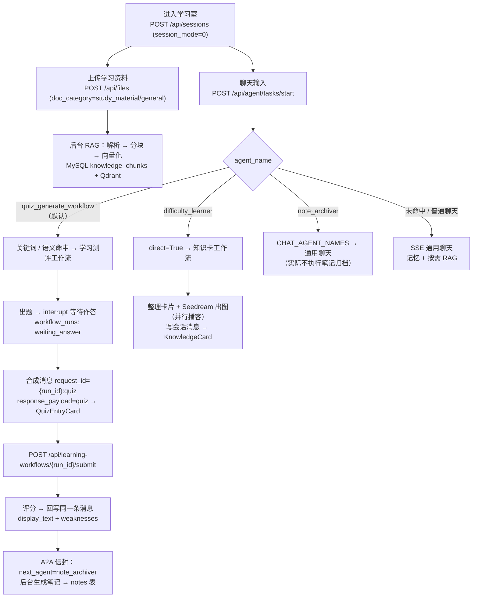
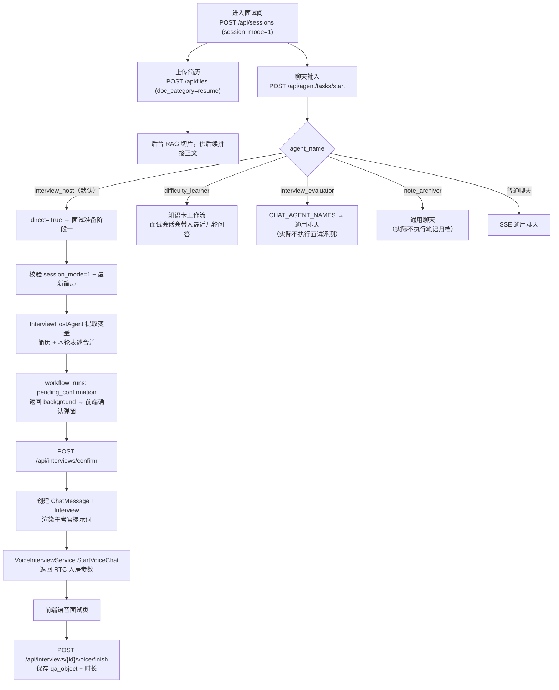
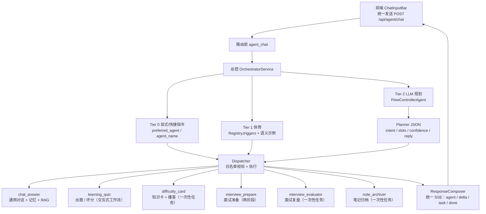
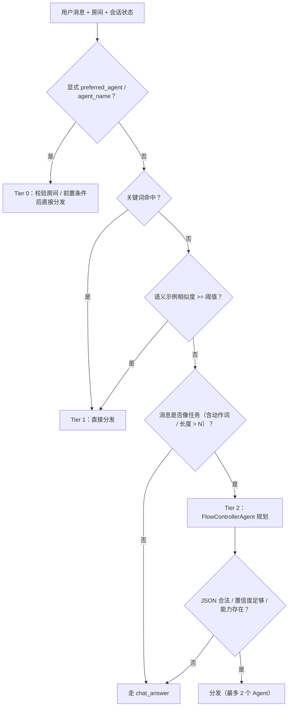

# 总控智能体驱动的多 Agent 架构调整方案

> 状态：**Phase 1–4 已实施**（可选审计表未建，A2A 幂等为进程内缓存；任务消息仍由子工作流写入）
> 日期：2026-11-10
> 范围：`agent-backend`（主）+ `agent-frontend`（配套）
> 关联文档：[`orchestrator-workflow-design.md`](orchestrator-workflow-design.md)、[`learning-workflow-api-guide.md`](learning-workflow-api-guide.md)、[`voice-interview-design.md`](voice-interview-design.md)、[`memory-system-flow.md`](memory-system-flow.md)

---

## 1. 结论先行

1. 现有「总控」本质上是**前端指定 `agent_name` + 静态规则表 + 关键词/语义兜底**，不是真正的智能调度；`flow_controller` 提示词已入库但运行时从未使用。
2. 学习室/面试间的子 Agent 能力已经存在，但**只有出题、面试准备、知识卡三条链路真正可执行**；`note_archiver` / `interview_evaluator` 在聊天里只是套用通用聊天提示词，并没有执行各自的工作。
3. 面试间的默认智能体是 `interview_host` 且规则 `direct=True`，意味着**不加选择地发任何一句话都会触发面试准备工作流**；这与产品流程「快速回答（默认）」相违背。
4. 引入**能力注册表 + 三层路由（显式/快筛/LLM 规划）+ 统一 SSE 事件流 + 会话级调度上下文**，新增 `POST /api/agent/chat` 作为唯一总控入口，**移除** `POST /api/agent/tasks/start`，前端同步迁移（已确认）。
5. 实施分三阶段：后端总控内核与前端迁移同步完成 → 补接力链路（复盘/笔记/知识卡）→ 清理旧规则与文档。

---

## 2. 现状梳理（改造前，历史记录）

> 以下描述的是本次改造前的旧实现，仅用于解释设计动机；当前行为以
> [`orchestrator-workflow-design.md`](orchestrator-workflow-design.md) 与 `AGENTS.md` 为准。

### 2.1 学习室（`session_mode=0`）工作流



要点：

- 学习室的默认智能体是 `quiz_generate_workflow`，但它有**关键词/语义门槛**，普通问候仍会回落到聊天。
- 出题、评分是**两次 HTTP 请求 + LangGraph interrupt**，执行现场在进程内 `MemorySaver`。
- 评分完成后由 `finalize_result` 产出 `A2AEnvelope`，`learning_workflow.submit_learning_workflow()` 调用总控后台派发。
- `note_archiver` 的按钮存在，但后端 `route()` 把它归入 `CHAT_AGENT_NAMES`，直接走通用聊天提示词；笔记提示词只在 A2A 接力时使用。

### 2.2 面试间（`session_mode=1`）工作流



要点：

- 面试准备是**两阶段 + 一次确认**：第一阶段不落会话消息，确认后才创建入口消息与 `Interview`。
- 语音面试结束后只保存 `qa_object`，**没有自动评测、没有复盘笔记**，与产品流程图中的「面试复盘 → 薄弱点 → 改进建议」仍有缺口。
- 面试间默认 `interview_host` 且 `direct=True`：任意一句话都会触发面试准备；没有简历时直接 404，有简历时反复生成待确认记录。

### 2.3 当前智能体清单（运行时真实能力）

| `agent_name` | 提示词作用域 | 运行实现 | 实际触发方式 | 产物 / 状态 |
| --- | --- | --- | --- | --- |
| `flow_controller` | `flow_controller/workflow` | **无**（仅模板入库） | 无 | 未运行 |
| `resume_parser` | `resume_parser/resume` | **无独立实现**（提取逻辑内嵌在 `InterviewHostAgent`） | 面试准备时隐式使用 | 未独立运行 |
| `quiz_generate_workflow` | `quiz_generate/quiz` | `agent/workflows/learning_quiz.py` | 关键词/语义 → 工作流 | 出题 + 评分 |
| `interview_host` | `interview_host/interview` | `agent/agents/interview_host.py` + `interview_host_workflow` | `direct=True` | 面试背景 + 面试 |
| `interview_evaluator` | `interview_evaluator/evaluation` | **仅作为测评评分提示词** | 测评提交时隐式使用 | 未独立运行 |
| `difficulty_learner` | `difficulty_learner/study` | `agent/agents/difficulty_learner.py` + `difficulty_card_workflow` | `direct=True` | 知识卡 + 播客 |
| `note_archiver` | `note_archiver/note` | `note_archive_service.py` | 仅 A2A（测评完成且有薄弱点） | 笔记落库 |

> 结论：7 个模板对应的智能体中，真正可被调度的只有 3 个；另外 2 个（笔记、面试评测）在聊天里是「空转」。

### 2.4 当前总控 / A2A 机制

- 入口：`POST /api/agent/tasks/start`（`app/routers/orchestrator.py`）。
- 路由：`OrchestratorService.route()`（`app/services/orchestrator_service.py:119`）：
  1. 未登记 `agent_name` → 404；
  2. `direct=True` → 直接命中规则；
  3. `required_keywords` 任一命中 → 命中规则；
  4. `SemanticIntentClassifier` 对比 `intent_examples`，超过阈值 → 命中；
  5. 否则 → 通用聊天。
- 规则表：`WORKFLOW_ROUTE_RULES`（同文件 `:74`），目前三条：
  - `quiz_generate_workflow → learning_quiz`（关键词 + 语义）
  - `interview_host → interview_prepare`（`direct=True`）
  - `difficulty_learner → difficulty_card`（`direct=True`）
- 双响应：工作流分支返回 JSON 信封；聊天分支返回 SSE（`meta → delta → done`），路由层不设 `response_class`。
- A2A：
  - 信封 `A2AEnvelope`（`app/agent/a2a/envelope.py`）字段只有 `from_agent / payload_type / payload / next_agent / confidence`；
  - 白名单 `HANDOFF_RULES`（`app/agent/a2a/rules.py:9`）只有 `learning_evaluator → (difficulty_learner, note_archiver)`；
  - 调度校验 `decide_next_agent()` 只做置信度与白名单，不执行业务；
  - Handler 注册表 `HANDLERS`（`app/services/a2a_handoff_service.py:28`），**当前只有 `note_archiver` 注册**（`note_archive_service.py:302`）；
  - 测评完成时 `learning_workflow.py:368-380` 触发一次，`next_agent` 由 `finalize_result()` 硬编码为 `note_archiver`（`learning_quiz.py:521-537`）。

### 2.5 前端现状（与总控直接相关）

- 学习室/面试间的输入框底部有智能体按钮（`src/types/agent.ts`），按房间写死：
  - 学习室：出题测评 / 难点学习 / 笔记归档；
  - 面试间：面试主考官 / 面试评测 / 难点学习 / 笔记归档。
- 未选择时使用房间默认：学习室 `quiz_generate_workflow`，面试间 `interview_host`（`DEFAULT_AGENT_BY_MODULE`）。
- 所有消息统一走 `POST /api/agent/tasks/start`，但请求体只带 `agent_name + session_id + request_text`（`src/api/conversation.ts:491`），**没有传 `select_mode` / `request_segments`**。
- 聊天分支由 SSE 增量渲染；工作流分支根据 JSON 结果刷新会话、弹面试确认框或渲染知识卡（`src/stores/chat.ts:208-294`、`InterviewRoom.vue:36-44`）。

---

## 3. 问题清单

| 优先级 | 问题 | 证据 | 影响 |
| --- | --- | --- | --- |
| P0 | 不是真正的「总控智能体」 | 路由完全依赖前端 `agent_name` + 静态规则；`flow_controller` 模板未运行 | 用户必须先点对按钮；说法变化只能靠语义阈值；无法跨 Agent 编排 |
| P0 | 面试间默认即触发面试准备 | `DEFAULT_AGENT_BY_MODULE.interview = interview_host` + `direct=True` | 任意消息都生成待确认 run；无简历直接 404；产品「快速回答（默认）」失效 |
| P0 | 笔记 / 面试评测在聊天中空转 | `CHAT_AGENT_NAMES` 直接返回 `None`，聊天链路只用 `session_mode/select_mode` 快照提示词 | 按钮点击后得到的不是笔记 / 评测结果，而是普通问答 |
| P0 | A2A 接力不完整 | `HANDOFF_RULES` 允许 `difficulty_learner`，但没有 handler；`finalize_result` 只硬编码 `note_archiver` | 「薄弱点继续讲解」无法自动/手动接力；面试复盘链路缺失 |
| P0 | 聊天与工作流是两套协议 | 工作流返回 JSON、聊天返回 SSE；前端需要两套解析与特殊分支 | 总控无法用统一的「聊天事件」表达「我派了某个 Agent、结果是什么」 |
| P0 | 缺少会话级调度上下文 | `workflow_runs` 有 `session_id`，但总控不读取「最近一次 run / interview」 | 「把刚才那套题整理成笔记」「复盘这次面试」无法解析指代 |
| P1 | 没有能力注册表 | 新 Agent 要同时改规则表、`start_task` 分支、前端类型 | 扩展成本高，容易出现前后端不一致 |
| P1 | 没有调度决策日志与置信度配置 | 仅零散 INFO 日志 | 难以定位「为什么没触发 / 为什么触发错」 |
| P1 | A2A 无 trace / 无最大跳数 / 无幂等 | 信封无 `trace_id`、无 `hops`；后台任务失败只记日志 | 多级接力易循环、难追踪、重复派发风险 |
| P1 | 面试复盘 / 面试笔记缺失 | `finish_voice_interview` 只保存 `qa_object` | 产品流程图的「总结薄弱点 + 改进建议 + 一键笔记」未闭环 |
| P2 | 前端未传 `select_mode` / 附件段 | `AgentTaskInput` 只有 `text + agentName` | 总控分支无法知道「知识精讲 / 刷题 / 模拟面试 / 复盘」等用户意图 |
| P2 | 动态提示词版本只读 | `prompt_template_service` 当前不支持新建版本 | 总控提示词调优只能改代码或直接改库 |

---

## 4. 目标架构

### 4.1 总体分层



核心原则：

- **单一入口**：前端不再自己判断该调哪个 Agent，只发一句自然语言（可带一个 `preferred_agent` 提示）。
- **单一事实来源**：所有 Agent 的可用范围、触发词、所需数据、执行方式都登记在 `AgentRegistry`。
- **总控只负责决策与编排**：不写具体业务；子 Agent 只负责自己的专业能力。
- **统一事件流**：无论聊天还是任务，前端都消费同一种 SSE 事件。
- **单一入口、不保留旧接口**：`/api/agent/tasks/start` 移除，前端同一版本内迁移到 `/api/agent/chat`，避免长期双份协议。

### 4.2 能力注册表（Agent Registry）

新增 `app/agent/registry.py`（或 `app/agent/capabilities.py`），用不可变 `dataclass` 描述每个 Agent：

```python
@dataclass(frozen=True)
class AgentCapability:
    name: str                     # 与提示词 / 前端标识一致
    title: str                    # 前端快捷按钮文案
    rooms: tuple[int, ...]        # 0=学习室, 1=面试间, 2=笔记
    kind: Literal["chat", "workflow", "task"]
    triggers: tuple[str, ...]     # 快筛关键词（双字优先）
    examples: tuple[str, ...]     # 语义示例
    threshold: float = 0.6
    requires: tuple[str, ...] = ()  # 如 "resume" / "interview" / "completed_run"
    returns: str = "text"         # task 事件的 kind：quiz / knowledge_card / ...
    description: str = ""         # 注入规划提示词的一句话能力说明
    enabled: bool = True
```

建议首批登记：

| name | room | kind | requires | returns |
| --- | --- | --- | --- | --- |
| `chat_answer` | 0,1,2 | chat | - | text |
| `quiz_generate_workflow` | 0 | workflow | - | quiz |
| `difficulty_learner` | 0,1 | task | - | knowledge_card |
| `interview_host` | 1 | workflow | `resume`, `session_mode=1` | interview_prepare |
| `interview_evaluator` | 1 | task | `interview` | interview_evaluation |
| `note_archiver` | 0,1 | task | `run_or_interview` | note |

扩展新 Agent 时只增加一条登记 + 一个 handler，不再改路由表与 `start_task` 分支。`GET /api/agent/capabilities?session_mode=` 可把注册表下发给前端，替代前端写死的 `AGENTS_BY_MODULE`。

### 4.3 三层路由（延迟与成本可控）



- **Tier 1 复用现有关键词 + fastembed 语义**，避免每轮多一次大模型调用。
- **Tier 2 仅在歧义或任务型消息时调用**，超时（建议 4s）或 JSON 非法时降级为聊天；任何异常只记 WARNING。
- 规划输出使用 JSON（与项目现有 `parse_json_object()` 一致），**不引入新的 tool-calling 依赖**，兼容 DeepSeek / Qwen 等 OpenAI 兼容服务。
- 规划器只允许从注册表中选 Agent；非法 name 直接丢弃，不执行。

规划 JSON 契约（建议）：

```json
{
  "intent": "learning_quiz | difficulty_card | interview_prepare | interview_evaluation | note_archive | chat | clarify",
  "confidence": 0.0,
  "reason": "一句话依据",
  "reply": "可选：面向用户的一句协调语",
  "agents": [
    {"name": "learning_quiz", "slots": {"question_count": 3, "topic": "MySQL 索引"}}
  ],
  "need_clarify": false,
  "clarify_question": ""
}
```

约束：

- `agents` 最多 2 个，主 Agent 只能 1 个；
- 同一轮不得重复同一 Agent；
- 未满足 `requires`（如面试间无简历）时，规划器应输出 `clarify`，而不是硬调；
- `confidence < 0.6` 时降级为 `chat_answer` 或在 UI 提示「可换个说法」。

### 4.4 统一 SSE 事件协议

新增 `POST /api/agent/chat`（需登录，复用 `enforce_chat_limit`）：

```jsonc
// 请求
{
  "session_id": 123,
  "request_text": "帮我出 3 道 MySQL 索引题",
  "preferred_agent": "quiz_generate_workflow", // 可选，快捷按钮提示
  "select_mode": 2,                            // 可选，0..5
  "request_id": "...",                         // 可选
  "request_segments": []                       // 可选，附件段
}
```

SSE 事件（在现有 `meta / delta / done / error` 之上新增 `agent` 与 `task`）：

| 事件 | 数据 | 说明 |
| --- | --- | --- |
| `meta` | `{session_id, message_id, request_id, trace_id}` | 流开始；`trace_id` 贯穿本轮所有 Agent |
| `agent` | `{from, to, phase: "start" \| "done" \| "skip", reason}` | 调度可观测性；前端可显示「正在调用出题智能体」 |
| `delta` | `{content}` | 聊天 / 协调语增量 |
| `task` | `{kind, run_id, payload}` | 子 Agent 的结构化产物（quiz / knowledge_card / interview_prepare / note / interview_evaluation） |
| `done` | `{message_id, status, sources}` | 流结束；`sources` 仍用于 RAG 来源展示 |
| `error` | `{code, message}` | 失败收尾 |

示例：

```text
event: meta
data: {"session_id":123,"message_id":9001,"request_id":"...","trace_id":"..."}

event: agent
data: {"from":"flow_controller","to":"learning_quiz","phase":"start","reason":"用户明确要求出题"}

event: task
data: {"kind":"quiz","run_id":"...","payload":{"status":"waiting_answer","quiz":[...]}}

event: done
data: {"message_id":9001,"status":1,"sources":[]}
```

关键策略：

- **旧入口移除**：`POST /api/agent/tasks/start` 下线，前端同一版本内改为调用 `/api/agent/chat`；相关测试同步改写为针对新入口。
- **新入口只返回 SSE**：不再用 `Content-Type` 切换分支，前端解析更简单。
- **`task` 事件只是「产物通知」**：quiz 提交、面试确认等交互仍走原有 `/api/learning-workflows/{run_id}/submit`、`/api/interviews/confirm`，不改现有闭环。

### 4.5 子 Agent 执行模型

| kind | 典型 Agent | 是否阻塞本轮 | 会话消息归属 | 说明 |
| --- | --- | --- | --- | --- |
| `chat` | `chat_answer` | 流式 | 新入口创建一条用户消息并回写 | 复用 `chat_service.prepare_stream/stream_reply` |
| `workflow` | `learning_quiz` / `interview_prepare` | 同步启动，返回 run_id | 迁移期沿用子工作流写入；Phase 3 收敛到总控 | 交互仍需后续 HTTP 请求 |
| `task` | `difficulty_card` / `note_archiver` / `interview_evaluator` | 可同步（知识卡）或后台（笔记 / 评测） | 产出 `task` 事件 + 落库消息 | 长任务不拖垮 SSE；失败只影响该任务 |

推荐执行顺序：

1. 发送 `meta`；
2. 发送 `agent(start)`；
3. 聊天：直接流式 `delta`；
4. 任务：在线程池执行，完成后写库并发送 `task`；
5. 发送 `agent(done)`；
6. 发送 `done`（或 `error`）。

> 长耗时任务（知识卡出图 + 播客、笔记生成、面试评测）建议设置服务端超时与心跳注释（`: keep-alive`），避免反向代理断流。

### 4.6 会话级调度上下文

新增 `app/services/session_agent_state.py`（Redis 优先，MySQL 兜底）：

```json
{
  "last_intent": "learning_quiz",
  "last_agent": "learning_quiz",
  "last_run_id": "...",
  "last_interview_id": null,
  "pending_confirmation_run_id": null,
  "last_message_id": 9001,
  "updated_at": 1760000000
}
```

- Key：`agent:session:{user_id}:{session_id}`，TTL 8 小时（与工作记忆一致），读写续期。
- Redis 不可用：回源 `workflow_runs`（按 `session_id` 取最近一条）/ `interviews`（按 `session_id` 取最近一条）；不阻断请求。
- 用途：
  - 解析「刚才那套题」「这次面试」等指代；
  - `note_archiver` 默认归档最近一次已完成的测评 / 面试；
  - `interview_evaluator` 默认复盘当前会话最近一次面试；
  - 避免规划器把「继续刚才的」误判成新任务。
- 所有查询仍带 `user_id`，防止跨用户读取。

### 4.7 A2A v2：有界、可追踪的多 Agent 接力

在现有信封上扩展（保持向后兼容，新字段可选）：

```python
class A2AEnvelope(BaseModel):
    trace_id: str | None = None
    intent: str | None = None
    from_agent: str
    payload_type: str
    payload: dict[str, Any]
    next_agent: str | None = None
    alternatives: list[str] = []      # 可选的候选下一跳（不自动执行）
    confidence: float = 1.0
    hops: int = 0                     # 当前已接力次数
    result_ref: dict[str, Any] = {}   # run_id / note_id / interview_id
```

规则：

- `HANDOFF_RULES` 从「单跳白名单」升级为「能力路由」：`next_agent` 必须存在于注册表且具备 `requires` 数据；
- **最大跳数 2**（可配置），同一 `trace_id` 内不得重复同一 Agent，超限直接结束并记录；
- 只自动执行「确定性、无副作用冲突」的下一跳（如 `interview_evaluator → note_archiver`）；`difficulty_learner` 作为候选（`alternatives`）返回给前端/规划器，由用户下一轮触发；
- 每个 handler 必须幂等或使用 `run_id + agent` 作为幂等键（笔记已有 `(user_id, source_run_id)` 唯一约束，可复用）；
- 后台执行失败只记日志，不回滚上游已完成结果（保持现有行为）。

建议新增 handler：

| Agent | handler | 数据来源 | 产物 |
| --- | --- | --- | --- |
| `note_archiver` | 已有 `archive_note_handler` | 测评 state / 面试评测结果 / 会话消息 | `notes` 记录 + 会话消息 |
| `interview_evaluator` | 新增 `evaluate_interview_handler` | `interviews.qa_object` + `interview_host_prompt` | 评分 + 薄弱点 + 建议；可写会话消息 |
| `difficulty_learner` | 复用现有知识卡工作流 | 最近测评薄弱点 / 用户指定知识点 | 知识卡消息（暂不自动执行） |

### 4.8 房间能力矩阵与默认行为

| 房间 | 默认行为 | 可用 Agent | 明确禁止 |
| --- | --- | --- | --- |
| 学习室 `0` | `auto` → 普通聊天；有任务意图才调度 | chat / quiz / difficulty / note | 面试准备 |
| 面试间 `1` | `auto` → 普通聊天；**不再默认触发面试准备** | chat / interview_host（明确要求「开始面试」或点快捷按钮）/ interview_evaluator / difficulty / note | 学习测评（可选放开，建议首期禁止） |
| 笔记本 `2` | 笔记编辑，不参与聊天调度 | note 管理接口 | chat / 工作流 |

面试准备的触发条件改为：

- 用户明确说「开始面试 / 准备面试 / 模拟面试 / 我准备好了」；
- 或点击前端「面试主考官」快捷按钮（带 `preferred_agent=interview_host`）；
- 或规划器判断意图为 `interview_prepare` 且 `session_mode=1`、简历已解析；
- 其他情况一律普通聊天。

> 这是对现有体验的**有意变更**，用于修复「随便说一句就生成待确认面试」的问题。

### 4.9 提示词与安全

- 总控提示词取 `prompt_template_service.get_rendered_prompt("flow_controller", "workflow", user_id)`，再追加**静态 JSON 输出契约**（与出题 / 评分相同的做法，避免模板里的花括号被当成占位符）。
- 规划提示词需包含：
  - 当前房间、会话模式；
  - 可用 Agent 列表（name + description + requires）；
  - 当前会话状态（最近 run / interview，可用则给）；
  - 用户画像摘要（目标岗位 / 薄弱点，复用 `user_profile_repo`）；
  - 最近 2~4 轮对话摘要（避免把「继续」判成新任务）。
- 用户输入视为不可信：只用于意图判断，**不允许让模型输出可执行代码 / 任意 Agent 名**；所有调度落到注册表白名单。
- 规划失败、超时、JSON 非法 → 降级为 `chat_answer`，不阻断请求。
- 规划器本身也受限流（`/api/agent/chat` 复用 `enforce_chat_limit`）。

### 4.10 可观测性、失败与限流

- 每轮生成 `trace_id`，记录：`tier`（0/1/2）、`intent`、`agents`、`confidence`、`latency_ms`、`fallback_reason`。
- 子 Agent 失败：`error` 事件 + 消息 `status=2`；不得留下孤立的待确认 run / 无主消息。
- 后台任务失败：只记 ERROR，不影响本轮聊天结果；前端可通过会话刷新看到任务消息。
- 限流：`/api/agent/chat` 复用聊天配额；知识卡 / 出题等重任务继续受工作流配额约束。
- 建议新增轻量审计表（Phase 3 可选）：`agent_dispatches`，字段 `trace_id / user_id / session_id / from_agent / to_agent / kind / status / confidence / slots_json / error / created_at`，用于排查与统计；不建表时先落日志。

---

## 5. 接口与前端变更

### 5.1 请求契约

新增 `app/schemas/agent.py`（或扩展现有 `schemas/orchestrator.py`）：

```python
class AgentChatIn(BaseModel):
    session_id: int
    request_text: RequestText
    preferred_agent: AgentName | None = None   # 快捷按钮提示，不是硬指定
    select_mode: int = 0
    request_id: str | None = None
    request_segments: list[SegmentIn] = []
```

- `session_mode` 由后端从会话读取，**不接受客户端伪造**。
- 不再接受旧字段 `agent_name`；快捷按钮统一传 `preferred_agent`（提示语义，规划器可忽略，但命中房间能力时优先）。

### 5.2 响应契约

- 唯一入口：`text/event-stream`，事件见 §4.4；不再返回 JSON 分支。
- `task.payload` 沿用现有字段命名：
  - `quiz`：`{status, quiz, run_id}`，与 `LearningWorkflowStartOut` 对齐；
  - `knowledge_card`：`{title, resource_id, image_url, audio_resource_id, audio_url}`；
  - `interview_prepare`：`{status, background, resume, run_id}`；
  - `note`：`{note_id, title, status}`；
  - `interview_evaluation`：`{score, strengths, weaknesses, review}`。

### 5.3 前端改造点

| 文件 | 变更 |
| --- | --- |
| `src/types/agent.ts` | 增加 `Auto`；`AgentName` 与实际注册表对齐；`DEFAULT_AGENT_BY_MODULE` 改为 `auto` |
| `src/stores/agent.ts` | 智能体按钮从「粘性模式」改为「一次性快捷指令」；发送后清空 |
| `src/stores/chat.ts` | 新增 `agent` / `task` 事件处理；`sendMessage` 改走 `/api/agent/chat`；删除旧 JSON 分支 |
| `src/api/conversation.ts` | 用 `startAgentChat` 替换 `startAgentTask`；解析新事件；`AgentTaskInput` 增加 `selectMode` / segments / preferredAgent |
| `src/components/chat/ChatInputBar.vue` | 发送时带 `select_mode`、`preferred_agent`；按钮文案来自能力注册表（可选） |
| `src/components/chat/ChatMessageItem.vue` | 支持新的 `task` 产物类型（note / interview_evaluation） |
| `src/views/InterviewRoom.vue` | 面试准备改为由 `task` 事件触发确认弹窗；不再依赖 JSON 分支 |
| `src/utils/sse.ts` | 事件类型扩展；保持对旧事件的兼容 |

---

## 6. 文件级改造清单

### 6.1 新增

| 文件 | 职责 |
| --- | --- |
| `app/agent/agents/flow_controller.py` | 总控规划器：拼提示词、调用模型、JSON 解析与归一化 |
| `app/agent/registry.py` | AgentCapability 定义 + 注册表 + 房间能力查询 |
| `app/services/session_agent_state.py` | 会话级调度上下文（Redis + MySQL 回退） |
| `app/services/interview_evaluation_service.py` | 面试复盘：读取 `qa_object`，生成评分 / 薄弱点 / 建议，登记 A2A handler |
| `app/schemas/agent.py` | `AgentChatIn` / `AgentCapabilityOut` / task 载荷模型 |
| `app/routers/agent.py`（或改造 `orchestrator.py`） | 新入口 `/api/agent/chat` + `/api/agent/capabilities` |
| `tests/test_flow_controller.py` | 规划器 JSON、降级、白名单 |
| `tests/test_agent_registry.py` | 注册表校验、房间能力 |
| `tests/test_agent_chat.py` | 新入口 SSE、任务事件、越权、限流 |

### 6.2 修改

| 文件 | 变更 |
| --- | --- |
| `app/services/orchestrator_service.py` | 规则表迁移为快筛提示；新增 `plan()` / `execute()`；删除 `start_task()` 旧入口 |
| `app/routers/orchestrator.py` | 删除 `/api/agent/tasks/start`，改为 `/api/agent/chat` + `/api/agent/capabilities` |
| `app/schemas/orchestrator.py` | 迁移到 `schemas/agent.py` 承载新入参；删除旧工作流出参联合类型 |
| `app/agent/a2a/envelope.py` | 可选增加 `trace_id / intent / alternatives / hops / result_ref` |
| `app/agent/a2a/rules.py` | 白名单升级为能力约束；补充最大跳数配置 |
| `app/services/a2a_handoff_service.py` | 支持 trace、跳数、幂等键；handler 未实现返回 pending |
| `app/services/note_archive_service.py` | 新增「从会话/面试结果归档」入口；复用现有 Markdown 生成 |
| `app/services/interview_service.py` | 结束面试后可选触发 `interview_evaluator`（后台任务） |
| `app/services/learning_workflow.py` | A2A 派发改为新调度器（信封 v2，保持后台执行） |
| `app/agent/workflows/learning_quiz.py` | `finalize_result` 产出 v2 信封（trace/intent），不再硬编码只给 note |
| `app/services/prompt_template_service.py` | 确认 `flow_controller` 作用域已在 `AGENT_CONFIG`（已存在），补充初始化说明 |
| `app/main.py` | 导入新 handler / 注册新路由 |
| `AGENTS.md` | 更新「流程总控约定」「A2A 约定」「接口清单」 |
| `docs/orchestrator-workflow-design.md` | 增补新架构，或标注以本方案为准 |

---

## 7. 分阶段实施

### Phase 1 · 后端总控内核 + 前端迁移（同一版本）

目标：`/api/agent/chat` 成为唯一入口，前端同版本完成迁移；`/api/agent/tasks/start` 移除。

1. 新增 `AgentRegistry`，把现有三条规则迁入，补齐能力描述与 `requires`。
2. 新增 `FlowControllerAgent` + 静态 JSON 契约；接入 `flow_controller/workflow` 模板。
3. 改造 `OrchestratorService`：
   - `plan(user_id, session, payload)` → 三层路由；
   - `execute(plan)` → 调子 Agent；
   - 删除 `start_task()` 与旧规则表对外语义。
4. 新增 `session_agent_state`（Redis + 回退）。
5. 新增 `POST /api/agent/chat`（支持 chat / quiz / difficulty / interview_prepare / note）。
6. 前端切换到 `/api/agent/chat`，解析 `agent` / `task` 事件；默认 `auto`；面试确认弹窗改由 `task(kind=interview_prepare)` 触发。
7. 删除旧接口的路由 / schema / 前端调用与测试，补齐新单测与集成测试。

验收：

- 学习室「帮我出 3 道 MySQL 索引题」→ `meta → agent → task → done`，`task.kind=quiz`；
- 学习室「你好」→ `meta → delta → done`；
- 面试间「你好」→ 聊天，**不再生成待确认面试**；
- `/api/agent/tasks/start` 已不存在（404）；
- `pnpm build` 通过，学习室 / 面试间手工回归正常。

### Phase 2 · 快捷指令 UX 与能力下发

1. 智能体按钮改为一次性快捷指令；发送后清空。
2. 前端按钮列表改为读取 `GET /api/agent/capabilities`，接口失败回退静态配置。
3. 知识卡、测评、笔记统一走 `task` 渲染；补充加载 / 失败态。
4. `pnpm build` + 手工回归学习室 / 面试间。

### Phase 3 · 多 Agent 接力与产品闭环

1. 补 `interview_evaluator` 能力与 `interview_evaluation` task：面试结束后生成复盘并写会话消息（幂等 `request_id="interview:{id}:evaluation"`）。
2. `note_archiver` 支持从已完成测评或已结束面试归档（`source_run_id="interview:{id}"`）。
3. A2A v2：信封 `trace_id / intent / hops / result_ref / alternatives`，`MAX_HOPS=2` + 自循环拒绝，已完成派发按 `(user_id, trace_id, next_agent)` 进程内幂等。
4. `finish_voice_interview` 成功后经 `BackgroundTasks` 自动触发复盘，`INTERVIEW_EVAL_AUTO` 可关闭。
5. 可选新增 `agent_dispatches` 审计表（未实施，先落日志）。

### Phase 4 · 清理与文档

1. 确认旧入口 `/api/agent/tasks/start` 已彻底移除，清理残留的测试夹具与前端死代码。
2. 移除 `direct=True` 的默认触发语义；前端按钮改读能力接口，`AGENTS_BY_MODULE` 仅保留为接口失败时的静态兜底（已完成，兜底有意保留）。
3. 更新 `AGENTS.md`、`orchestrator-workflow-design.md`、前端 `AGENTS.md`。
4. 补充压测 / 回归清单（见 [`orchestrator-workflow-design.md`](orchestrator-workflow-design.md) §10，已完成）。

---

## 8. 测试计划

| 层级 | 用例 | 覆盖点 |
| --- | --- | --- |
| 单元 | `AgentRegistry` 校验 | 房间、`requires`、重复登记、未实现 handler |
| 单元 | `FlowControllerAgent` | 合法 JSON、非法 JSON、超时、未知 Agent、置信度不足 |
| 单元 | 三层路由 | Tier 0/1/2 优先级、关键词不调模型、语义失败降级 |
| 单元 | 会话上下文 | Redis 命中 / 未命中回源、指代解析、越权 |
| 集成 | 新入口 SSE | 事件顺序、`task` 载荷、`done`、客户端断开 |
| 集成 | 旧入口回归 | 现有 `test_orchestrator.py` 全绿 |
| 集成 | 面试间默认聊天 | 「你好」不产生 `workflow_runs` / `interviews` |
| 集成 | 面试准备触发 | 明确要求 + 简历存在 → `pending_confirmation`；无简历 → 可读提示 |
| 集成 | 笔记 / 评测 | 从最近 run / interview 生成，用户隔离，重复派发幂等 |
| 集成 | A2A 接力 | 最大跳数、循环阻断、失败不回滚上游 |
| 安全 | 越权 | 他人 session / run / interview 一律 404 |
| 安全 | 提示注入 | 用户文本诱导「调用 admin_agent」不得执行 |

手工回归矩阵（学习室 / 面试间各跑一遍）：

| 输入 | 预期 |
| --- | --- |
| 「帮我出 3 道 MySQL 索引题」 | quiz task，前端渲染测评表单 |
| 「给我讲讲 B+ 树」 | 知识卡任务（图片 + 可选播客） |
| 「把刚才的测评整理成笔记」 | note task，复用最近 run |
| 「你好」 | 普通聊天，无任务 |
| 面试间「你好」 | 普通聊天，不弹确认框 |
| 面试间「开始模拟面试」 | 面试准备 task → 确认弹窗 |
| 面试结束「复盘一下这次面试」 | interview_evaluation task |

---

## 9. 兼容性与迁移

| 对象 | 迁移策略 |
| --- | --- |
| `/api/agent/tasks/start` | **移除**；前端同一版本迁移到 `/api/agent/chat`，不留兼容层 |
| `/api/sessions/{id}/stream-chat` | 保留（独立聊天接口，非总控场景仍可用） |
| 前端智能体按钮 | 默认 `auto`；按钮改为 `preferred_agent` 一次性快捷指令 |
| 提示词模板 | 继续走 `prompt_template_service`；`flow_controller` 模板已存在，无需新建版本机制 |
| 数据库 | Phase 1/2 **不改表**；Phase 3 审计表可选 |
| 记忆 / RAG | 聊天分支完全复用 `chat_service`，不改记忆与检索逻辑 |
| 测试 | 保留 `test_orchestrator.py` 并改写为新入口用例；新增 `test_interview_evaluation.py` / `test_a2a_handoff.py` |

---

## 10. 风险与取舍

| 风险 | 影响 | 对策 |
| --- | --- | --- |
| 每轮多一次规划模型调用 | 延迟 / 成本上升 | 仅 Tier 2 调用；超时降级；小模型或低 temperature；关键词/语义先行 |
| 规划误判 | 调错 Agent / 误建面试 | 置信度阈值 + `requires` 前置校验 + 结构化白名单 + 用户可撤销 |
| SSE 长任务断流 | 知识卡 / 笔记失败 | 心跳注释、服务端超时、失败 `error` 事件、可重试 |
| 子工作流仍自己写消息 | 迁移期消息重复 / 缺失 | Phase 1 沿用；Phase 3 收敛为总控统一写消息（传入 `message_id`） |
| `MemorySaver` 多进程限制 | 重启后测评无法恢复 | 本方案不改变；后续可换 Redis/DB checkpointer（独立议题） |
| 面试间默认行为变更 | 用户习惯变化 | 产品确认；用快捷按钮与引导文案降低摩擦 |
| 动态提示词版本只读 | 调优受限 | 继续用代码默认 + 数据库模板；版本写入另立需求 |

---

## 11. 决策记录

已确认：

1. **新入口**：新增 `POST /api/agent/chat` 作为唯一总控入口，**移除** `/api/agent/tasks/start`，前端同版本迁移。
2. **路由成本**：接受「快筛优先、歧义时最多一次规划模型调用」。
3. **面试间默认行为**：取消「默认 `interview_host` 直接触发面试准备」，改为「明确说开始面试 / 点快捷按钮」。

默认按以下方式实现（如无异议不再单独确认）：

4. **聊天消息归属**：Phase 1 允许子工作流继续自己写会话消息（总控只发 `task` 事件），Phase 3 再统一收敛。
5. **笔记 / 面试评测范围**：首期只处理「当前会话最近一次测评 / 面试」，不做跨会话任意选择。
6. **审计表**：先只打日志，`agent_dispatches` 落库留到 Phase 3。
7. **前端同步实施**：本次前后端同仓库一起改，前端随 Phase 1 迁移到新入口。

---

## 12. 附录：术语与现有文件索引

| 术语 | 含义 |
| --- | --- |
| 总控 / Supervisor | 负责意图判断、能力选择、调度与结果汇总的智能体 |
| 子 Agent | 承担单一专业能力（出题、知识卡、面试、笔记、评测）的智能体 |
| 快筛 | 关键词 + fastembed 语义相似度，低成本路由 |
| task 事件 | 子 Agent 的结构化产物通知；不是聊天文本 |
| 会话调度上下文 | 记录最近 run / interview / 待确认状态的 Redis + MySQL 兜底数据 |

关键文件：

- 路由与规则：`app/services/orchestrator_service.py`、`app/routers/orchestrator.py`
- 聊天与 SSE：`app/services/chat_service.py`、`app/services/ai/prompt_layer.py`
- 学习测评：`app/agent/workflows/learning_quiz.py`、`app/services/learning_workflow.py`
- 面试准备 / 确认：`app/services/interview_host_workflow.py`、`app/services/interview_service.py`
- 知识卡：`app/agent/agents/difficulty_learner.py`、`app/services/difficulty_card_workflow.py`
- 笔记 / 评测：`app/services/note_archive_service.py`、`scripts/agent_prompt.py`
- A2A：`app/agent/a2a/envelope.py`、`app/agent/a2a/rules.py`、`app/services/a2a_handoff_service.py`
- 前端：`src/types/agent.ts`、`src/stores/chat.ts`、`src/api/conversation.ts`、`src/components/chat/ChatInputBar.vue`
