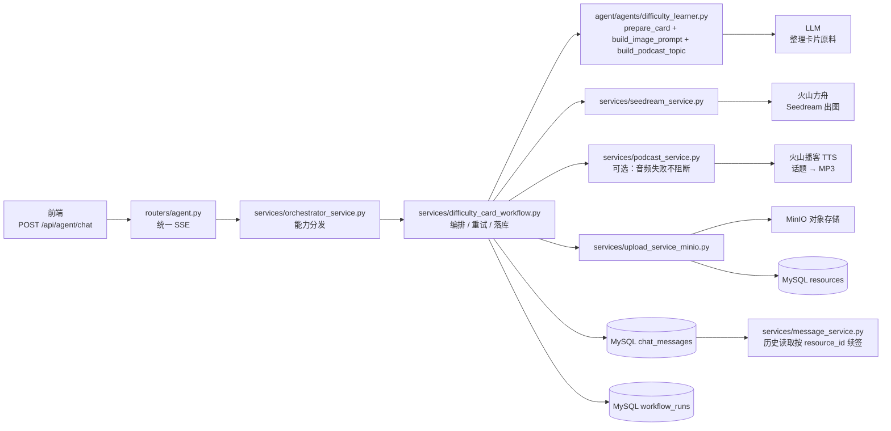
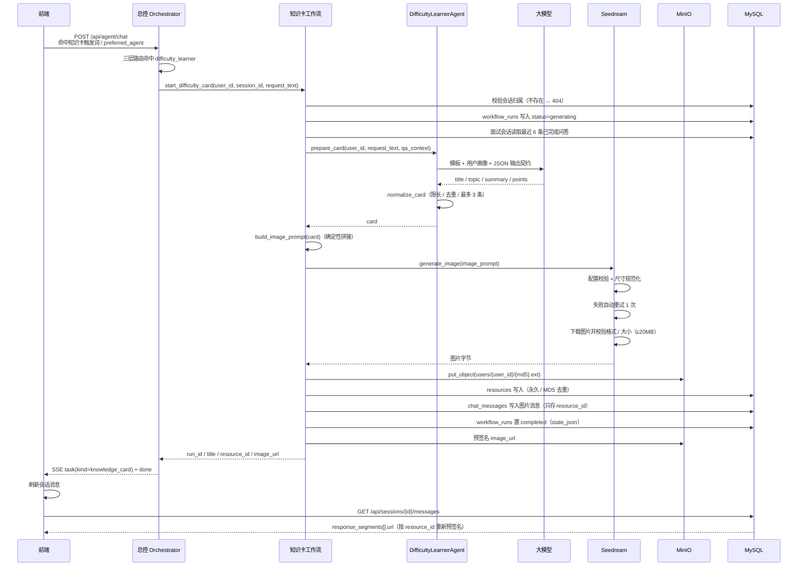
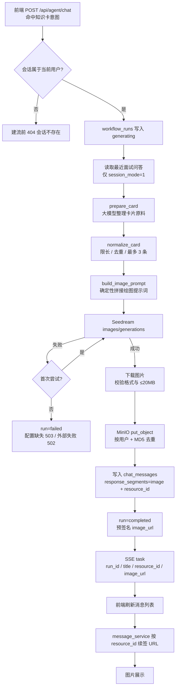

# 难点知识卡（Seedream + 播客 TTS）配置与验证指南

面向本地联调，覆盖两件事：

1. **配置**：接入火山方舟 Seedream 文生图与火山播客 TTS 所需的密钥、尺寸与 MinIO 存储配置；
2. **验证**：从一次请求开始，跑通「卡片原料 → 出图 + 出音频（并行）→ 永久存储 → 会话消息 → 历史续签」全链路。

> 图片是主产物，音频是可选加分项：未配置或生成失败时只返回图片，不影响整体成功。

相关代码：

- 总控分发：[`app/services/orchestrator_service.py`](../app/services/orchestrator_service.py)
- 工作流编排：[`app/services/difficulty_card_workflow.py`](../app/services/difficulty_card_workflow.py)
- 卡片原料与提示词：[`app/agent/agents/difficulty_learner.py`](../app/agent/agents/difficulty_learner.py)
- Seedream 调用：[`app/services/seedream_service.py`](../app/services/seedream_service.py)
- 播客 TTS 调用：[`app/services/podcast_service.py`](../app/services/podcast_service.py)
- 图片 / 音频落库：[`app/services/upload_service_minio.py`](../app/services/upload_service_minio.py)
- 历史消息续签：[`app/services/message_service.py`](../app/services/message_service.py)
- 配置入口：[`app/core/config.py`](../app/core/config.py)
- 自动化回归：[`tests/test_difficulty_card.py`](../tests/test_difficulty_card.py)

---

## 0. 这条线从哪开始、到哪结束

**起点**：前端调用 `POST /api/agent/chat`（SSE），`request_text` 命中知识卡触发词（或快捷按钮传 `preferred_agent=difficulty_learner`）。

**终点**：流中下发 `task(kind=knowledge_card)`，`payload` 含 `run_id / status / title / resource_id / image_url / audio_resource_id / audio_url`；前端刷新会话消息后，通过 `response_segments[].url` 展示知识卡图片。之后每次读取历史消息，都会按 `resource_id` 重新预签名，图片链接不会因过期而失效。



**状态机**：

```text
generating ──成功──> completed
     └──────失败──> failed（workflow_runs.error_message 记录原因）
```

失败时不写会话消息，只保留失败 run 供排查；配置缺失以 SSE `error(code=503)` 收尾，外部服务 / 模型输出异常以 `error(code=502)` 收尾。

---

## 1. Seedream 配置指南

### 1.1 前置依赖

| 依赖 | 用途 | 说明 |
| --- | --- | --- |
| 火山方舟 API Key | 调用 Seedream 出图 | 未配置时仅知识卡接口返回 `503`，不影响服务启动与其他接口 |
| 火山播客 TTS 凭证 | 生成语音讲解 MP3（可选） | 未配置时知识卡照常返回，只是没有音频 |
| 兼容 OpenAI 协议的 LLM | `prepare_card` 整理卡片原料 | 复用现有 `LLM_*` 配置；缺失时同样返回 `503` |
| MinIO | 保存生成图片 | 未配置 / 不可达时，图片落库失败返回 `502` |
| MySQL | `workflow_runs` / `resources` / `chat_messages` | 需先执行 `alembic upgrade head` |

### 1.2 获取凭证与模型 ID

1. 登录火山方舟控制台，在「API Key 管理」创建或复制 API Key；
2. 在「模型服务 / 开通管理」开通 **Doubao-Seedream** 图片生成模型；
3. 确认可用的模型 ID（代码默认 `doubao-seedream-4-0-250828`），按实际开通版本填写 `SEEDREAM_MODEL`；
4. 如果使用的是「推理接入点」，`SEEDREAM_MODEL` 直接填接入点 ID（形如 `ep-2026xxxx-xxxxx`），接口的 `model` 字段同时支持模型 ID 与接入点 ID；
5. 图片接口地址默认为 `https://ark.cn-beijing.volces.com/api/v3`，无需修改 `SEEDREAM_BASE_URL`。

> API Key、模型 ID / 接入点 ID 只放环境变量，不要写入代码或提交到仓库。API Key 必须与已开通模型属于同一账号 / 项目 / 地域。

**如何确认当前 Key 能调用哪个图片模型**：Ark 的 `/models` 接口会返回当前 Key 可见的模型目录：

```bash
APP_ENV=dev .venv/bin/python - <<'PY'
import json, urllib.request
from app.core.config import get_seedream_config

cfg = get_seedream_config()
req = urllib.request.Request(
    f"{cfg.base_url}/models",
    headers={"Authorization": f"Bearer {cfg.api_key}"},
)
with urllib.request.urlopen(req, timeout=30) as resp:
    items = json.loads(resp.read().decode()).get("data", [])

for item in items:
    task = item.get("task_type") or []
    if item.get("domain") == "ImageGeneration" or "TextToImage" in task:
        print(item.get("id"), "|", item.get("status"))
PY
```

目录里能看到还不够，最终以调用结果为准：

| 调用结果 | 含义 | 处理 |
| --- | --- | --- |
| `200` + `data[0].url` | 模型已开通且可调用 | 填入 `SEEDREAM_MODEL` |
| `ModelNotOpen` | Key 有权限看到，但账号未开通该模型 | 控制台「开通管理」开通后重试 |
| `InvalidEndpointOrModel.NotFound` | 模型不在当前目录，或与 Key / 项目 / 地域不匹配 | 换目录中的模型，或改用 `ep-...` 接入点 |
| `InvalidParameter`（如尺寸不合法） | 模型可调用，参数有问题 | 调整 `SEEDREAM_IMAGE_SIZE` 等参数 |

### 1.3 环境变量

在 `agent-backend/.env`（或 `.env.dev`）中补充：

```dotenv
# ===== LLM：卡片原料整理 =====
LLM_PROVIDER=deepseek
LLM_MODEL=deepseek-chat
LLM_API_KEY=sk-xxxx

# ===== MinIO：生成图片永久存储 =====
MINIO_ENDPOINT=127.0.0.1:9000
MINIO_ACCESS_KEY=minioadmin
MINIO_SECRET_KEY=minioadmin
MINIO_BUCKET=ai-resource
MINIO_SECURE=false
# 预签名有效期（秒，默认 7 天 = 604800，MinIO 上限）
# MINIO_PRESIGN_EXPIRE_SECONDS=604800

# ===== Seedream 文生图 =====
SEEDREAM_API_KEY=sk-xxxx
SEEDREAM_BASE_URL=https://ark.cn-beijing.volces.com/api/v3
SEEDREAM_MODEL=doubao-seedream-4-0-250828
SEEDREAM_IMAGE_SIZE=1728x2304
SEEDREAM_TIMEOUT=120
```

| 变量 | 必填 | 默认值 | 说明 |
| --- | --- | --- | --- |
| `SEEDREAM_API_KEY` | 是 | 无 | 缺失时知识卡接口返回 `503` |
| `SEEDREAM_BASE_URL` | 否 | `https://ark.cn-beijing.volces.com/api/v3` | 代码自动去掉末尾 `/`，再拼接 `/images/generations` |
| `SEEDREAM_MODEL` | 否 | `doubao-seedream-4-0-250828` | 按控制台已开通版本填写 |
| `SEEDREAM_IMAGE_SIZE` | 否 | `1728x2304` | 合法值：`WIDTHxHEIGHT` 或 `2k` / `3k` / `4k`；默认 3:4 竖版，适配手机信息图 |
| `SEEDREAM_TIMEOUT` | 否 | `120` | 单次出图 / 下载超时（秒） |
| `MINIO_PRESIGN_EXPIRE_SECONDS` | 否 | `604800` | 图片 URL 有效期；历史消息读取时会重新续签 |

说明：

- `SEEDREAM_IMAGE_SIZE` 只做格式校验，具体像素范围由模型决定；模型拒绝时接口返回 `400`，后端统一转 `502`，详细原因见日志与错误响应 `detail`。
- 出图请求固定 `response_format="url"`、`watermark=false`；响应优先读 `b64_json`，否则下载 `data[0].url`。
- 单次出图失败会自动重试 1 次（共 2 次尝试），仍失败才返回 `502`。
- 生成图片仅接受 JPG / PNG / GIF / WebP，且不超过 20MB；落库时按 `(user_id, MD5)` 去重。

### 1.4 配置自检（不触网）

```bash
cd agent-backend && source .venv/bin/activate

.venv/bin/python - <<'PY'
from app.core.config import get_seedream_config
cfg = get_seedream_config()
print("base_url:", cfg.base_url)
print("model:", cfg.model)
print("image_size:", cfg.image_size)
print("timeout:", cfg.timeout)
print("api_key_configured:", bool(cfg.api_key))
PY
```

预期：打印配置且 `api_key_configured: True`。若报 `RuntimeError: 环境变量 SEEDREAM_API_KEY 未配置`，回到 1.3 补 Key。

### 1.5 直接出图自检（可选，会消耗一次出图额度）

```bash
.venv/bin/python - <<'PY'
from app.services.seedream_service import generate_image

data = generate_image(
    "一张竖版中文知识卡信息图，标题「Python GIL」，"
    "浅色背景，简洁扁平化，文字清晰。"
)
print("bytes:", len(data))
print("head:", data[:8])
PY
```

预期：输出字节数与文件头（PNG 为 `b'\x89PNG\r\n\x1a\n'`，JPEG 为 `b'\xff\xd8\xff'`）。此步骤只验证 Seedream 凭证与网络，不写数据库、不写 MinIO。

### 1.6 配置相关错误对照

| 现象 | 原因 | 处理 |
| --- | --- | --- |
| 启动正常，知识卡接口 `503 知识卡服务暂不可用` | `SEEDREAM_API_KEY` 缺失，或 `SEEDREAM_IMAGE_SIZE` 格式非法 | 补齐 Key；尺寸改为 `1728x2304` 或 `2k/3k/4k` |
| 知识卡接口 `503` 且 detail 指向 LLM | `LLM_API_KEY` / `LLM_MODEL` 缺失 | 补齐 LLM 配置 |
| 知识卡接口 `502`，detail 为 `InvalidEndpointOrModel.NotFound` | `SEEDREAM_MODEL` 对应模型 / 接入点不可见，或与 API Key 不在同一账号 / 项目 / 地域 | 用 `/models` 目录确认，或到控制台复制模型 ID / `ep-...` 后重启服务 |
| 知识卡接口 `502`，detail 为 `ModelNotOpen` | 账号能看到该模型，但尚未开通 | 控制台「开通管理」开通对应模型后重试 |
| 知识卡接口 `502 知识卡生成失败，请稍后重试` | Ark 返回 401/400、网络超时、响应非 JSON | 看 `logs/app.log` 中 `seedream` 相关 detail，核对 Key、模型 ID、尺寸与网络 |
| `502 模型返回的图片格式不受支持` | 返回内容不是 JPG/PNG/GIF/WebP | 检查模型响应；必要时更换模型版本 |
| `502 生成图片过大，已取消保存` | 图片超过 20MB | 降低 `SEEDREAM_IMAGE_SIZE` 或换更小的尺寸 |
| 图片保存失败 `502` | MinIO 不可达 / 凭证错误 / 桶创建失败 | 确认 MinIO 已启动、`MINIO_*` 正确 |

### 1.7 播客 TTS 配置（可选）

语音讲解与出图并行，**任何音频问题都不会让知识卡请求失败**（只记 WARNING）。

在 `.env` 中补充：

```dotenv
# ===== 火山语音播客大模型（知识卡语音讲解）=====
PODCAST_TTS_APP_ID=your_app_id
PODCAST_TTS_ACCESS_KEY=your_access_key
# 以下按语音控制台实际接口覆盖，默认值见下
# PODCAST_TTS_BASE_URL=wss://openspeech.bytedance.com
# PODCAST_TTS_PATH=/api/v3/sami/podcasttts
# PODCAST_TTS_RESOURCE_ID=volc.service_type.10050
# PODCAST_TTS_TIMEOUT=300
```

| 变量 | 必填 | 默认值 | 说明 |
| --- | --- | --- | --- |
| `PODCAST_TTS_APP_ID` | 是 | 无 | 语音控制台的 App ID（不是 RTC App ID） |
| `PODCAST_TTS_ACCESS_KEY` | 是 | 无 | 语音控制台的 Access Key / Access Token |
| `PODCAST_TTS_BASE_URL` | 否 | `wss://openspeech.bytedance.com` | 自动去掉末尾 `/`；写 `https://` 会自动转 `wss://` |
| `PODCAST_TTS_PATH` | 否 | `/api/v3/sami/podcasttts` | 自动补前导 `/` |
| `PODCAST_TTS_RESOURCE_ID` | 否 | `volc.service_type.10050` | 语音播客服务资源 ID |
| `PODCAST_TTS_TIMEOUT` | 否 | `300` | 单次播客生成超时（秒） |

请求约定（客户端实现见 `app/services/podcast_service.py`）：

- **WebSocket 二进制协议**：`X-Api-App-Id` / `X-Api-Access-Key` / `X-Api-Resource-Id` 建连；
- 上行 `StartSession`（event 100）payload 为 `action=0` + `input_text`，由
  `build_podcast_topic()` 从同一份卡片原料确定性拼接；音频参数 `mp3 / 24000`，默认双人音色；
- 下行 `PodcastRoundResponse`（event 361）为音频字节，按序拼接；`PodcastEnd`（363）后发送
  `FinishSession`（102），收到 `SessionFinished`（152）结束；错误帧按 `error code` 转 502；
- 音频只接受 MP3（ID3 或 MPEG 帧同步），超过 30MB 拒绝保存；**不重试**，避免重复扣费；
- 不落本地、不保存对白稿；音频字节经 `save_generated_audio()` 永久入 MinIO，消息只存 `resource_id`。

> WebSocket 握手、二进制帧逐字节解析、事件流与排障对照的完整说明见
> **[podcast-communication-guide.md](./podcast-communication-guide.md)**。

---

## 2. 启动与准备

```bash
cd agent-backend && source .venv/bin/activate
alembic upgrade head                  # 确保 workflow_runs / resources / chat_messages 已建表
python scripts/init_prompt.py         # 可选：写入 difficulty_learner/study 模板；缺失时自动降级内置提示词
uvicorn app.main:app --reload --reload-exclude 'logs/*' --port 8000
```

- 打开 `http://127.0.0.1:8000/docs`；
- 确认 `.env` 已配置 `LLM_API_KEY`、`SEEDREAM_API_KEY` 与 `MINIO_*`；
- 知识卡是**同步接口**，一次请求包含 LLM + 出图 + 下载 + 上传，耗时可能数十秒；前端 / 反向代理的超时建议不低于 **300 秒**（`SEEDREAM_TIMEOUT` 默认 120 秒，且最多重试 2 次）。

---

## 3. 跑通知识卡

### 3.1 登录并创建会话

登录 **POST `/api/auth/login`**（如 `prompt_demo / abc12345`），复制 `data.access_token`。

创建学习会话 **POST `/api/sessions`**：

```json
{"title": "知识卡联调", "session_mode": 0}
```

记下 `data.id` 作为 `session_id`。

> `session_mode=0`（学习）只使用本轮 `request_text`；`session_mode=1`（面试）会额外带入最近 6 条已完成问答（最多 4000 字）作为背景。

### 3.2 发起知识卡

**POST `/api/agent/chat`**（SSE，建议用 `curl -N`）：

```json
{
  "session_id": 123,
  "request_text": "解释一下 Python GIL，以及它对多线程的影响"
}
```

命中「解释一下 / 讲解 / 知识卡 …」等触发词即分发；也可带一次性提示 `"preferred_agent": "difficulty_learner"`。该能力没有前置数据要求，学习和面试会话都可用。

### 3.3 校验响应

预期 `HTTP 200`、`Content-Type: text/event-stream`；出图与播客并行，整轮约 1～3 分钟：

```text
event: meta
data: {"session_id":123,"message_id":0,"request_id":"","trace_id":"..."}

event: agent
data: {"trace_id":"...","from":"flow_controller","to":"difficulty_learner","phase":"start","reason":"难点学习触发"}

event: task
data: {"trace_id":"...","kind":"knowledge_card","run_id":"...","payload":{...}}

event: agent
data: {"trace_id":"...","from":"flow_controller","to":"difficulty_learner","phase":"done","reason":"..."}

event: done
data: {"message_id":9001,"status":1,"sources":[],"trace_id":"..."}
```

`task.payload`：

```json
{
  "run_id": "5b0f2c1e-5f0e-4d7f-9f5e-0f7d1c2a3b4c",
  "status": "completed",
  "title": "Python GIL",
  "resource_id": 45,
  "image_url": "http://127.0.0.1:9000/ai-resource/users/1/<md5>.png?X-Amz-...",
  "audio_resource_id": 46,
  "audio_url": "http://127.0.0.1:9000/ai-resource/users/1/<md5>.mp3?X-Amz-...",
  "message_id": 9001
}
```

- `meta.message_id` 在任务分支固定为 `0`，对账以 `task.payload.message_id` 为准；
- `image_url` 是 MinIO 预签名地址，默认 7 天有效；
- 预签名失败时 `image_url` 为空串，图片本身已落库，可通过历史消息接口重新续签；
- 音频未配置 / 生成失败时 `audio_resource_id` 与 `audio_url` 均为 `null`，知识卡仍为 `completed`；
- 出参模型见 [`app/schemas/difficulty_card.py`](../app/schemas/difficulty_card.py)。

### 3.4 校验会话图片消息

**GET `/api/sessions/{session_id}/messages?page=1&page_size=20`**，找到 `request_id={run_id}:card` 的消息：

```json
{
  "id": 9001,
  "request_id": "<run_id>:card",
  "request_text": "解释一下 Python GIL，以及它对多线程的影响",
  "response_text": "已生成知识卡「Python GIL」，点击查看大图，可收听语音讲解。",
  "response_payload": {"type": "knowledge_card"},
  "response_segments": [
    {
      "type": "image",
      "resource_id": 45,
      "file_name": "知识卡-Python GIL.png",
      "url": "http://127.0.0.1:9000/ai-resource/users/1/<md5>.png?X-Amz-..."
    },
    {
      "type": "audio",
      "resource_id": 46,
      "file_name": "知识卡播客-Python GIL.mp3",
      "url": "http://127.0.0.1:9000/ai-resource/users/1/<md5>.mp3?X-Amz-..."
    }
  ],
  "status": 1
}
```

消息表只存 `resource_id`；每次读取历史时由 `message_service` 重新预签名。可将这条消息的 `url` 直接在浏览器打开，确认图片 / 音频可访问。音频生成失败时 `response_segments` 只有 `image` 段。

### 3.5 数据落库核对

```sql
-- 运行记录：状态、卡片原料、绘图提示词、图片与消息 ID
SELECT run_id, user_id, session_id, workflow_type, status, error_message,
       JSON_PRETTY(state_json) AS state
FROM workflow_runs WHERE run_id = '<run_id>';

-- 图片资源：永久存储、按用户 + MD5 去重
SELECT id, user_id, resource_type, storage_scene, file_name, file_hash,
       storage_path, expire_time
FROM resources WHERE id = <resource_id>;

-- 会话消息：只存 resource_id，不存临时 URL
SELECT id, session_id, select_mode, request_id, request_text, response_text,
       response_segments, status
FROM chat_messages WHERE id = <message_id>;
```

预期：

- `workflow_runs.status=completed`，`state_json` 含 `card / image_prompt / resource_id / message_id / image_reused / podcast_topic / audio_resource_id`；
- `resources.resource_type=1`（图片）或 `2`（音频）、`storage_scene=0`（长期）、`expire_time IS NULL`；
- `chat_messages.select_mode=1`、`request_id={run_id}:card`、`status=1`、`response_payload={"type":"knowledge_card"}`，`response_segments` 为 `[{type:"image",...}]` 或 `[{type:"image",...},{type:"audio",...}]`。

### 3.6 日志核对

```bash
grep -E "知识卡" logs/app.log | tail -10
```

成功时应看到 `知识卡已生成 | user_id=... run_id=... resource_id=... reused=...`。失败时可看到 `记录知识卡失败状态出错`（仅在失败状态写库也失败时出现）或全局异常日志中的 `seedream` 详情。

### 3.7 curl 一键流程

```bash
BASE=http://127.0.0.1:8000
TOKEN=$(curl -s -X POST "$BASE/api/auth/login" \
  -H 'Content-Type: application/json' \
  -d '{"username":"prompt_demo","password":"abc12345"}' | jq -r '.data.access_token')

SESSION_ID=$(curl -s -X POST "$BASE/api/sessions" \
  -H "Authorization: Bearer $TOKEN" -H 'Content-Type: application/json' \
  -d '{"title":"知识卡联调","session_mode":0}' | jq -r '.data.id')

RESP=$(curl -sN -X POST "$BASE/api/agent/chat" \
  -H "Authorization: Bearer $TOKEN" -H 'Content-Type: application/json' \
  -d "{\"session_id\":$SESSION_ID,\"request_text\":\"解释一下 Python GIL\"}")

# SSE 流里取 task 事件的数据行
TASK=$(echo "$RESP" | awk '/^event: task/{found=1; next} found && /^data: /{sub(/^data: /,\"\"); print; exit}')
echo "$TASK" | jq

RESOURCE_ID=$(echo "$TASK" | jq -r '.payload.resource_id')
curl -s "$BASE/api/sessions/$SESSION_ID/messages?page=1&page_size=20" \
  -H "Authorization: Bearer $TOKEN" | jq --argjson rid "$RESOURCE_ID" \
  '.data.items[] | select(.response_segments[0].resource_id == $rid)'
```

---

## 4. 时序图（起点 → 终点）



---

## 5. 处理流程图（含失败分支）



---

## 6. 断言清单

| 检查项 | 预期 |
| --- | --- |
| 分发方式 | 关键词 / 语义快筛或 Tier 2 规划命中 `difficulty_learner`；无前置数据要求 |
| 卡片原料 | `title / topic / summary / points` 齐全，`points` 为 1..3 条且每条含 `title + tip` |
| 提示词 | 绘图与播客话题都由同一份卡片原料确定性拼接；播客要求双人口语化、不念稿 |
| 并行 | 出图与出音频并行执行，总耗时接近较慢的一路 |
| 出参 | SSE `task(kind=knowledge_card)`，`status=completed`，含 `run_id / title / resource_id / image_url`，音频可额外含 `audio_resource_id / audio_url` |
| 运行记录 | `workflow_runs.status=completed`，`state_json` 含 `card / image_prompt / resource_id / message_id / audio_resource_id` |
| 资源 | 图片 `resource_type=1`、音频 `resource_type=2`，均 `expire_time IS NULL`，`storage_path` 为 `minio:/{bucket}/users/{user_id}/{md5}.ext` |
| 会话消息 | `select_mode=1`、`request_id={run_id}:card`、`status=1`、`response_payload={"type":"knowledge_card"}`，附件段只存 `resource_id` |
| 历史回显 | `GET /api/sessions/{id}/messages` 返回 `response_segments[].url`，且每次读取重新签名 |
| 去重 | 同一用户重复生成同一图片 / 音频时复用原 `resource_id`（`*_reused=true`） |

---

## 7. 反向用例

| 场景 | 操作 | 预期 |
| --- | --- | --- |
| 他人会话 | 用其他用户的 `session_id` | `404 会话不存在` |
| 未配置 Seedream Key | 注释 `SEEDREAM_API_KEY` 后调用 | SSE `error(code=503)`「知识卡服务暂不可用」，run 置 `failed` |
| 尺寸非法 | `SEEDREAM_IMAGE_SIZE=abc` | SSE `error(code=503)`，detail 提示合法值 |
| Ark 鉴权失败 / 参数错误 | 错误的 Key 或模型 ID | SSE `error(code=502)`「知识卡生成失败，请稍后重试」，重试 1 次后失败 |
| 出图超时 / 网络异常 | 断开网络或调小 `SEEDREAM_TIMEOUT` | SSE `error(code=502)`，run 置 `failed` |
| 返回非图片内容 | 假接口返回纯文本 | SSE `error(code=502)`「模型返回的图片格式不受支持」 |
| 图片超过 20MB | 使用超清尺寸 | SSE `error(code=502)`「生成图片过大，已取消保存」 |
| LLM 配置缺失 | 注释 `LLM_API_KEY` | SSE `error(code=503)`「知识卡服务暂不可用」 |
| 未配置播客 TTS | 注释 `PODCAST_TTS_*` | 知识卡照常 `task(kind=knowledge_card)`，`audio_resource_id / audio_url` 为 `null` |
| 播客接口失败 / 超时 | 错误凭证或断开网络 | 只记 WARNING，知识卡照常返回，消息无 `audio` 段 |
| 音频落库失败 | MinIO 写入异常（仅音频） | 同上，不阻断图片 |
| 模型输出非 JSON | 模型持续返回普通文本 | 重试耗尽后 SSE `error(code=502)`「知识卡生成失败，请稍后重试」 |
| 提示词模板未初始化 | 未执行 `init_prompt.py` | 不报错，自动降级为内置角色提示词并继续出图 |

---

## 8. 自动化回归

```bash
.venv/bin/python -m pytest tests/test_difficulty_card.py -v
```

覆盖：能力分发、绘图 / 播客提示词确定性、图片与音频消息落库、音频软失败、历史 URL 续签、会话越权、Seedream 缺 Key `503`。
