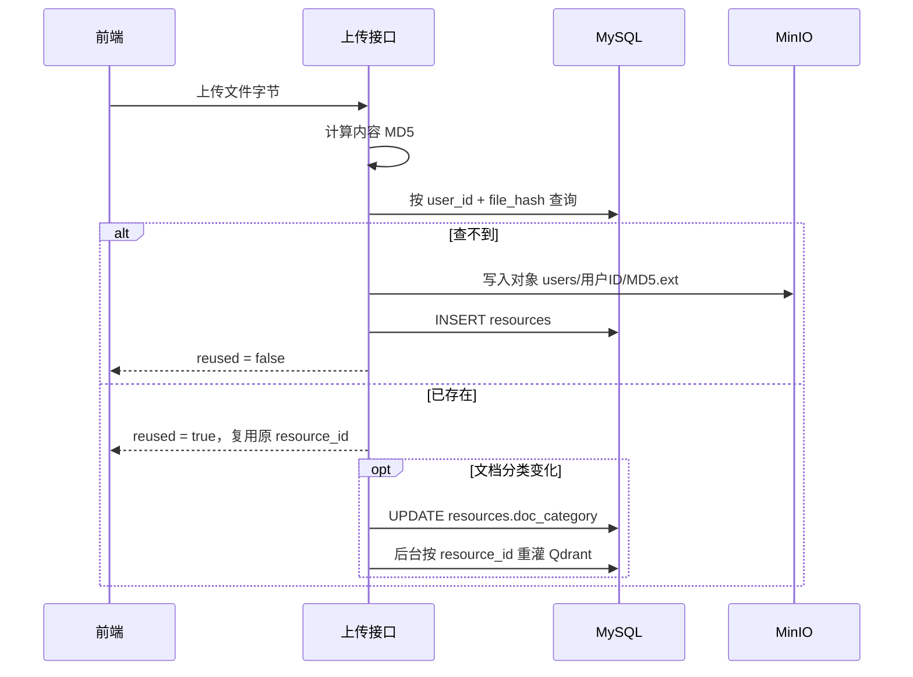

# 文档上传接入 RAG · 验证指南

本文覆盖 `POST /api/files` 新增 `doc_category`、文档上传后异步接入 RAG、以及聊天输入框回形针上传对话框的端到端验证步骤。

---

## 1. 变更范围

| 位置 | 变更 |
| --- | --- |
| `resources` 表 | 新增可空字段 `doc_category`（`resume` / `study_material` / `general`，仅文档有意义） |
| `POST /api/files` | 文档必传 `doc_category`；响应新增 `doc_category`、`reused` |
| 文档上传后 | 通过 `BackgroundTasks` 异步执行 RAG：解析 → 清洗 → 分块 → DashScope 向量化 → Qdrant |
| 重复上传 | 同内容同分类直接复用、不重复入库；分类变化则更新分类并删除旧向量后重灌 |
| 前端 | 聊天输入框回形针打开 `el-upload`（drag）对话框，单文件 + 分类下拉，手动提交 |

重复上传行为对照：

| 场景 | `reused` | `doc_category` | RAG |
| --- | --- | --- | --- |
| 首次上传 | `false` | 本次选择值 | 入库（`replace=false`） |
| 重复，分类相同 | `true` | 首次分类 | 跳过 |
| 重复，分类不同 | `true` | 更新为本次分类 | 删除旧向量后重灌（`replace=true`） |
| 音频 / 头像 | 按去重结果 | `null` | 不触发 |

### 1.1 「文件已存在」是怎么判断的

判断依据是 **MySQL `resources` 表的元数据**，不是文件名、不是 MinIO 对象、也不是 Qdrant。

具体链路（`app/services/upload_service_minio.py:180-218`）：

1. 读取上传字节，计算内容 MD5：`md5 = hashlib.md5(data).hexdigest()`；
2. 调 `resource_repo.find_by_hash(user_id, md5)`，实际 SQL 为：
   ```sql
   SELECT * FROM resources
   WHERE user_id = :user_id AND file_hash = :md5
   LIMIT 1;
   ```
3. **查不到** → 写 MinIO 对象 `users/{user_id}/{md5}{ext}`，再向 `resources` 插入一条记录，响应 `reused=false`；
4. **查到** → 直接复用已有记录（`resource_id`、`storage_path` 不变），**不重复写 MinIO**，响应 `reused=true`；若文档的 `doc_category` 与本次选择不同，则更新 `resources.doc_category`，并以 `replace=True` 触发该 `resource_id` 的向量重灌；
5. **并发兜底**：`resources` 表有唯一键 `uk_file_hash_user_id(file_hash, user_id)`。两个请求同时插入同一内容时，后到的会触发 `IntegrityError`，代码回查一次并复用先写入的记录。



几个容易误解的点：

| 问题 | 结论 |
| --- | --- |
| 按文件名判断吗？ | 不按。同内容改文件名（`a.pdf` → `b.pdf`）仍命中同一条资源，保留首次上传的 `file_name` |
| 按 MinIO 对象判断吗？ | 不按。只查 MySQL；若对象被手工删除但元数据还在，仍返回 `reused=true`，此时访问 `storage_path` 可能 404 |
| 按 Qdrant 判断吗？ | 不按。Qdrant 只存 chunk 向量，去重发生在写向量之前，不会查询向量库 |
| 是全局去重吗？ | 不是。唯一键包含 `user_id`，**同一用户**相同内容才复用；不同用户上传同一文件会各自保留记录与对象 |
| 内容怎样才算「相同」？ | 按字节 MD5。重新压缩、重新导出、改一个字符都会得到新 MD5，视为新文件 |
| 重复上传会刷新有效期吗？ | 不会。复用分支不修改 `expire_time`、`storage_scene` 等字段 |
| 前端如何提示？ | 上传响应 `reused=true` 时，聊天输入框提示「文件已存在，已复用」（`ChatInputBar.vue:107`） |

---

## 2. 前置依赖

- MySQL、MinIO、Qdrant 已启动，且 `.env` 中已配置 `MYSQL_URL`、`MINIO_*`。
- 已配置 `DASHSCOPE_API_KEY`（缺失时上传仍成功，但后台向量化失败）。
- Qdrant 默认地址 `127.0.0.1:6333`，可用 `QDRANT_HOST` / `QDRANT_PORT` 覆盖。
- 扫描版 PDF 需配置火山引擎 `VOLC_ACCESS_KEY` / `VOLC_SECRET_KEY`（可选 `VOLC_REGION`，默认 `cn-north-1`）；缺失时扫描页入库失败，普通可搜索 PDF 不受影响。判定与选型说明见 [`scanned-pdf-ocr.md`](scanned-pdf-ocr.md)。

```bash
cd agent-backend
source .venv/bin/activate
```

---

## 3. 数据库迁移

本次迁移文件：`alembic/versions/0005_add_resource_doc_category.py`。

```bash
alembic upgrade head
```

验证字段已存在：

```bash
mysql -uroot -p -e "SHOW COLUMNS FROM resources LIKE 'doc_category';" 你的库名
```

预期 `Type` 为 `varchar(32)`、`Null` 为 `YES`。

> 若后续继续改 `app/db/models.py`，仍使用 `scripts/db_sync.sh "说明"` 一键生成并升级。

---

## 4. 启动后端

```bash
uvicorn app.main:app --reload --reload-exclude 'logs/*' --port 8000
```

打开 <http://127.0.0.1:8000/docs>，确认 `POST /api/files`：

- 表单出现 `doc_category`；
- `FileOut` 出现 `doc_category` 与 `reused`。

---

## 5. 准备账号与令牌

```bash
# 注册（如已存在则跳过）
curl -s -X POST http://127.0.0.1:8000/api/auth/register \
  -H 'Content-Type: application/json' \
  -d '{"username":"doc_demo","password":"abc12345"}'

# 登录并取出 access_token（需要 jq）
TOKEN=$(curl -s -X POST http://127.0.0.1:8000/api/auth/login \
  -H 'Content-Type: application/json' \
  -d '{"username":"doc_demo","password":"abc12345"}' | jq -r '.data.access_token')
echo "$TOKEN"
```

---

## 6. 接口验证

### 6.1 正常上传文档

准备一个可解析出文本的 PDF / DOCX / TXT。扫描版 PDF 会逐页判定并调用 OCR；日志出现 `PDF 含扫描页，转 OCR` 表示触发了兜底。

```bash
curl -s -X POST http://127.0.0.1:8000/api/files \
  -H "Authorization: Bearer $TOKEN" \
  -F "file=@/path/to/resume.pdf" \
  -F "doc_category=resume" | jq
```

预期：

```jsonc
{
  "code": 200,
  "message": "ok",
  "data": {
    "url": "minio:/ai-resource/users/1/<md5>.pdf",
    "md5": "<md5>",
    "size": 12345,
    "kind": "document",
    "resource_id": 1,
    "storage_path": "minio:/ai-resource/users/1/<md5>.pdf",
    "expire_time": "2026-11-24T...",
    "doc_category": "resume",
    "reused": false
  }
}
```

检查数据库：

```sql
SELECT id, file_name, doc_category, resource_type, storage_scene, expire_time
FROM resources
WHERE user_id = 1
ORDER BY id DESC
LIMIT 5;
```

预期 `doc_category = 'resume'`。

后端日志（`logs/app.log` 或控制台）在后台任务完成后出现：

```text
知识库入库完成：file=resume.pdf user=1 category=resume chunks=N
```

> RAG 是后台异步执行，上传接口会先返回；稍等片刻再查 Qdrant。

### 6.2 文档缺少 / 非法分类

```bash
# 缺少 doc_category → 422
curl -s -X POST http://127.0.0.1:8000/api/files \
  -H "Authorization: Bearer $TOKEN" \
  -F "file=@/path/to/resume.pdf" | jq

# 非法值 → 422
curl -s -X POST http://127.0.0.1:8000/api/files \
  -H "Authorization: Bearer $TOKEN" \
  -F "file=@/path/to/resume.pdf" \
  -F "doc_category=unknown" | jq
```

两次均应返回 `{"code":422,...}`，且不会写入 MinIO / `resources`。

### 6.3 重复上传（同分类）

用同一个文件、同一个分类再传一次：

```bash
curl -s -X POST http://127.0.0.1:8000/api/files \
  -H "Authorization: Bearer $TOKEN" \
  -F "file=@/path/to/resume.pdf" \
  -F "doc_category=resume" | jq
```

预期：

- `reused = true`；
- `resource_id` 与首次一致；
- `resources` 表仍只有一条该内容记录；
- Qdrant 该 `resource_id` 的点数不变（不重复入库）。

### 6.4 重复上传（不同分类）

同一个文件改传 `study_material`：

```bash
curl -s -X POST http://127.0.0.1:8000/api/files \
  -H "Authorization: Bearer $TOKEN" \
  -F "file=@/path/to/resume.pdf" \
  -F "doc_category=study_material" | jq
```

预期：

- `reused = true`；
- `resource_id` 不变，响应 `doc_category = "study_material"`；
- `resources.doc_category` 已更新为 `study_material`；
- Qdrant 中原 `resource_id` 的旧向量被删除，新向量 `doc_category` 为 `study_material`。

### 6.5 音频 / 头像行为不变

```bash
# 音频：即使传了 doc_category 也会被忽略
curl -s -X POST http://127.0.0.1:8000/api/files \
  -H "Authorization: Bearer $TOKEN" \
  -F "file=@/path/to/voice.wav" \
  -F "doc_category=resume" | jq
```

预期 `kind = "audio"`、`doc_category = null`，且后端不会触发 RAG。

---

## 7. Qdrant 验证

集合固定为 `knowledge_chunks`。按 `resource_id` 查看向量：

```bash
curl -s -X POST http://127.0.0.1:6333/collections/knowledge_chunks/points/scroll \
  -H 'Content-Type: application/json' \
  -d '{
    "filter": {
      "must": [
        {"key": "resource_id", "match": {"value": 1}}
      ]
    },
    "limit": 5,
    "with_payload": true
  }' | jq '.result.points[].payload'
```

预期每条 payload 包含：

```jsonc
{
  "text": "chunk 文本",
  "user_id": 1,
  "doc_category": "resume",
  "file_name": "resume.pdf",
  "chunk_index": 0,
  "resource_id": 1
}
```

查看点数：

```bash
curl -s -X POST http://127.0.0.1:6333/collections/knowledge_chunks/points/scroll \
  -H 'Content-Type: application/json' \
  -d '{"filter":{"must":[{"key":"resource_id","match":{"value":1}}]},"limit":1000}' \
  | jq '.result.points | length'
```

6.3 同分类重复上传前后数量应一致；6.4 不同分类重灌后数量变为新文件的分块数，且分类为新值。

---

## 8. 前端验证

```bash
cd agent-frontend
pnpm dev
```

登录后进入学习室 / 面试间，在聊天输入框：

1. 点击回形针，弹出「上传文档」对话框。
2. 拖拽或点击选择单个 `pdf / doc / docx / txt` 文件；文件列表只允许一个。
3. 「文档类型」默认为空；未选文件或未选类型时「提交」不可点击。
4. 点「提交」后：
   - 首次上传提示「文档上传成功」；
   - 同一文件同分类再次上传提示「文件已存在，已复用」；
   - 请求失败由统一请求层提示错误。
5. 关闭对话框后重新打开，文件、分类、提交状态均被重置。
6. 异常场景：
   - 选择非法扩展名 → 「仅支持 PDF / DOC / DOCX / TXT 文档」；
   - 超过 10MB → 「文档不能超过 10MB」；
   - 已选一个文件后再选第二个 → 「一次只能上传一个文档，请先移除已选文件」。

> 该上传只把文档写入当前用户的知识库，不会附加到当前聊天消息。

---

## 9. 后台异步与失败排查

- 上传响应返回时 RAG 可能尚未完成，属正常现象；观察日志关键字：
  - 成功：`知识库入库完成：...`
  - 失败：`文档 RAG 入库失败：...`
- 常见失败：
  | 现象 | 原因 / 处理 |
  | --- | --- |
  | `向量化服务未配置` | `.env` 未配置 `DASHSCOPE_API_KEY` |
  | `文本向量化请求失败` | 网络 / DashScope 配额 / Key 无效 |
  | `Qdrant 连接失败` | Qdrant 未启动或 `QDRANT_HOST` / `QDRANT_PORT` 错误 |
  | `OCR 服务未配置` | 未配置 `VOLC_ACCESS_KEY` / `VOLC_SECRET_KEY`，扫描页无法识别 |
  | `OCR 识别失败 ... AccessDenied` | 火山引擎账号未开通 `cv:OCRNormal` 权限或 Key 不匹配 |
  | `OCR 识别失败 ... attempts=2` | 临时故障重试后仍失败，稍后重新上传 |
  | `文件未解析出有效文本` | OCR 未识别出文字（空白页 / 图片无文字），或文件内容为空 |
  | `.doc 解析失败` | 系统缺少 `textutil` / `antiword` / `soffice` / `libreoffice` |
  | 上传 503 | MinIO 不可用，查看启动日志 |
- 后台入库失败不会回滚上传结果。**同一文件同一分类重复上传不会自动重试**；需要重新入库时：
  - 改选另一个分类上传（触发 `replace` 重灌），或
  - 删除该资源后重新上传。
- 后台任务运行在当前进程内，进程重启会丢失尚未执行完的任务。

---

## 10. 自动化检查

```bash
# 后端：上传 / 去重 / 分类 / 音频忽略 / RAG 调用（RAG 已 stub，不访问外部服务）
cd agent-backend
pytest tests/test_auth.py -v

# 前端：TypeScript 类型检查 + 生产构建
cd ../agent-frontend
pnpm build
```

> 后端测试依赖真实 MySQL / MinIO；二者不可用时相关用例会失败或跳过（`minio_ready`）。
