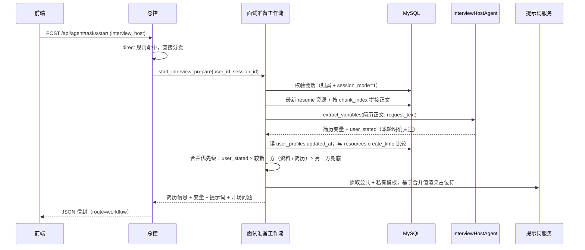

# 面试主考官面试前准备 · 验证指南

面向本地联调：通过 `POST /api/agent/tasks/start`（`agent_name=interview_host`）验证
「面试会话校验 → 取最新简历 → 拼接切片 → 提取变量 → 按最新输入优先覆盖 → 注入提示词」链路。

覆盖优先级：**本轮聊天明确表述（`user_stated`）> `user_profiles` 与简历中较新的一方**
（`user_profiles.updated_at` vs `resources.create_time`）。

- 总控分发：[`app/services/orchestrator_service.py`](../app/services/orchestrator_service.py)
- 工作流编排：[`app/services/interview_host_workflow.py`](../app/services/interview_host_workflow.py)
- 变量提取 Agent：[`app/agent/agents/interview_host.py`](../app/agent/agents/interview_host.py)
- 出参模型：[`app/schemas/interview_host.py`](../app/schemas/interview_host.py)

> 该分支始终返回 JSON 信封（不会走 SSE）：`interview_host` 规则为 `direct=True`，
> `agent_name` 命中即启动工作流，**路由决策**与 `request_text` 内容无关（但工作流会读取其中的明确表述）。

## 0. 前置条件

```bash
cd agent-backend && source .venv/bin/activate
alembic upgrade head
uvicorn app.main:app --reload --reload-exclude 'logs/*' --port 8000
```

- 打开 `http://127.0.0.1:8000/docs`
- `.env.dev` 必须配置 `LLM_API_KEY` / `LLM_MODEL`，否则变量提取返回 `503`
- 简历解析依赖 `DASHSCOPE_API_KEY` + Qdrant；未配置时上传成功但切片为空，接口会返回 `409`
- 使用国内镜像下载向量模型时保持 `HF_HUB_DISABLE_XET=1`，否则启动预热会因 Xet 401 失败

初始化提示词模板（确保 `interview_host:interview` 的 v2 含 `target_skills` / `weak_topics` 占位符）：

```bash
python scripts/init_prompt.py
```

该脚本会创建 / 复用演示账号 `prompt_demo / abc12345` 并写入演示画像；
若追加 `--username 你的账号`，会用演示画像覆盖该用户资料，联调前请知悉。

自动化回归（可选）：

```bash
pytest tests/test_interview_host.py -v
```

## 1. 登录获取令牌

**POST `/api/auth/login`**

```json
{"username": "prompt_demo", "password": "abc12345"}
```

复制 `data.access_token` → Swagger 右上角 **Authorize** 粘贴（不加 `Bearer ` 前缀）。

## 2. 创建面试会话

**POST `/api/sessions`**

```json
{"title": "面试主考官联调", "session_mode": 1}
```

记下 `data.id` 作为 `session_id`。注意 `session_mode` 必须是 `1`，否则第 4 步返回 `400`。

### 2.1 配置用户资料（可选，用于验证优先级）

若画像已存在用 **PUT `/api/profiles/me`**，否则 **POST `/api/profiles`**：

```json
{
  "target_job": "前端开发工程师",
  "years_experience": 5,
  "target_level": "P7",
  "target_skills": ["Vue", "TypeScript"],
  "weak_topics": ["性能优化"]
}
```

这里写入的 `updated_at` 若晚于简历上传时间，冲突字段以资料为准；若简历更晚上传，
则以简历为准。只想验证「纯简历提取」时跳过本节。
注意 `init_prompt.py --username` 会写入演示画像，可能覆盖这里的配置。

## 3. 上传简历并等待解析

**POST `/api/files`**（`multipart/form-data`）

| 字段 | 值 |
| --- | --- |
| `file` | 本地 PDF / DOCX / TXT 简历 |
| `doc_category` | `resume`（必填） |
| `upload_purpose` | `0` |
| `storage_scene` | `0` |

预期 `data` 含 `resource_id`、`kind=document`、`doc_category=resume`、`reused`；
记下 `resource_id` 供后续核查切片。

上传后 RAG 在后台异步执行，**必须等切片落库**再调用总控。核对：

```sql
-- 最新简历资源
SELECT id, file_name, doc_category, create_time
FROM resources
WHERE user_id = <user_id> AND doc_category = 'resume'
ORDER BY create_time DESC, id DESC LIMIT 1;

-- 切片是否就绪（有行才可继续）
SELECT chunk_index, CHAR_LENGTH(text) AS chars
FROM knowledge_chunks
WHERE resource_id = <resource_id>
ORDER BY chunk_index ASC;
```

也可观察日志出现该资源的解析完成记录。切片为空时总控会返回 `409`。

## 4. 调用总控接口

**POST `/api/agent/tasks/start`**

```json
{
  "agent_name": "interview_host",
  "session_id": 123,
  "request_text": "开始面试"
}
```

`request_text` 需满足 1..20000 字。本分支会用其中的**明确表述**覆盖简历 / 资料
（如「我想面前端，5 年经验，P7」），没有明确表述时按 `"开始面试"` 这类通用话术即可；
`select_mode` / `question_count` / `provider` / `request_segments` 均被忽略。

预期响应（`HTTP 200`）：

```json
{
  "code": 200,
  "message": "ok",
  "data": {
    "route": "workflow",
    "agent_name": "interview_host",
    "workflow_type": "interview_prepare",
    "session_id": 123,
    "resume": {
      "resource_id": 45,
      "file_name": "resume.pdf",
      "doc_category": "resume",
      "create_time": "2026-10-31T17:20:00"
    },
    "variables": {
      "target_job": "后端开发工程师",
      "target_level": "P6",
      "target_skills": ["Python", "MySQL", "Redis"],
      "weak_topics": ["分布式事务"],
      "opening_question": "请介绍你最近负责的订单系统项目。"
    },
    "prompt": "……岗位：后端开发工程师；职级：P6；……已掌握技能：Python、MySQL、Redis；薄弱点：分布式事务……",
    "opening_question": "请介绍你最近负责的订单系统项目。"
  }
}
```

> `variables` 是**合并后的最终值**：本轮 `request_text` 明确表述优先；其次取
> `user_profiles`（`updated_at`）与简历（`create_time`）中较新的一方；`opening_question`
> 始终来自简历提取结果。

## 5. 断言清单

| 检查项 | 预期 |
| --- | --- |
| 路由字段 | `route=workflow`、`agent_name=interview_host`、`workflow_type=interview_prepare` |
| 简历来源 | `resume.resource_id` 等于第 3 步最新一条 `resume` 资源 |
| 变量完整性 | `variables` 五个键齐全，技能 / 薄弱点为数组 |
| 最新输入优先 | 本轮聊天明确表述覆盖其余来源；否则 `updated_at` 较新的资料覆盖简历（简历更晚上传则反过来），`variables` 与 `prompt` 一致 |
| 占位符替换 | `prompt` 中不再出现 `{target_job}` / `{target_level}` / `{target_skills}` / `{weak_topics}` |
| 年限来源 | 本轮明确说了年限则用本轮值；否则取 `user_profiles.years_experience`（演示画像为「3 年」） |
| 数组拼接 | 技能 / 薄弱点在提示词中以「、」连接（空数组显示「暂无」，缺省标量显示「未提供」） |
| 开场问题 | 顶层 `opening_question` 与 `variables.opening_question` 一致 |
| 不写入提示词 | `opening_question` 只随响应返回，不应出现在 `prompt` 正文（按设计） |

### 5.1 冲突时以「谁最新」为准

三档优先级，从高到低：

1. **本轮聊天明确表述**（`request_text` 中写明的岗位 / 职级 / 年限 / 技能 / 薄弱点）；
2. **资料**（开场表单 / `/api/profiles` 写入）与**简历**中**较新**的一方：
   `user_profiles.updated_at >= resources.create_time` 时资料胜，否则简历胜；
3. 另一方兜底：某字段只在一方填写 / 提取到时，直接用该值。

例一（资料更新更晚）：

| 字段 | 本轮表述 | 用户资料 | 简历提取 | 最终采用 |
| --- | --- | --- | --- | --- |
| `target_job` | 前端开发工程师 | 全栈开发工程师 | 后端开发工程师 | 前端开发工程师（本轮） |
| `target_level` | P7 | P8 | P6 | P7（本轮） |
| `target_skills` | `["Vue", "TypeScript"]` | `["Java"]` | `["Python", "MySQL"]` | `["Vue", "TypeScript"]`（本轮） |
| `weak_topics` | 未提及 | `["架构设计"]` | `["分布式事务"]` | `["架构设计"]`（较新的资料） |
| `years_experience` | 5 | 8 | — | 5（本轮） |
| `opening_question` | — | 无 | 结合简历生成 | 简历提取值 |

例二（简历上传更晚、资料未填技能）：`target_job` 取资料值，`target_level` /
`target_skills` / `weak_topics` 回退简历提取值。

日志在发生覆盖时额外打印一条：
`面试准备变量覆盖 | user_id=... profile_newer=true|false profile_fields=... stated_fields=...`。

资料字段为空（未填写 / 空数组）时不参与覆盖，该字段交给简历或本轮表述兜底；
`opening_question` 只取简历提取结果。

## 6. 日志与数据核对

```bash
grep "面试主考官" logs/app.log | tail -4
```

应看到至少两条 INFO（资料发生覆盖时多一条）：

- `面试主考官变量提取完成 | user_id=... resource_id=... target_job=... target_level=... target_skills=... weak_topics=...`
- `面试准备变量覆盖 | user_id=... profile_newer=true|false profile_fields=... stated_fields=...`（仅覆盖时出现；`profile_newer` 表示资料是否比简历新，`stated_fields` 为本轮表述命中的字段）
- `面试主考官提示词生成完成 | user_id=... session_id=... prompt_chars=...`

提示词模板核对：

```sql
SELECT agent_name, scene, version, is_active, variables
FROM prompt_templates
WHERE agent_name = 'interview_host' AND scene = 'interview';
```

生效版本（`is_active=1`）的 `variables` 应包含
`["target_job","target_level","years_experience","target_skills","weak_topics"]`。

画像核对：

```sql
SELECT target_job, years_experience, target_level, target_skills, weak_topics,
       updated_at, FROM_UNIXTIME(updated_at) AS updated_at_text
FROM user_profiles WHERE user_id = <user_id>;
```

用 `updated_at` 与第 3 步查到的 `resources.create_time` 比较，即可判断资料与简历谁更新。

> 该工作流是同步串联，不写 `workflow_runs`、不落 `chat_messages`；
> 重复调用会重新调用模型提取，结果可能略有差异。

## 7. 反向用例

| 场景 | 操作 | 预期 |
| --- | --- | --- |
| 非面试会话 | 用 `session_mode=0` 的会话调用 | `400 当前会话不是面试会话` |
| 他人会话 | 用其他用户的 `session_id` 调用 | `404 会话不存在` |
| 没有简历 | 账号未上传 `doc_category=resume` 的资源 | `404 未找到简历，请先上传简历` |
| 简历未解析 | 资源存在但 `knowledge_chunks` 无行 | `409 简历内容尚未解析完成，请稍后重试` |
| 模型配置缺失 | 注释掉 `LLM_API_KEY` 后调用 | `503 面试主考官服务暂不可用` |
| 模型输出非法 | 模型未按 JSON 契约返回且重试耗尽 | `502 面试准备失败，请稍后重试` |
| 未知智能体 | `agent_name=unknown_agent` | `404 智能体不存在` |
| 参数非法 | `request_text=""` 或 `session_id=0` | `422`（校验层拦截） |

失败路径均在服务层抛 `BusinessException` / `SystemException`，由全局处理器转统一错误信封。

## 8. curl 一键流程

```bash
BASE=http://127.0.0.1:8000
TOKEN=$(curl -s -X POST "$BASE/api/auth/login" \
  -H 'Content-Type: application/json' \
  -d '{"username":"prompt_demo","password":"abc12345"}' | jq -r '.data.access_token')

SESSION_ID=$(curl -s -X POST "$BASE/api/sessions" \
  -H "Authorization: Bearer $TOKEN" -H 'Content-Type: application/json' \
  -d '{"title":"面试主考官联调","session_mode":1}' | jq -r '.data.id')

# 可选：写入用户资料验证优先级（已存在时改用 PUT /api/profiles/me）
curl -s -X POST "$BASE/api/profiles" -H "Authorization: Bearer $TOKEN" \
  -H 'Content-Type: application/json' \
  -d '{"target_job":"前端开发工程师","years_experience":5,"target_level":"P7","target_skills":["Vue","TypeScript"],"weak_topics":["性能优化"]}' | jq

# 上传简历；等待后台解析完成后再执行下一步
curl -s -X POST "$BASE/api/files" -H "Authorization: Bearer $TOKEN" \
  -F "file=@/绝对路径/resume.pdf" -F "doc_category=resume" | jq

curl -s -X POST "$BASE/api/agent/tasks/start" \
  -H "Authorization: Bearer $TOKEN" -H 'Content-Type: application/json' \
  -d "{\"agent_name\":\"interview_host\",\"session_id\":$SESSION_ID,\"request_text\":\"开始面试，我想面前端，5 年经验，P7\"}" | jq
```

## 9. 链路时序


