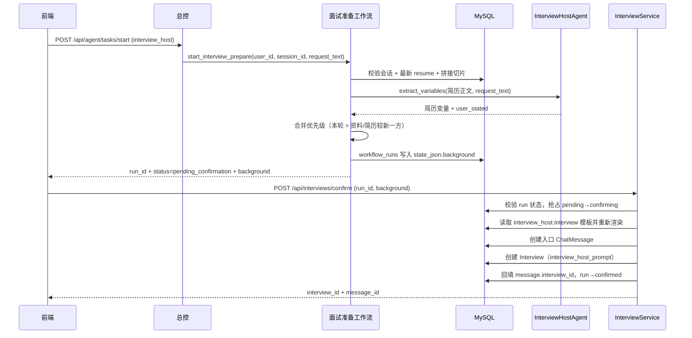

# 语音面试 · 简历背景确认验证指南

面向本地联调，验证两阶段流程：

1. `POST /api/agent/tasks/start`（`agent_name=interview_host`）只生成**可编辑背景**，
   保存到 `workflow_runs.state_json`，返回 `status=pending_confirmation` 与 `run_id`；
2. 前端确认（可修改）后调用 `POST /api/interviews/confirm`，后端按确认后的背景
   **重新渲染主考官提示词**，创建入口 `ChatMessage` 与正式 `Interview`，返回 `interview_id`。

相关代码：

- 总控分发：[`app/services/orchestrator_service.py`](../app/services/orchestrator_service.py)
- 第一阶段：[`app/services/interview_host_workflow.py`](../app/services/interview_host_workflow.py)
- 第二阶段：[`app/services/interview_service.py`](../app/services/interview_service.py)
- 变量提取：[`app/agent/agents/interview_host.py`](../app/agent/agents/interview_host.py)
- 入参 / 出参：[`app/schemas/interview_host.py`](../app/schemas/interview_host.py)、
  [`app/schemas/interview.py`](../app/schemas/interview.py)

> `interview_host` 规则为 `direct=True`，`agent_name` 命中即启动第一阶段，
> 路由决策与 `request_text` 内容无关（但会读取其中的明确表述）。

## 0. 前置条件

```bash
cd agent-backend && source .venv/bin/activate
alembic upgrade head
python scripts/init_prompt.py     # 必须：写入 interview_host:interview 模板
uvicorn app.main:app --reload --reload-exclude 'logs/*' --port 8000
```

- 打开 `http://127.0.0.1:8000/docs`
- `.env.dev` 必须配置 `LLM_API_KEY` / `LLM_MODEL`，否则变量提取返回 `503`
- 简历解析依赖 `DASHSCOPE_API_KEY` + Qdrant；未配置时上传成功但切片为空，第一阶段返回 `409`
- 使用国内镜像下载向量模型时保持 `HF_HUB_DISABLE_XET=1`，否则启动预热会因 Xet 401 失败
- 若第一阶段响应 `404 提示词模板不存在`，说明 `prompt_templates` 未初始化，执行上面的 `init_prompt.py`

自动化回归：

```bash
pytest tests/test_interview_host.py -v
```

## 1. 登录与创建面试会话

登录 **POST `/api/auth/login`**（`prompt_demo / abc12345`，或自己的账号），
复制 `data.access_token` 到 Swagger **Authorize**。

创建面试会话 **POST `/api/sessions`**：

```json
{"title": "语音面试联调", "session_mode": 1}
```

记下 `data.id` 作为 `session_id`；`session_mode` 必须为 `1`，否则第一阶段返回 `400`。

### 1.1 可选：配置用户资料

**POST `/api/profiles`**（已存在用 **PUT `/api/profiles/me`**）：

```json
{
  "target_job": "前端开发工程师",
  "years_experience": 5,
  "target_level": "P7",
  "target_skills": ["Vue", "TypeScript"],
  "weak_topics": ["性能优化"]
}
```

资料 `updated_at` 晚于简历 `resources.create_time` 时，冲突字段以资料为准；反之以简历为准。

## 2. 上传简历并等待解析

**POST `/api/files`**（`multipart/form-data`）：

| 字段 | 值 |
| --- | --- |
| `file` | 本地 PDF / DOCX / TXT 简历 |
| `doc_category` | `resume`（必填） |
| `upload_purpose` | `0` |
| `storage_scene` | `0` |

等待切片落库后再调用第一阶段，可核对：

```sql
SELECT id, file_name, create_time FROM resources
WHERE user_id = <user_id> AND doc_category = 'resume'
ORDER BY create_time DESC, id DESC LIMIT 1;

SELECT chunk_index, CHAR_LENGTH(text) AS chars FROM knowledge_chunks
WHERE resource_id = <resource_id> ORDER BY chunk_index ASC;
```

## 3. 第一阶段：生成待确认背景

**POST `/api/agent/tasks/start`**

```json
{
  "agent_name": "interview_host",
  "session_id": 123,
  "request_text": "开始面试，我想面前端，5 年经验"
}
```

`request_text` 中的明确表述优先级最高；没有明确表述时用「开始面试」这类通用话术即可。

预期响应（`HTTP 200`）：

```json
{
  "code": 200,
  "message": "ok",
  "data": {
    "route": "workflow",
    "agent_name": "interview_host",
    "workflow_type": "interview_prepare",
    "session_id": 123,
    "run_id": "1a9b55fa-b52d-4082-bb1b-c7b407946839",
    "status": "pending_confirmation",
    "resume": {
      "resource_id": 45,
      "file_name": "resume.pdf",
      "doc_category": "resume",
      "create_time": "2026-10-31T17:20:00"
    },
    "background": {
      "target_job": "后端开发工程师",
      "target_level": "P6",
      "years_experience": "3 年",
      "target_skills": "Python、MySQL",
      "project_experience": "负责订单系统开发。",
      "weak_topics": "分布式事务",
      "opening_question": "请介绍你最近负责的那个订单系统项目。"
    }
  }
}
```

约定：

- `background` 七个字段**全部是字符串**，可直接绑定单行文本框；
- 技能 / 薄弱点用「、」连接；年限为「N 年」或「应届/无经验」，未知为空字符串；
- `target_job / target_level / project_experience / opening_question` 中未知项为空字符串；
- 第一阶段**不返回**最终提示词，`run_id` 是第二阶段的唯一凭据。

同时已写入 `workflow_runs`：`workflow_type=interview_prepare`、
`status=pending_confirmation`、`state_json.background` 与 `state_json.source_variables`。

## 4. 第二阶段：确认背景并创建面试

前端展示 `background` 供用户编辑，确认后调用 **POST `/api/interviews/confirm`**：

```json
{
  "run_id": "1a9b55fa-b52d-4082-bb1b-c7b407946839",
  "background": {
    "target_job": "前端开发工程师",
    "target_level": "P7",
    "years_experience": "5 年",
    "target_skills": "Vue、TypeScript",
    "project_experience": "负责电商前端重构。",
    "weak_topics": "性能优化",
    "opening_question": "请介绍你负责的前端项目。"
  }
}
```

预期响应（`HTTP 200`）：

```json
{
  "code": 200,
  "message": "ok",
  "data": {
    "run_id": "1a9b55fa-b52d-4082-bb1b-c7b407946839",
    "interview_id": 88,
    "session_id": 123,
    "message_id": 9001,
    "status": "confirmed"
  }
}
```

后端行为：

1. 校验 run 归属当前用户、类型为 `interview_prepare`、状态为 `pending_confirmation`；
2. 用确认后的 `background` 重新渲染 `interview_host:interview` 提示词
   （空字段回退为「未提供 / 暂无」）；
3. 原子抢占 `pending_confirmation → confirming`，**同一 `run_id` 只能成功一次**；
4. 创建入口消息：`chat_messages` 一条记录，`select_mode=4`（模拟面试）、
   `request_id={run_id}:interview`、`request_text` 为用户原话、
   `response_text` 为确认后的 `opening_question`、`status=1`；
5. 创建面试：`interviews.qa_object=[]`、`status=0`、
   `interview_host_prompt` 保存最终提示词；
6. 回填 `chat_messages.interview_id`，run 状态置为 `confirmed`。

面试详情 **GET `/api/interviews/{interview_id}`** 会返回 `interview_host_prompt`，便于核对。

## 5. 断言清单

| 检查项 | 预期 |
| --- | --- |
| 第一阶段状态 | `status=pending_confirmation`，返回 `run_id`，无 `prompt` / `variables` |
| 背景字段 | 七个字段齐全且均为字符串，技能 / 薄弱点用「、」连接 |
| 最新输入优先 | 本轮表述 > 较新的资料/简历 > 另一方兜底；`opening_question` 只取简历 |
| run 落库 | `workflow_runs.state_json.background` 与响应一致，状态 `pending_confirmation` |
| 确认提示词 | `interviews.interview_host_prompt` 只包含确认后的值，占位符已替换 |
| 入口消息 | `chat_messages.select_mode=4`，`request_id={run_id}:interview`，`interview_id` 已回填 |
| 面试记录 | `interviews.message_id` 等于入口消息 ID，`qa_object=[]`，`status=0` |
| 幂等 | 同一 `run_id` 第二次确认返回 `409 该面试已确认，请勿重复确认` |
| 越权 | 确认他人 run 或查询他人 interview 均返回 `404` |

## 6. 数据与日志核对

```sql
-- 待确认 / 已确认运行
SELECT run_id, user_id, session_id, workflow_type, status,
       JSON_EXTRACT(state_json, '$.background') AS background
FROM workflow_runs WHERE run_id = '<run_id>';

-- 确认后的面试（提示词应包含用户确认后的岗位 / 职级 / 年限 / 技能 / 薄弱点）
SELECT id, user_id, session_id, message_id, status, qa_object, interview_host_prompt
FROM interviews WHERE id = <interview_id>;

-- 入口消息
SELECT id, session_id, select_mode, request_id, request_text, response_text,
       status, interview_id
FROM chat_messages WHERE id = <message_id>;
```

```bash
grep -E "面试主考官|面试准备变量覆盖|面试背景待确认|面试已确认" logs/app.log | tail -10
```

应依次看到：`面试主考官变量提取完成`（覆盖时多一条 `面试准备变量覆盖`）→
`面试背景待确认` → `面试已确认`。

## 7. 反向用例

| 场景 | 操作 | 预期 |
| --- | --- | --- |
| 非面试会话 | 第一阶段用 `session_mode=0` 的会话 | `400 当前会话不是面试会话` |
| 他人会话 | 第一阶段用其他用户的 `session_id` | `404 会话不存在` |
| 没有简历 | 账号未上传 `doc_category=resume` 的资源 | `404 未找到简历，请先上传简历` |
| 简历未解析 | 资源存在但 `knowledge_chunks` 无行 | `409 简历内容尚未解析完成，请稍后重试` |
| 模型配置缺失 | 注释掉 `LLM_API_KEY` 后调用 | `503 面试主考官服务暂不可用` |
| 模型输出非法 | 重试耗尽仍非 JSON | `502 面试准备失败，请稍后重试` |
| 模板未初始化 | `prompt_templates` 为空后确认 | `404 提示词模板不存在` |
| 重复确认 | 同一 `run_id` 再调 confirm | `409 该面试已确认，请勿重复确认` |
| 确认他人 run | 用其他用户的 `run_id` | `404 面试准备不存在` |
| 未知 run | 随机 UUID 调 confirm | `404 面试准备不存在` |
| 参数非法 | `run_id=""` / 背景字段超长 | `422`（校验层拦截） |

## 8. curl 一键流程

```bash
BASE=http://127.0.0.1:8000
TOKEN=$(curl -s -X POST "$BASE/api/auth/login" \
  -H 'Content-Type: application/json' \
  -d '{"username":"prompt_demo","password":"abc12345"}' | jq -r '.data.access_token')

SESSION_ID=$(curl -s -X POST "$BASE/api/sessions" \
  -H "Authorization: Bearer $TOKEN" -H 'Content-Type: application/json' \
  -d '{"title":"语音面试联调","session_mode":1}' | jq -r '.data.id')

# 可选：写入资料（已存在时改用 PUT /api/profiles/me）
curl -s -X POST "$BASE/api/profiles" -H "Authorization: Bearer $TOKEN" \
  -H 'Content-Type: application/json' \
  -d '{"target_job":"前端开发工程师","years_experience":5,"target_level":"P7","target_skills":["Vue","TypeScript"],"weak_topics":["性能优化"]}' | jq

# 上传简历；等待后台解析完成后再执行下一步
curl -s -X POST "$BASE/api/files" -H "Authorization: Bearer $TOKEN" \
  -F "file=@/绝对路径/resume.pdf" -F "doc_category=resume" | jq

# 第一阶段
PREPARE=$(curl -s -X POST "$BASE/api/agent/tasks/start" \
  -H "Authorization: Bearer $TOKEN" -H 'Content-Type: application/json' \
  -d "{\"agent_name\":\"interview_host\",\"session_id\":$SESSION_ID,\"request_text\":\"开始面试\"}")
echo "$PREPARE" | jq

# 第二阶段：修改背景中的岗位与年限后确认
BODY=$(echo "$PREPARE" | jq \
  '{run_id: .data.run_id, background: (.data.background
    | .target_job = "前端开发工程师"
    | .years_experience = "5 年")}')
curl -s -X POST "$BASE/api/interviews/confirm" \
  -H "Authorization: Bearer $TOKEN" -H 'Content-Type: application/json' \
  -d "$BODY" | jq
```

## 9. 链路时序


