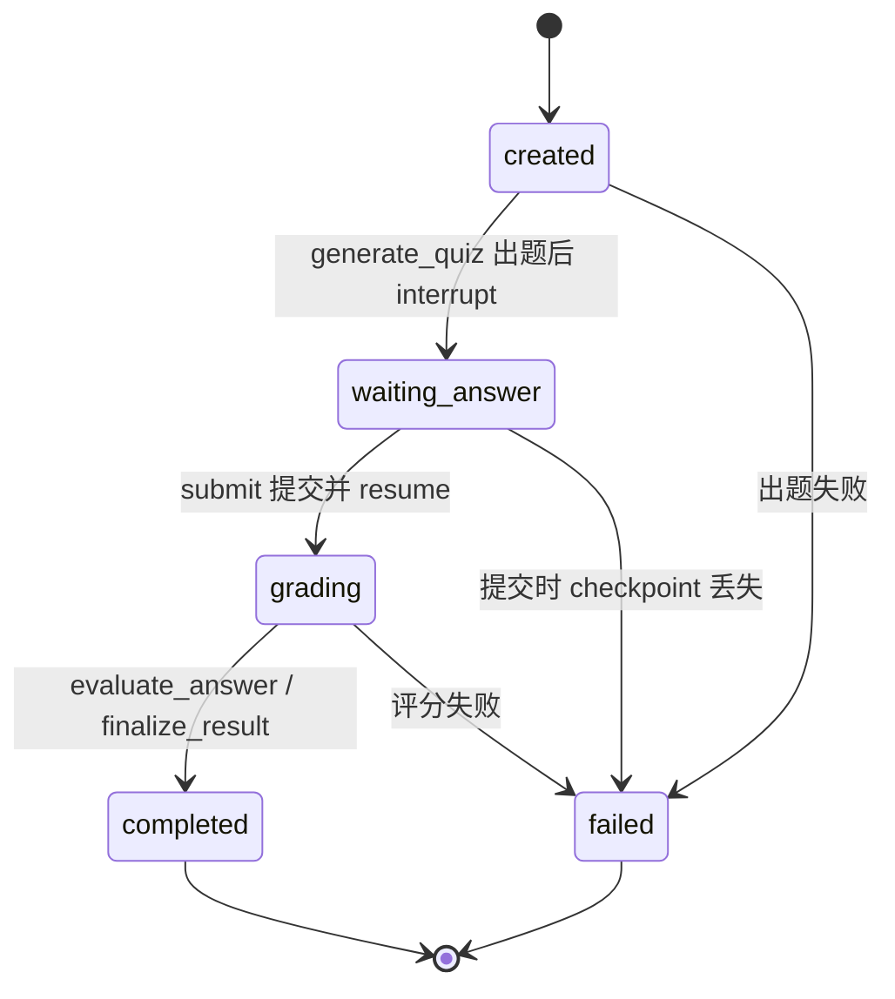

# 学习测评工作流 · Swagger 验证指南

面向本地联调：通过 `http://127.0.0.1:8000/docs` 依次调用鉴权、会话与学习测评接口，
验证「出题 → 作答 → 评分」闭环及各项约束。图为
[`app/agent/workflows/learning_quiz.py`](../app/agent/workflows/learning_quiz.py)，
接口编排见 [`app/services/learning_workflow.py`](../app/services/learning_workflow.py)。

## 0. 前置条件

```bash
cd agent-backend && source .venv/bin/activate
alembic upgrade head          # 确认 workflow_runs 表已存在
uvicorn app.main:app --reload --port 8000
```

- 打开 `http://127.0.0.1:8000/docs`
- `.env` 必须配置 `LLM_API_KEY` / `LLM_MODEL`，否则 `/start` 返回 `503`

## 1. 注册并获取令牌

**POST `/api/auth/register`**（已有账号可跳过）

```json
{"username": "wf_demo_01", "password": "abc12345"}
```

**POST `/api/auth/login`**

```json
{"username": "wf_demo_01", "password": "abc12345"}
```

复制响应中的 `data.access_token` → 点击页面右上角 **Authorize** → 粘贴令牌
（不要加 `Bearer ` 前缀）→ Authorize。

> 访问令牌有效期 30 分钟；过期后重新登录。

## 2. 创建会话

**POST `/api/sessions`**

```json
{"title": "Python 基础测评", "session_mode": 0}
```

记下响应中的 `data.id`（即后续使用的 `session_id`）。

## 3. 发起测评出题

**POST `/api/learning-workflows/start`**

```json
{
  "session_id": 123,
  "request_text": "测一下 Python 基础，包括数据类型、函数和异常处理",
  "question_count": 3
}
```

预期响应（`HTTP 200`）：

```json
{
  "code": 200,
  "message": "ok",
  "data": {
    "run_id": "6f1c9e3a-2b4d-4c8e-9a10-123456789abc",
    "status": "waiting_answer",
    "quiz": [
      {
        "question_id": 1,
        "type": "radio",
        "stem": "以下哪个是 Python 的不可变类型？",
        "options": [
          {"key": "A", "text": "list"},
          {"key": "B", "text": "tuple"}
        ]
      }
    ]
  }
}
```

检查点：

- `status == "waiting_answer"`，`quiz` 长度等于题量。`question_count` 可省略：未传时从 `request_text` 提取「N 道 / N 题」（支持中文数字，如「出三道题」），仍无则默认 5，上限 20
- 此时图停在 `wait_user_answer` 的 `interrupt()`，执行现场保存在 checkpoint（`run_id` 即 `thread_id`）
- `question_id` 从 1 连续递增
- 题型为前端控件类型 `radio`（单选）/ `checkbox`（多选）/ `textarea`（简答）
- **题目中没有 `answer` 字段**（标准答案不落库、不下发）
- 出题成功后会话中新增一条消息（`request_id="{run_id}:quiz"`），`response_payload` 即上面的 `quiz`，
  `response_text` 固定为 `已完成出题，请完成后提交答案。`

复制 `run_id`。

## 4. 提交整套作答

**POST `/api/learning-workflows/{run_id}/submit`**

按题型填写 `value`：

| 题型 | value 示例 |
| --- | --- |
| `radio` | `"B"` |
| `checkbox` | `["A", "C"]` |
| `textarea` | `"索引用于加速查询定位"` |

必须覆盖**全部题目**：

```json
{
  "answers": [
    {"question_id": 1, "value": "B"},
    {"question_id": 2, "value": ["A", "C"]},
    {"question_id": 3, "value": "用于加速数据检索，减少全表扫描"}
  ]
}
```

预期响应（`HTTP 200`）：

```json
{
  "code": 200,
  "message": "ok",
  "data": {
    "run_id": "6f1c9e3a-2b4d-4c8e-9a10-123456789abc",
    "status": "completed",
    "score": 67,
    "evaluation": [
      {"question_id": 1, "correct": true, "comment": "正确，tuple 不可变"}
    ],
    "weaknesses": ["异常处理"],
    "review": "建议补充 try/except 与自定义异常的知识。"
  }
}
```

评分阶段的模型输出必须包含 `display_text / score / items / weaknesses / review`，
`items` 覆盖每题 `{question_id, correct, comment}`。接口响应保持上面的
`score / evaluation / weaknesses / review` 结构；`display_text` 只用于回写会话消息，
缺失或过短时后端用「得分 + 逐题点评 + 薄弱点 + 建议」拼接兜底。

## 4.1 会话消息验证（表单 → 点评）

**GET `/api/sessions/{session_id}/messages`**

1. 出题后：只有一条测评消息，`request_text` 为出题请求，
   `response_text == "已完成出题，请完成后提交答案。"`，`response_payload` 为完整 `quiz` 数组；
2. 提交后：仍是同一条消息（不新增），`response_text` 变为评分点评文本，
   `response_payload` 为 `null`。

`response_payload` 是 `chat_messages` 新增的 JSON 列（Alembic `76b0a08b3e79`），普通聊天为 `null`。

## 5. 查询运行详情

**GET `/api/learning-workflows/{run_id}`**

预期返回 `status` 与完整 `state`（含 `quiz`、`answers`、`evaluation`、`score`、`provider` 等）。

## 6. 反向用例（验证约束）

| 操作 | 预期 |
| --- | --- |
| 不点 Authorize 直接调接口 | `401 未提供认证凭证` |
| 用他人会话 `session_id` 发起 | `404 会话不存在` |
| 用他人 `run_id` 提交 / 查询 | `404 测评不存在` |
| 少提交一道题 | `422 还有 N 道题未作答` |
| `radio` 题提交 `"Z"` | `422 第 1 题的选项非法` |
| 同一题重复提交 | `422 同一题目不能重复作答` |
| 对已完成的 `run_id` 再次提交 | `409 该测评已提交，请勿重复提交` |
| 重启服务后对旧 `run_id` 提交（checkpoint 丢失） | `409 测评流程已失效，请重新发起测评`，记录置 `failed` |
| 未配置 LLM 密钥时发起 | `503 学习测评服务暂不可用` |
| 模型输出非法 JSON | `502 学习测评生成失败，请稍后重试` |

## 7. 数据库落库核对（可选）

```sql
SELECT run_id, workflow_type, status, completed_at,
       JSON_EXTRACT(state_json, '$.score') AS score,
       error_message
FROM workflow_runs
ORDER BY id DESC
LIMIT 5;
```

预期：

- 出题成功后 `status=waiting_answer`
- 提交过程 `waiting_answer → grading → completed`，完成后 `completed_at` 非空
- 失败时 `status=failed` 且 `error_message` 记录原因
- 删除会话后对应 `workflow_runs` 记录随外键级联清理

## 8. 总控入口

前端统一走 `POST /api/agent/chat`（SSE），不再有按 `agent_name` 分叉的 JSON 入口。

```json
{
  "session_id": 123,
  "request_text": "帮我出 3 道 Python 基础题",
  "question_count": 3,
  "preferred_agent": "quiz_generate_workflow"
}
```

`preferred_agent` 是快捷按钮的一次性提示，可省略；省略时由关键词 / 语义快筛决定，仍不命中则交给规划器或普通聊天。

| `request_text` | 预期响应 |
| --- | --- |
| `帮我出 3 道 Python 基础题` | `task(kind=quiz)`，`payload` 含 `run_id` / `quiz` / `message_id` |
| `检验一下我对数据库索引的掌握程度` | `task(kind=quiz)`（关键词未命中，语义快筛命中） |
| `你好，介绍一下你自己` | `meta → agent(start) → delta* → done`，无 `task` |

事件顺序与 `task.payload` 形状见 [`orchestrator-workflow-design.md`](orchestrator-workflow-design.md)。`task.payload.run_id` 可直接用于 `POST /api/learning-workflows/{run_id}/submit`。

> 聊天分支忽略 `question_count` / `provider`；出题分支忽略 `select_mode` / `request_segments`。

### 8.1 工作流内部状态机



`created / waiting_answer / grading / completed / failed` 同时是 `workflow_runs.status`。
`waiting_answer` 期间可刷新页面，题目与作答入口由会话消息 `{run_id}:quiz` 还原；
总控只负责触发 `start`，答题提交直接调用本节接口。总控与工作流的协作时序、
通信通道与跨 Agent 接力见
[`orchestrator-workflow-design.md`](orchestrator-workflow-design.md) §5.5–§5.7。


```
 语义快筛位于 Tier 1（app/services/orchestrator_service.py 的 _fast_match）：
  1. 先遍历注册表关键词，任一命中即分发，不加载向量模型；
  2. 关键词全部落空后，才把用户问题向量化一次（fastembed BAAI/bge-small-zh-v1.5，启动时预热）；
  3. 与各能力登记的 examples 逐一算余弦相似度（示例向量缓存），达到阈值即命中；
  4. 仍未命中且原文 >= 10 字时，才调用一次 FlowControllerAgent 规划；模型异常 / 低置信度一律降级聊天。
 所以它解决的是「说法不同但意思一样」的问题，例如「检验一下我对数据库索引的掌握程度」不含任何关键词，
 但语义上接近「测测我对这个知识点的掌握程度」而命中。模型 / 向量化异常只记 WARNING，不阻断请求。
```


## 9. 实现对照

| 环节 | 代码位置 |
| --- | --- |
| 路由 | `app/routers/learning_workflow.py` |
| 入参 / 出参校验 | `app/schemas/learning_workflow.py` |
| LangGraph 图与节点 | `app/agent/workflows/learning_quiz.py` |
| checkpoint（MemorySaver） | `app/agent/workflows/checkpoint.py` |
| 业务编排（恢复 / 落库） | `app/services/learning_workflow.py` |
| 动态提示词 | `app/services/prompt_template_service.py`（`get_rendered_prompt`） |
| 模型 JSON 解析 | `app/services/ai/json_utils.py` |
| 状态持久化 | `app/db/workflow_run_repo.py`、`workflow_runs` 表 |
| 会话消息（表单 / 点评） | `app/db/message_repo.py`、`chat_messages` 表 |
| 流程总控 | `app/routers/agent.py`、`app/services/orchestrator_service.py` |
| LLM 规划器 | `app/agent/agents/flow_controller.py` |
| 语义快筛 | `app/services/semantic_intent.py`、`app/services/embedding.py` |
