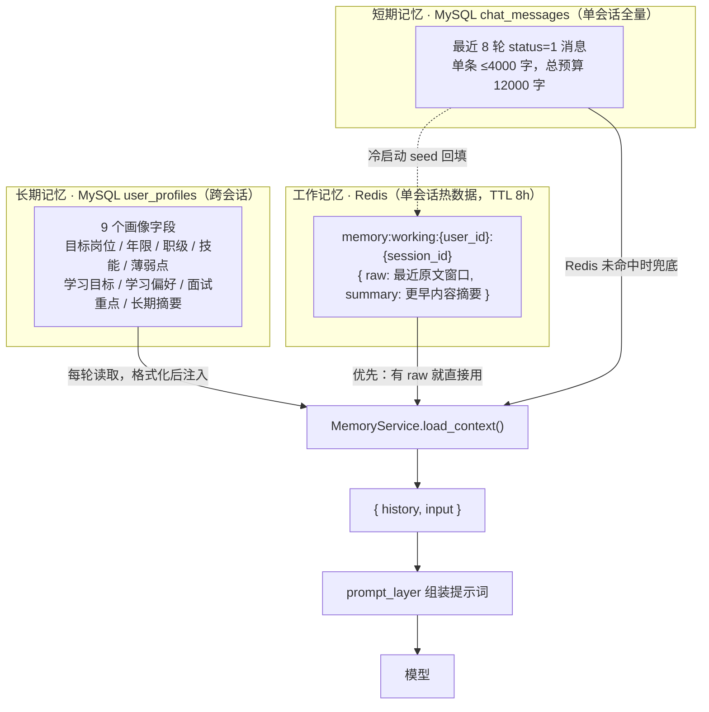
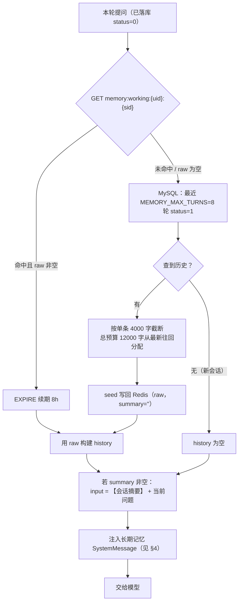
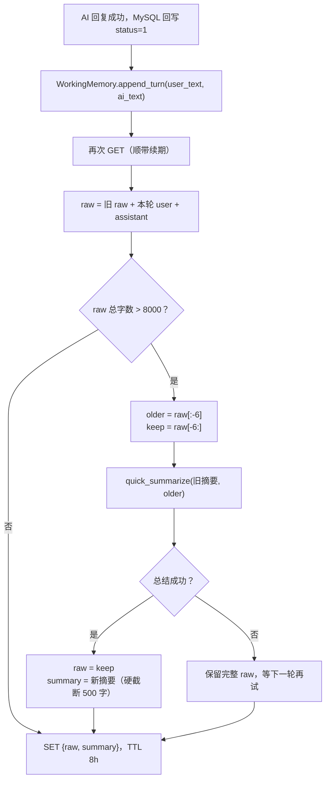
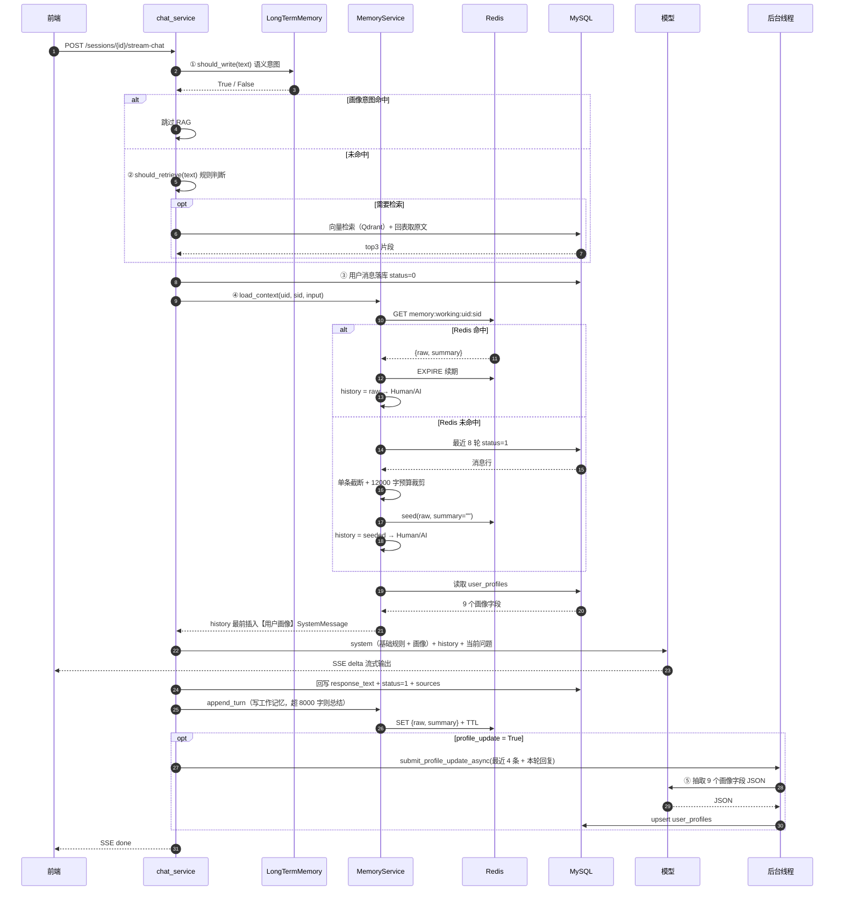
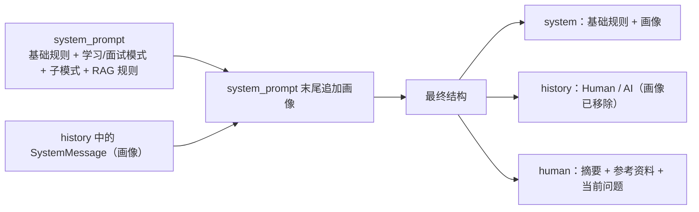
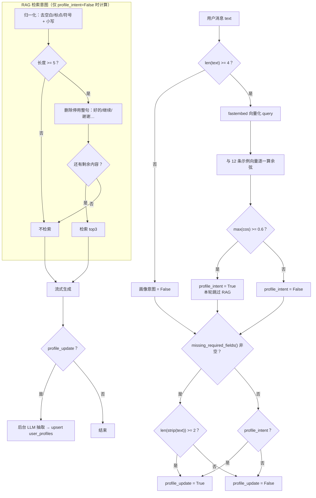
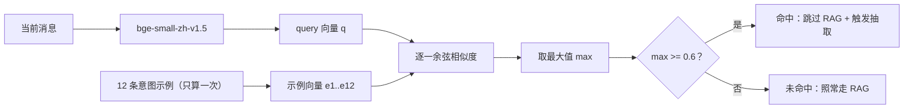

# 记忆系统完整链路与意图识别原理

> 适用版本：V2.1（2026-10-27）
> 配套文档：[`memory-system-v1.md`](memory-system-v1.md)（Redis 工作记忆）、[`memory-system-v2.md`](memory-system-v2.md)（长期画像）、[`memory-verification.md`](memory-verification.md)（前端验证步骤）
> 本文重点：**短期记忆与长期记忆如何在一轮对话里结合**、**Redis 在其中到底缓存了什么**、**每一步意图识别的底层原理**。

实现位置：`app/services/chat_service.py`、`app/services/memory_service.py`、`app/services/long_term_memory.py`、`app/services/ai/prompt_layer.py`、`app/rag/context.py`。

---

## 0. 一句话概括

- **长期记忆**（MySQL `user_profiles`）决定「模型长期怎么理解这个用户」；
- **短期记忆**（MySQL `chat_messages`）决定「这个会话之前聊过什么」；
- **工作记忆**（Redis）是短期记忆的**热窗口 + 摘要缓存**，让每轮不必重扫 MySQL；
- **意图识别**决定「这轮要不要检索知识库」和「这轮结束后要不要回写画像」。

---

## 1. 三层记忆与 Redis 的位置



三层的职责边界：

| 层 | 存储 | 生命周期 | 是否可重建 | 回答的问题 |
| --- | --- | --- | --- | --- |
| 长期记忆 | MySQL `user_profiles` | 永久 | 是（用户表单 / 对话抽取） | 用户是谁、目标是什么 |
| 工作记忆 | Redis | 8 小时，读写续期 | 原文可重建，**摘要不可重建** | 这个会话最近聊了什么、更早聊了什么 |
| 短期记忆 | MySQL `chat_messages` | 永久（随会话） | 是（消息即原始数据） | 这个会话完整历史中的最近 N 轮 |

---

## 2. Redis 在工作记忆中的缓存作用

### 2.1 它缓存的不是「消息」，而是「本轮要用的上下文窗口」

Redis 里每个会话只有一个 JSON：

```json
{
  "raw": [
    {"role": "user", "content": "我最近在补分布式"},
    {"role": "assistant", "content": "可以从 CAP 和一致性协议开始……"}
  ],
  "summary": "用户目标：3 年后端转架构；薄弱点：分布式、消息队列；偏好视频 + 项目式学习。"
}
```

`raw` 只保留**最近的原文窗口**（正常情况 6 条），更早的内容被压缩进 `summary`（≤500 字）。因此 Redis 解决的是：

1. **省一次 MySQL 查询**：每轮直接 `GET`，不必查最近 8 轮消息再裁剪；
2. **省上下文 token**：窗口固定为「最近 6 条 + 500 字摘要」，不会随会话变长无限增长；
3. **承载摘要**：滚动摘要是模型生成的，**只存在 Redis，不回写 MySQL**；Redis 过期后摘要丢失，只能从 MySQL 最近 8 轮重新拼上下文（早期细节会有损）；
4. **会话粘性**：每次读写都续期 8 小时，活跃会话不会中途过期；闲置 8 小时后自动回落 MySQL。

> 注意：MySQL `chat_messages` 才是消息的唯一事实来源；Redis 只是「工作集」。因此 Redis 挂了不会丢聊天记录，只会让下一轮退化为 MySQL 路径。

### 2.2 读路径：命中直接用，未命中回源并回填



关键细节：

- 查询只取 `status=1`，当前这条 `status=0` 的消息不会重复进入历史；
- `seed()` **只写 Human / AI 消息**，不写画像 SystemMessage，否则画像会被当成用户说过的话永久留在 Redis；
- 有摘要时，摘要拼在**本轮问题前面**，不额外插入一条 system 消息；
- 读取成功就 `EXPIRE`，失败（Redis 不可用、JSON 损坏）返回空结构并降级 MySQL。

### 2.3 写路径：回复成功后追加，超阈值滚动总结



- 总结失败不会裁剪，宁可多占内存也不丢上下文；
- 只有「更早的 `raw[:-6]`」进入摘要，最近 6 条始终保留原文；
- 追加的是**原始问题**，不是拼接了 RAG 资料后的 `input`，避免「参考片段」被当成用户历史。

### 2.4 Redis 失效时到底会发生什么

| 场景 | 读取行为 | 写入行为 | 对用户的影响 |
| --- | --- | --- | --- |
| key 过期（闲置 8h） | 回落 MySQL 最近 8 轮并 seed | 正常 | 早期摘要丢失，细节可能变少 |
| Redis 不可用 | 每轮都回落 MySQL | 只记日志 | 对话正常，摘要能力暂停 |
| Redis 恢复但 seed 曾失败 | 若 append 已写入「仅本轮」的 raw，则下一轮直接用这份不完整 raw，**不会回源 MySQL** | 正常 | 直到 key 过期（8h）才重新从 MySQL 重建 |
| 总结调用 LLM 失败 | — | 保留完整 raw | 下一轮继续尝试总结 |

---

## 3. 一轮对话的端到端时序（短期 + 长期结合）



三个「意图」在时序中的位置：① ② 在生成**之前**同步执行（影响是否检索、影响首包延迟）；⑤ 在生成**之后**异步执行（不影响 `done`）。

---

## 4. 短期记忆与长期记忆如何合并进提示词

`MemoryService.load_context()` 产出的 `history` 是**时间正序**的消息列表，长期画像是其中最前面的一条 `SystemMessage`：

```text
history = [
  SystemMessage("【用户画像】\n- 目标岗位：后端开发\n- 工作年限：3 年\n..."),
  HumanMessage("之前的问题"),
  AIMessage("之前的回答"),
  ...
]
input = "【会话摘要】\n...\n\n【知识库参考资料】\n[1] ...\n\n当前问题"
```

`prompt_layer.merge_history_system_messages()` 在调用模型前做一次「前移合并」：



为什么要合并而不是原样把 SystemMessage 放在 history 中间：

- OpenAI 兼容协议下，多轮对话中间出现 system 消息行为不一致；
- 合并后画像始终处于「全局规则」位置，不会被后续对话稀释；
- Redis `seed` 只回填 Human/AI，画像每轮从 MySQL 重新读取，保证跨会话最新。

---

## 5. 意图识别底层原理

### 5.1 三个判断 + 一个抽取，先看总决策图



### 5.2 判断一：画像写入意图（语义相似度）

目的：识别「这句话是不是在描述用户自己」，而不是知识提问。

底层步骤：

1. **长度闸门**：去空白后少于 4 字（`INTENT_MIN_CHARS`）直接 `False`，避免「好的」也跑一次 embedding；
2. **向量化**：`fastembed` + `BAAI/bge-small-zh-v1.5`，本地 CPU 推理，首次使用时下载并缓存模型；
3. **示例向量缓存**：12 条 `PROFILE_INTENT_EXAMPLES` 的向量用 `lru_cache` 只算一次；
4. **余弦相似度**：

   ```text
   cos(q, e_i) = (q · e_i) / (|q| × |e_i|)
   score = max(cos(q, e_1), ..., cos(q, e_12))
   score >= 0.6  →  命中
   ```

5. **异常降级**：模型缺失、推理失败、向量为空一律 `False`，不阻断对话。



示例覆盖的语义空间（12 条）：

| 类别 | 示例 |
| --- | --- |
| 目标岗位 | 「我的目标岗位是后端开发工程师」「我希望在半年内转行做数据分析」 |
| 学习计划 | 「我计划今年系统学习算法和数据库」 |
| 学习偏好 | 「我喜欢通过看视频和做项目来学习」「我更喜欢先看例子再理解原理」「我平时学习时间比较零散」 |
| 面试关注 | 「我面试时比较担心算法题和系统设计」「我希望重点准备 Java 后端方向的面试」「我找工作时比较看重成长空间」 |
| 薄弱点 | 「我的薄弱点是高并发和分布式」 |
| 技能栈 | 「我熟悉 Python、MySQL 和 Redis」「我的技术栈是 Java 和 Spring Boot」 |

为什么用语义而不是关键词：用户会说「我想往服务端深耕」「面 P6 还得补补」这类没有固定词的表达；语义相似度对同义改写更稳。代价是每条消息一次本地推理，以及阈值固定 0.6 带来的少量误判。

命中后的两个副作用：

- **跳过 RAG**：自我描述不是知识库问题，避免把「我想转行」当成检索 query；
- **触发后台抽取**：回复完成后把画像写回 MySQL。

代码：`app/services/long_term_memory.py` 的 `should_write()`（阈值 `INTENT_THRESHOLD`、最短长度 `INTENT_MIN_CHARS`）。

### 5.3 判断二：RAG 检索意图（纯规则，零模型成本）

目的：过滤寒暄、确认、推进语，避免无意义检索。

底层步骤：

1. **归一化**：`re.sub(r"[\s\W_]+", "", text).lower()`，去掉空白、标点、符号；
2. **长度闸门**：归一化后少于 5 字（`MIN_QUERY_CHARS`）不检索；
3. **停用整句剥离**：把「好的」「继续」「谢谢」「下一步」等 40+ 条短语按**长度倒序**从文本中删除（先删「好的」再删「好」，避免拆错）；
4. **剩余非空才检索**：剥离后还有内容，说明仍包含实质问题。

| 输入 | 归一化 | 剥离停用句后 | 结论 |
| --- | --- | --- | --- |
| 「好的，谢谢！」 | 好的谢谢 | 空 | 不检索 |
| 「嗯嗯」 | 嗯嗯 | 空 | 不检索（长度也不足） |
| 「继续讲讲项目经历」 | 继续讲讲项目经历 | 讲讲项目经历 | 检索 |
| 「CAP 和 BASE 的区别？」 | cap和base的区别 | cap和base的区别 | 检索 |
| 「你好，帮我看看简历」 | 你好帮我看看简历 | 帮我看看简历 | 检索 |

代码：`app/rag/context.py` 的 `should_retrieve()`。

### 5.4 判断三：必填缺失兜底（规则 + 查库）

目的：用户跳过开场白表单后，用「3 年」「后端开发」这类短句也能补全资料。

```text
profile_update = profile_intent
              or (len(strip(text)) >= 2 and missing_required_fields() 非空)
```

- 必填字段：`target_job`、`years_experience`、`target_level`；
- `None` / 空串算缺失；`years_experience = 0` 是有效值（应届）；
- 读取画像失败返回 `[]`（视为不缺失），避免数据库故障时每轮都抽取；
- 该路径**不跳过 RAG**，因为短句既可能是资料回答，也可能是正常提问的开头。

决策矩阵：

| 场景 | 画像意图 | 必填缺失 | RAG 检索 | 后台抽取 |
| --- | --- | --- | --- | --- |
| 「我是 3 年后端，目标 P6」 | 是 | — | 否 | 是 |
| 「CAP 是什么」（资料齐全） | 否 | 否 | 是 | 否 |
| 「CAP 是什么」（必填缺失） | 否 | 是 | 是 | 是 |
| 「3 年」（必填缺失） | 否 | 是 | 是（可能无命中） | 是 |
| 「继续」（必填缺失） | 否 | 是 | 否（停用句） | **是**（长度恰好 ≥2，已知边界） |
| 「好」（必填缺失） | 否 | 是 | 否 | 否（<2 字） |

### 5.5 抽取阶段：不是「意图」，而是结构化信息抽取

触发后（异步）用 LLM 把对话转成 JSON：

- 输入：最近 4 条 Human/AI + 本轮 AI 回复（过滤 SystemMessage），外加「已有画像」JSON；
- 系统提示词：**静态** `SystemMessage(EXTRACT_PROMPT)`，内含输出 JSON Schema；
- 输出清洗：`_clean_text` / `_clean_years`（「3 年」→3，0 有效，0..60）/ `_clean_list`（去重、单项 ≤50 字、≤20 项）；
- 只写非空字段；数组要求模型输出「合并去重后的完整列表」，摘要要求「合并后的完整画像」；
- 经 `profile_service.create_or_update()` 白名单过滤后 upsert。

> 注意：`EXTRACT_PROMPT` 里有 JSON 示例的 `{` `}`，必须作为**静态消息**传入；写成 `("system", EXTRACT_PROMPT)` 会被 `ChatPromptTemplate` 当成模板变量，导致抽取线程在格式化阶段直接 `KeyError`。

---

## 6. 参数总表

| 参数 | 值 | 位置 |
| --- | --- | --- |
| Redis key | `memory:working:{user_id}:{session_id}` | `memory_service.py` |
| 工作记忆 TTL | 8 小时（读/写续期） | `WORKING_MEMORY_TTL` |
| 触发总结的原文阈值 | 8000 字 | `WORKING_RAW_CHAR_LIMIT` |
| 总结后保留原文 | 最近 6 条（3 轮） | `WORKING_KEEP_MESSAGES` |
| 摘要上限 | 500 字（提示词约束 + 硬截断） | `SUMMARY_MAX_CHARS` |
| 短期记忆轮数 | 8 轮 | `MEMORY_MAX_TURNS` |
| 短期记忆单条上限 | 4000 字 | `MEMORY_MESSAGE_MAX_CHARS` |
| 短期记忆总预算 | 12000 字（从最新往回分配） | `HISTORY_CHAR_BUDGET` |
| RAG 单轮片段数 | 3 | `chat_service.RAG_TOP_K` |
| RAG 相似度阈值 | 0.4 | `rag/retriever.py` |
| RAG 意图最短长度 | 5 字（归一化后） | `rag/context.MIN_QUERY_CHARS` |
| 画像意图最短长度 | 4 字 | `long_term_memory.INTENT_MIN_CHARS` |
| 画像意图阈值 | 余弦相似度 0.6 | `long_term_memory.INTENT_THRESHOLD` |
| 必填补全最短长度 | 2 字 | `PROFILE_ANSWER_MIN_CHARS` |
| 画像抽取上下文 | 最近 4 条 + 本轮回复 | `chat_service._recent_context()` |
| 画像字段上限 | 岗位 64 / 职级 32 / 年限 0..60 | `JOB_MAX_CHARS` 等 |

---

## 7. 场景走查

### 场景 A：新会话第一轮

1. Redis 无 key → MySQL 查最近 8 轮（新会话为空）；
2. 画像存在 → history 最前插入 SystemMessage；
3. 生成完成后 `append_turn` 写入「本轮 user + assistant」，TTL 8h。

### 场景 B：同一会话第二轮

1. Redis 命中 raw → 直接构建 history，`EXPIRE` 续期；
2. 摘要若存在，作为本轮 `input` 前缀；
3. 不查 MySQL 消息表。

### 场景 C：长会话超过 8000 字

1. `append_turn` 发现超阈值；
2. `raw[:-6]` + 旧摘要 → LLM 总结成 ≤500 字；
3. Redis 只保留最近 6 条原文 + 新摘要；
4. MySQL 仍保留全部消息，Redis 过期后可重建最近 8 轮（摘要丢失）。

### 场景 D：用户跳过开场白，直接说「我是 3 年后端」

1. `should_write` 语义命中 → 跳过 RAG；
2. `profile_update = True`；
3. `done` 之后后台线程抽取 `target_job=后端`、`years_experience=3`；
4. 下一轮 `load_memory_context` 就能读到新画像；
5. Redis 工作记忆不参与画像存储，画像始终从 MySQL 读取。

### 场景 E：Redis 宕机

1. 每轮 `get` 失败 → 回源 MySQL 最近 8 轮；
2. `seed` / `append_turn` 失败只记 WARNING；
3. 对话、RAG、画像读写均不受影响，只是失去摘要能力。

---

## 8. 代码索引

| 关注点 | 文件 | 关键函数 |
| --- | --- | --- |
| 记忆统一入口 | `app/services/memory_service.py` | `MemoryService.load_context()` / `append_turn()` |
| Redis 工作记忆 | `app/services/memory_service.py` | `WorkingMemory.get()` / `append_turn()` / `seed()` |
| 短期记忆 | `app/services/memory_service.py` | `InstantMemory.load()` / `_fit_char_budget()` |
| 长期记忆读取 | `app/services/long_term_memory.py` | `load_memory_context()` |
| 画像写入意图 | `app/services/long_term_memory.py` | `should_write()` / `_cosine()` |
| 必填缺失判断 | `app/services/long_term_memory.py` | `missing_required_fields()` |
| 后台抽取 | `app/services/long_term_memory.py` | `update_profile_from_conversation()` / `_extract_profile_fields()` |
| RAG 检索意图 | `app/rag/context.py` | `should_retrieve()` |
| 对话编排 | `app/services/chat_service.py` | `prepare_stream()` / `stream_reply()` |
| 提示词合并 | `app/services/ai/prompt_layer.py` | `merge_history_system_messages()` / `build_chat_chain()` |
