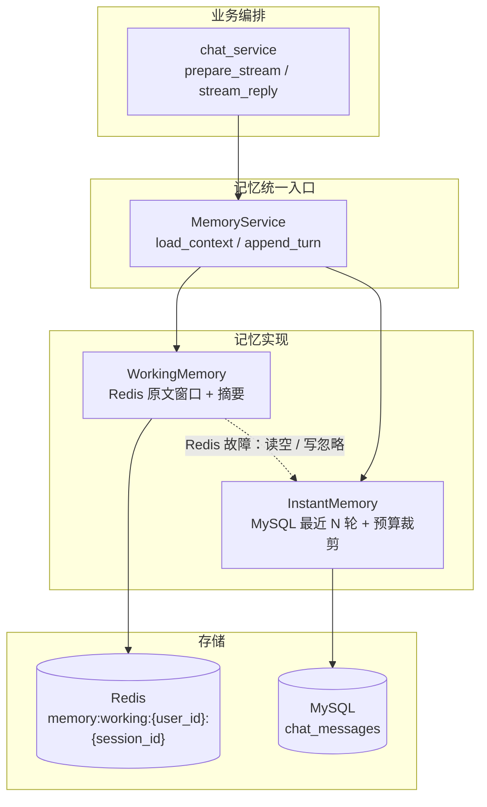
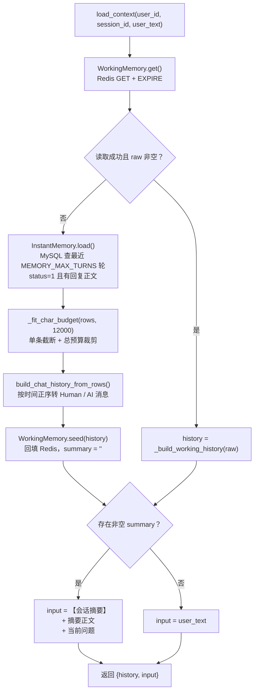
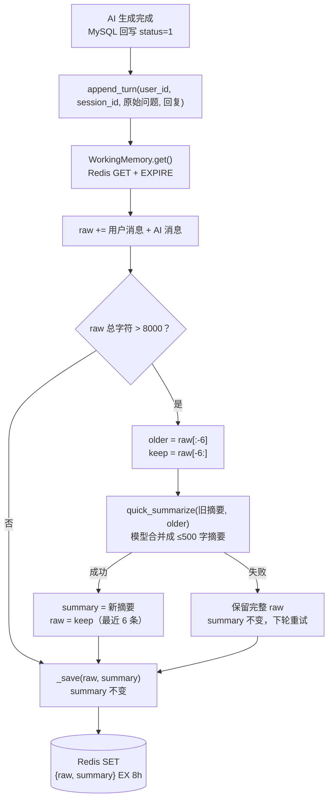
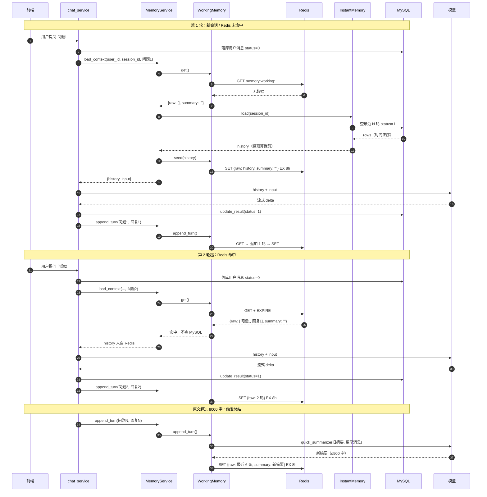

# 记忆系统设计（V1）

> 版本：V1（2026-10-27）
> 范围：会话内的短期记忆 —— 工作记忆（Redis）+ 短期历史（MySQL）
> 后续优化会新建 `memory-system-v2.md`，本文保留为 V1 实现快照，不再覆盖。

实现位置：`app/services/memory_service.py`；接入点：`app/services/chat_service.py`。

---

## 1. 设计目标

- 多轮对话时让模型看到「最近发生了什么」，同时不撑爆上下文。
- Redis 存活跃会话的原文窗口与摘要，读写快、自动过期；Redis 不可用时回退 MySQL，不阻断对话。
- 对话原文始终以 MySQL `chat_messages` 为准，Redis 只是可重建的工作副本。
- 超过字符阈值后把更早的对话压缩成摘要，原文只保留最近几条。

---

## 2. 分层结构



`chat_service` 只调用 `MemoryService`，不关心 Redis / MySQL 的查询细节。

---

## 3. Redis 数据结构

一个会话一个 JSON 字符串：

```json
{
  "raw": [
    {"role": "user", "content": "问题 1"},
    {"role": "assistant", "content": "回答 1"},
    {"role": "user", "content": "问题 2"},
    {"role": "assistant", "content": "回答 2"}
  ],
  "summary": "更早对话的摘要，最多 500 字"
}
```

| 项 | 说明 |
| --- | --- |
| key | `memory:working:{user_id}:{session_id}`，按用户 + 会话隔离 |
| value | `raw` 按时间正序（最旧 → 最新）保存原文；`summary` 保存更早内容的摘要 |
| TTL | 8 小时；每次成功读取或写入都会续期 |
| 写入方 | 仅 `WorkingMemory._save()` |
| 读取方 | 仅 `MemoryService.load_context()` / `WorkingMemory.get()` |

---

## 4. 读取链路（每轮提问）

`prepare_stream` 先把本轮用户消息以 `status=0` 落库（生成中），再调用：

```python
MemoryService.load_context(user_id, session_id, user_text)
```

因为历史查询只取 `status=1`，当前这条生成中的消息不会被重复注入。



要点：

- **Redis 优先**：`raw` 非空就直接用，不查 MySQL。
- **MySQL 兜底**：新会话、Redis 过期或 Redis 故障时，用最近 `MEMORY_MAX_TURNS` 轮已完成消息重建历史。
- **冷启动回填**：回退得到的 `history` 会 `seed()` 写回 Redis，否则下一轮只追加当前一问一答，更早上下文会丢失。
- **摘要注入位置**：摘要拼在本轮 `input` 前，不插入额外 system 消息，避免破坏历史消息的交替顺序。

### 4.1 字符预算分配

MySQL 兜底时，`_fit_char_budget` 的分配方向与输出方向相反：

```text
查询结果（时间正序）
旧 ──────────────────────────────► 新
│ 第1轮 │ 第2轮 │ 第3轮 │ 第4轮 │
                ▲
                └── 从最新一轮开始往回分配 12000 字预算

放不下 → 整轮丢弃（更旧）
最新一轮本身超预算 → 保留并按剩余预算截断
输出前反转回时间正序，交给模型
```

单条消息先按 `MEMORY_MESSAGE_MAX_CHARS` 截断，附件提取文本会拼进对应用户消息，避免一条超长附件吃光全部预算。

---

## 5. 写入链路（AI 回复成功后）

MySQL 回写 `status=1` 后，`stream_reply` 调用：

```python
MemoryService.append_turn(user_id, session_id, 原始问题, 完整回复)
```

写入的是**原始问题**，不是拼接了 RAG 资料的增强输入，避免把「参考片段」误当作用户历史。



要点：

- **按需总结**：只有原文累计超过 8000 字才调用模型，避免每轮都产生额外开销。
- **保留窗口**：总结后保留最近 6 条原文（通常 3 轮问答），更早内容并入摘要。
- **失败不丢上下文**：总结失败时保留完整原文，主流程不受影响，下一轮会再次尝试。
- **续期**：每次 `GET` / `SET` 都刷新 TTL，活跃会话不会在对话中途过期。

---

## 6. 多轮对话时序



---

## 7. 状态演进示例

假设每轮问答很短，未触发总结：

| 时间点 | Redis `raw` | Redis `summary` | MySQL `chat_messages` |
| --- | --- | --- | --- |
| 第 1 轮提问前 | 不存在 | 不存在 | 空 |
| 第 1 轮 `load_context` 后 | 仍不存在（无历史可回填，不写空值） | — | 问题1（status=0） |
| 第 1 轮 `append_turn` 后 | 问题1 / 回复1 | `""` | 问题1 + 回复1（status=1） |
| 第 2 轮 `load_context` | 问题1 / 回复1（命中） | `""` | 问题2（status=0） |
| 第 2 轮 `append_turn` 后 | 问题1 / 回复1 / 问题2 / 回复2 | `""` | 全部已完成 |

触发总结后：

| 项 | 变化 |
| --- | --- |
| `raw` | 从「全部原文」变为「最近 6 条」 |
| `summary` | 由 `quick_summarize(旧摘要 + 被裁掉的更早消息)` 生成，≤500 字 |
| 下一轮 `input` | `【会话摘要】\n{summary}\n\n{用户问题}` |
| 下一轮 `history` | 最近 6 条原文，摘要不在 history 中 |

---

## 8. 降级与一致性

| 场景 | 行为 | 对对话的影响 |
| --- | --- | --- |
| Redis `GET` / `EXPIRE` 异常 | `get()` 记 WARNING 并返回空结构 | 回退 MySQL 历史，不阻断 |
| Redis `SET` 异常 | `_save()` 只记 WARNING | 本轮工作记忆未写入；下一轮从 MySQL 兜底 |
| Redis 无数据（新会话 / 过期） | 回退 MySQL，并尝试 `seed` | 正常 |
| `seed` 写入失败 | 只记 WARNING | 本轮上下文正常，下一轮继续回退 MySQL |
| `quick_summarize` 失败或返回空 | 保留完整 `raw`，摘要不变 | 本轮回复正常，下轮重试 |
| MySQL 历史查询异常 | 未捕获，向上抛出 | 建立流之前失败，不会留下生成中的流（V2 可考虑降级为空历史） |

一致性说明：

- `chat_messages` 是唯一事实来源；Redis 是可重建的工作副本。
- Redis 写入出现在 MySQL `update_result` 成功之后，因此即使 Redis 丢数据，已完成消息仍可从 MySQL 恢复。
- Redis 中的 `raw` 与 MySQL 最近消息大致对应，但不保证逐条一致（预算裁剪、总结、TTL 过期都会改变窗口）。

---

## 9. 关键参数

| 参数 | 值 | 位置 |
| --- | --- | --- |
| 工作记忆 key | `memory:working:{user_id}:{session_id}` | `WORKING_MEMORY_KEY` |
| 工作记忆 TTL | 8 小时（读写续期） | `WORKING_MEMORY_TTL` |
| 原文总结阈值 | 8000 字 | `WORKING_RAW_CHAR_LIMIT` |
| 总结后保留原文 | 最近 6 条消息 | `WORKING_KEEP_MESSAGES` |
| 摘要上限 | 500 字 | `SUMMARY_MAX_CHARS` |
| 短期记忆轮数 | `MEMORY_MAX_TURNS`（环境变量，默认 8） | `app/core/config.py` |
| 历史总字符预算 | 12000 字 | `HISTORY_CHAR_BUDGET` |
| 单条消息上限 | `MEMORY_MESSAGE_MAX_CHARS` | `app/core/config.py` |

---

## 10. V1 边界与 V2 预留

V1 已覆盖：

- 会话级工作记忆（Redis）与 MySQL 短期历史回退。
- 按字符阈值自动总结，摘要随 `input` 注入。
- Redis / 总结失败时的降级路径。

V1 未覆盖（留待后续版本）：

- 摘要只存在 Redis：TTL 过期后无法恢复历史摘要，只能从 MySQL 窗口重建原文。
- 没有长期记忆（跨会话用户偏好、知识积累）与用户画像记忆。
- 总结在流结束前同步执行，超阈值那一轮可能增加 `done` 前的延迟；V2 可改为异步任务。
- 删除会话时不会立即删除 Redis key，依赖 8 小时 TTL 自然过期。
- 多实例部署依赖共享 Redis；本地内存无一致性保证。
- MySQL 历史查询失败未降级为空历史。
