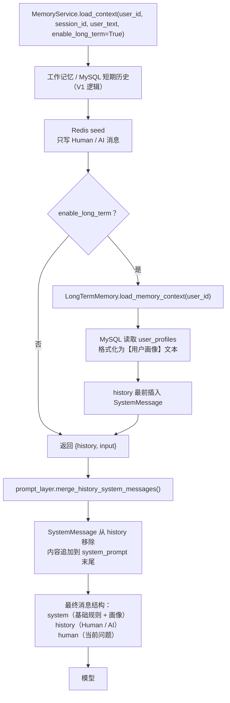
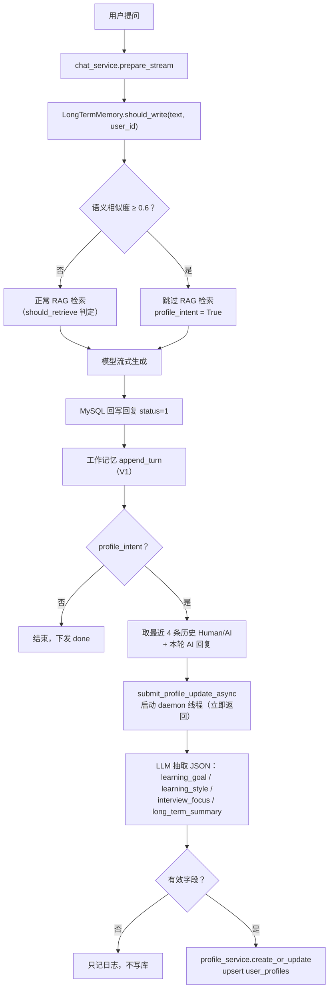
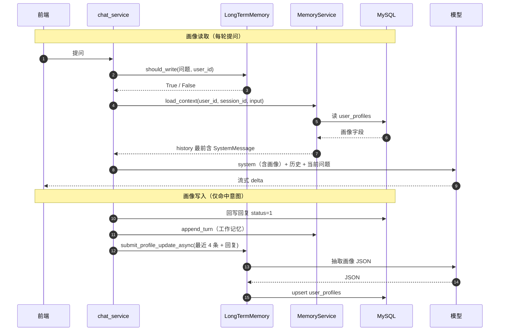

# 记忆系统设计（V2）

> 版本：V2（2026-10-27）
> 前置版本：[`memory-system-v1.md`](memory-system-v1.md)（Redis 工作记忆 + MySQL 短期历史）
> 本版新增：用户画像长期记忆 —— 意图判断、SystemMessage 注入、后台异步抽取。

实现位置：`app/services/long_term_memory.py`、`app/services/memory_service.py`、`app/services/ai/prompt_layer.py`、`app/services/chat_service.py`。

---

## 1. V2 新增能力

| 能力 | 说明 |
| --- | --- |
| 长期画像存取 | `user_profiles` 新增 `learning_goal` / `learning_style` / `interview_focus` / `long_term_summary` |
| 写入意图判断 | fastembed + `BAAI/bge-small-zh-v1.5` 计算语义相似度，判断消息是否在描述用户自己 |
| 画像注入 | 画像格式化为 `SystemMessage` 插在 history 最前，链路执行前合并进 system_prompt |
| 异步更新 | 流式回复结束后后台线程调 LLM 抽取画像，写回 MySQL，不阻塞 SSE |

---

## 2. 数据模型

`user_profiles`（一人一行，`user_id` 唯一）：

| 字段 | 类型 | 来源 | 用途 |
| --- | --- | --- | --- |
| `target_job` / `years_experience` / `target_level` | 原有字段 | 用户手工填写 | 提示词变量注入 |
| `target_skills` / `weak_topics` | JSON 数组 | 用户手工填写 | 提示词变量注入 |
| `learning_goal` | `VARCHAR(255)` | 对话自动抽取 | 学习目标 |
| `learning_style` | `VARCHAR(255)` | 对话自动抽取 | 学习偏好 |
| `interview_focus` | JSON 数组 | 对话自动抽取 | 面试重点 / 方向 |
| `long_term_summary` | `TEXT` | 对话自动抽取（滚动合并） | 长期画像摘要 |

`profile_service.create_or_update()` 只允许写入后四个字段，避免后台任务覆盖用户手工维护的资料。

---

## 3. 读取链路：画像如何进入提示词



关键顺序：**先 `seed()`，后注入画像**。如果先注入，冷启动回填会把 `SystemMessage` 当成普通消息写进 Redis，污染后续轮次。

---

## 4. 写入链路：对话如何更新画像



要点：

- **意图命中才写**：普通知识问答不会触发画像更新，避免无意义的模型调用。
- **命中时跳过 RAG**：画像类表达不需要知识库资料，避免把「我想转行」误当成检索问题。
- **异步执行**：线程启动后立即返回，LLM / 数据库失败只记日志，不影响 SSE `done`。
- **只看最近 4 条**：避免把整段历史塞进抽取提示词，控制成本与时延。

---

## 5. 意图判断

```text
用户消息 ──► fastembed 向量 ──┐
                              ├─► 余弦相似度 ──► max ≥ 0.6 ?
10 条意图示例 ──► 向量（缓存）┘
```

示例覆盖：目标岗位、学习计划、学习偏好、面试关注点、薄弱点等自我描述。模型不可用或相似度不足时返回 `False`，对话继续走普通链路。

---

## 6. 多轮时序



---

## 7. 参数

| 参数 | 值 | 位置 |
| --- | --- | --- |
| 向量模型 | `BAAI/bge-small-zh-v1.5` | `long_term_memory.py` `EMBED_MODEL` |
| 意图相似度阈值 | 0.6 | `INTENT_THRESHOLD` |
| 意图判断最短长度 | 4 字 | `INTENT_MIN_CHARS` |
| 意图示例数量 | 10 条 | `PROFILE_INTENT_EXAMPLES` |
| 画像更新上下文 | 最近 4 条历史 + 本轮回复 | `chat_service._recent_context()` |
| 摘要上限 | 2000 字 | `SUMMARY_MAX_CHARS` |
| 单字段上限 | 255 字 | `FIELD_MAX_CHARS` |
| 面试重点上限 | 10 项 × 50 字 | `FOCUS_MAX_ITEMS` / `FOCUS_ITEM_MAX_CHARS` |

---

## 8. 降级行为

| 场景 | 行为 | 对对话的影响 |
| --- | --- | --- |
| fastembed 未安装 / 模型加载失败 | `should_write()` 记 WARNING 并返回 False | 不跳过 RAG，不更新画像 |
| 画像读取失败 | `load_memory_context()` 返回空串 | 本轮无画像，其余记忆正常 |
| LLM 抽取失败 / JSON 非法 | 后台线程记 WARNING，不写库 | 本轮回复正常 |
| 抽取结果为空 | 不写库 | 本轮回复正常 |
| 并发更新同一用户 | 后写覆盖先写 | 可能丢失其中一次抽取结果（V2 边界） |
| 首次调用 fastembed | 下载模型，可能耗时 | 首次进入意图判断的请求变慢 |

---

## 9. 与 V1 的差异

| 维度 | V1 | V2 |
| --- | --- | --- |
| 记忆范围 | 单会话：Redis 原文 + 摘要 | 新增跨会话用户画像 |
| 历史注入 | 只注入 Human / AI 消息 | 画像以 `SystemMessage` 注入并合并进 system_prompt |
| 写入触发 | 每轮成功后写工作记忆 | 命中画像意图时额外后台更新画像 |
| RAG | 每轮按意图判断 | 命中画像意图时跳过 |
| 外部依赖 | Redis / MySQL / LLM | 新增 fastembed 本地模型 |

---

## 10. V2 边界与后续

- 画像更新按「最近 4 条 + 本轮回复」抽取，长对话早期信息依赖 `long_term_summary` 滚动保留。
- 没有画像版本历史，后台更新直接覆盖字段；用户手工修改暂无保护机制。
- 后台线程无重试与队列，失败即丢弃（日志可追踪）。
- 意图判断阈值固定 0.6，未按用户或场景自适应。
- fastembed 模型在进程内单例缓存，多实例各自加载。
