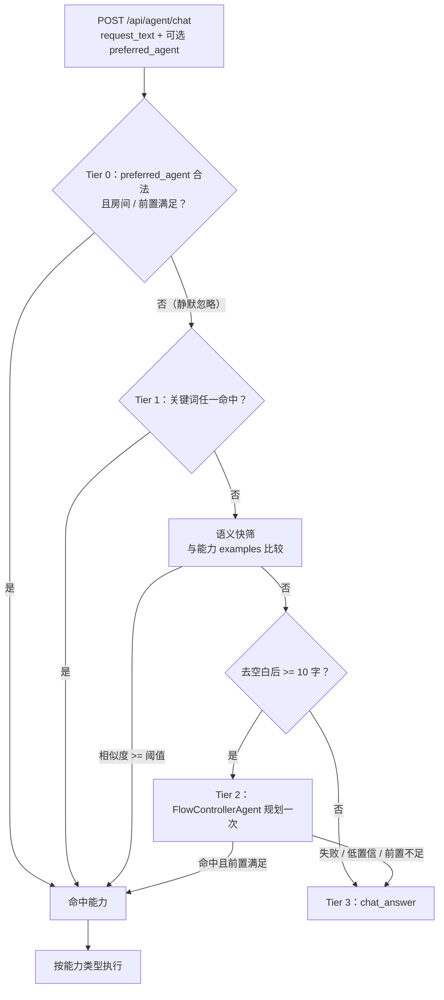
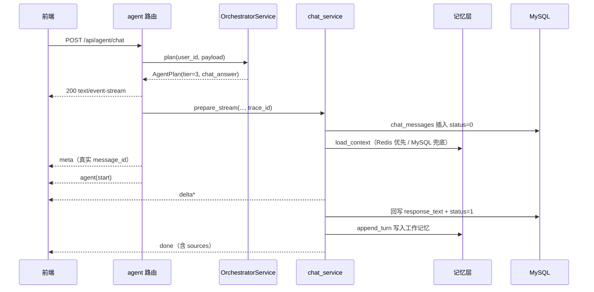
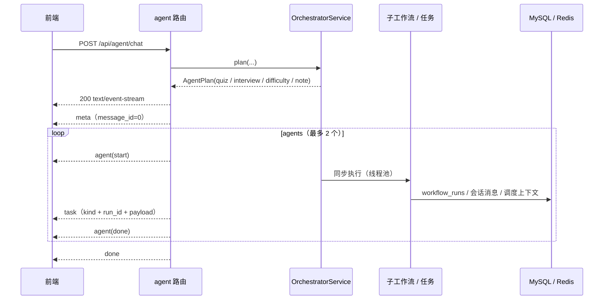
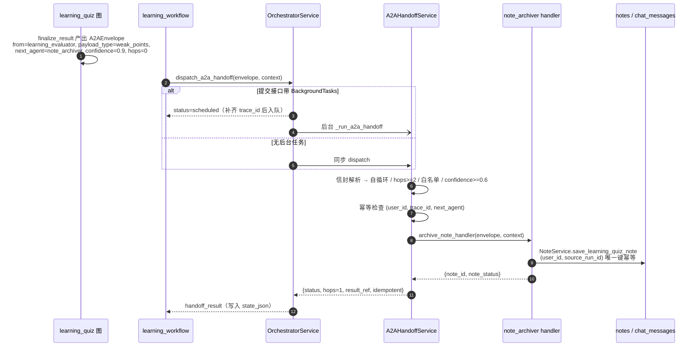
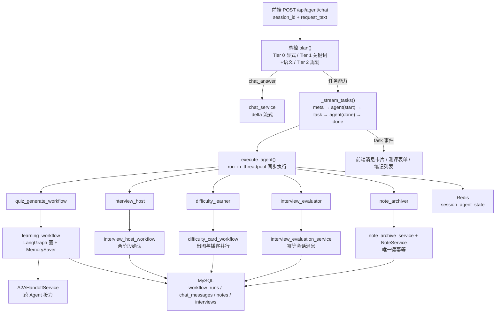
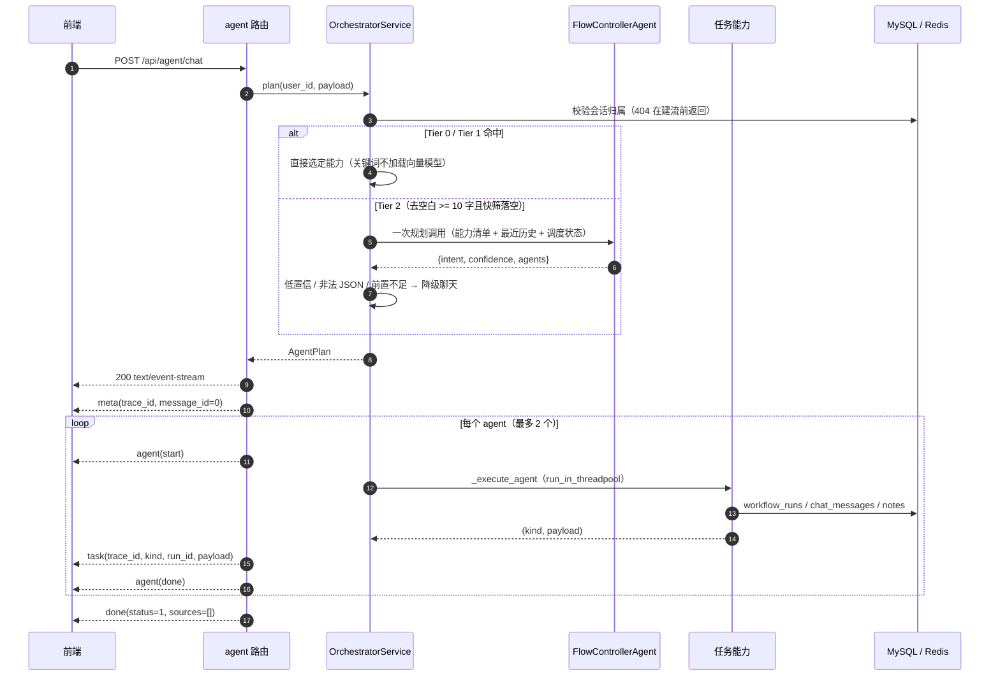
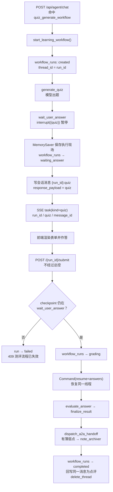

# 流程总控与多智能体调度 · 实现思路

> 入口：`POST /api/agent/chat`（SSE，唯一总控入口）、`GET /api/agent/capabilities`（能力下发）
> 实现位置：`app/routers/agent.py`、`app/schemas/agent.py`、`app/services/orchestrator_service.py`、
> `app/agent/registry.py`、`app/agent/agents/flow_controller.py`、`app/services/session_agent_state.py`
> 学习测评内部实现见 [`learning-workflow-api-guide.md`](learning-workflow-api-guide.md)，
> 面试准备见 [`interview-host-verification-guide.md`](interview-host-verification-guide.md)，
> 知识卡见 [`difficulty-card-guide.md`](difficulty-card-guide.md)。
> 旧入口 `POST /api/agent/tasks/start` 已下线。

---

## 1. 要解决的问题

旧总控要求前端先选智能体（`agent_name`），且面试间默认 `interview_host` + `direct=True`，
任何一句话都会触发面试准备工作流；同时工作流返回 JSON、聊天返回 SSE，前端要维护两套协议。

新架构把「选谁干活」完全收拢到后端：

- 前端只发一句自然语言（可带一个**一次性** `preferred_agent` 快捷提示）；
- 后端按「显式指令 → 快筛 → LLM 规划 → 聊天」三层路由，统一用 SSE 返回；
- 可用能力由注册表下发，前端快捷按钮与后端路由共用同一份事实来源；
- 前置数据不满足的能力不参与路由，自动降级为聊天，而不是硬调后 4xx。

---

## 2. 分层与职责

| 层 | 文件 | 职责 |
| --- | --- | --- |
| 路由 | `app/routers/agent.py` | `POST /chat` 只返回 SSE；`GET /capabilities` 返回能力列表 |
| 校验 | `app/schemas/agent.py` | `AgentChatIn` / `AgentCapabilityOut` |
| 注册表 | `app/agent/registry.py` | 能力声明：房间、触发关键词 / 语义示例、前置数据、产物类型 |
| 业务 | `app/services/orchestrator_service.py` | 三层路由、执行分发、统一事件流 |
| 业务 | `app/agent/agents/flow_controller.py` | LLM 规划器（仅歧义时调用一次） |
| 业务 | `app/services/session_agent_state.py` | 会话级调度上下文（Redis 优先，MySQL 兜底） |
| 业务 | `app/services/chat_service.py` | 聊天分支：落库、记忆、RAG、SSE 增量 |
| 业务 | `app/services/semantic_intent.py` / `embedding.py` | 快筛语义比较（fastembed 共享实例） |

路由层不写业务判断；能力注册表是「能调什么」的唯一事实来源，规划器只能从注册表给定的能力中挑选。

---

## 3. 能力注册表

| 能力 | 房间 | 类型 | 触发关键词 | 前置数据 | `task.kind` |
| --- | --- | --- | --- | --- | --- |
| `chat_answer` | 0 / 1 | chat | —（兜底） | 无 | —（走 delta） |
| `quiz_generate_workflow` | 0 | workflow | 出题 / 刷题 / 题目 / 试题 / 练习题 / 练习 / 测验 / 测评 / 小测 / 面试题 / 考考 | 无 | `quiz` |
| `interview_host` | 1 | workflow | 开始面试 / 模拟面试 / 面试开始 / 准备面试 / 我准备好了 / 来场面试 / 开始模拟 / 约面试 / 面试一下吧 | `session_mode=1` + 简历 | `interview_prepare` |
| `interview_evaluator` | 1 | task | 复盘 / 面试复盘 / 总结面试 / 面试总结 / 点评面试 / 面试评价 / 面试表现 | `session_mode=1` + 本会话有已结束面试 | `interview_evaluation` |
| `difficulty_learner` | 0 / 1 | task | 知识卡 / 难点 / 讲解 / 详细讲 / 展开讲 / 讲一讲 / 科普 / 图解 / 梳理 / 深入讲 / 解释一下 / 是什么原理 | 无 | `knowledge_card` |
| `note_archiver` | 0 / 1 | task | 笔记 / 归档 / 整理成笔记 / 记录下来 / 总结成笔记 / 存成笔记 | 本会话有已完成测评或已结束面试 | `note` |

- 关键词至少双字，避免「题 / 讲」这类单字误命中。
- 各能力同时登记 `examples` 与阈值（0.65~0.68），关键词全部落空后才做语义比较。
- **登记顺序即快筛优先级**：先命中的能力先调度。
- `requires` 只在路由阶段判断；不满足的能力既不会被快筛命中，也不会被规划器选中。

---

## 4. 三层路由



要点：

- **Tier 0 是提示不是命令**：`preferred_agent` 未知、房间不符、前置数据缺失时静默忽略，继续走后续路由。
- **Tier 1 不调用大模型**：关键词命中时连向量模型也不会加载，延迟最低。
- **Tier 2 只调用一次模型**：规划器输出固定 JSON（`intent / confidence / reason / reply / agents`），
  `confidence < 0.6`、JSON 非法、模型异常一律返回 `None` 并降级聊天；最多返回 2 个能力。
- **前置过滤在规划之后再做一遍**：规划器给出无简历的 `interview_host` 也会被丢弃。
- **Tier 3 聊天是默认行为**，不需要显式标记。

---

## 5. 执行层：统一 SSE 事件协议

### 5.1 事件

| 事件 | 载荷 | 说明 |
| --- | --- | --- |
| `meta` | `{session_id, message_id, request_id, trace_id}` | 流开始；`trace_id` 贯穿本轮 |
| `agent` | `{trace_id, from, to, phase, reason}` | 调度可观测性；`phase` 取 `start / done`，`from` 固定 `flow_controller` |
| `delta` | `{content}` | 仅聊天分支的增量文本 |
| `task` | `{trace_id, kind, run_id, payload}` | 任务产物；`kind` 见第 3 节 |
| `done` | `{message_id, status, sources, trace_id}` | 流结束；`status=1`，任务分支 `sources` 为空 |
| `error` | `{code, message}` | 失败收尾；`code` 取业务异常状态码或 `502` |

- 事件顺序固定：`meta → agent(start) → delta* / task → agent(done) → done`，失败以 `error` 收尾。
- `message_id` 语义：聊天分支为落库后的真实消息 ID；任务分支 `meta.message_id=0`，前端以 `task.payload.message_id` 对账。
- 编码统一走 `chat_service.sse_event()`，`json.dumps(..., default=str)` 兜底 `datetime / Decimal` 等非 JSON 原生类型。

### 5.2 聊天分支



聊天分支完全复用 `chat_service.prepare_stream()` + `stream_reply()`，与 `/api/sessions/{id}/stream-chat`
的事件格式一致；总控只额外补充 `trace_id` 与 `agent` 事件。

### 5.3 任务分支



- 子能力同步执行，异常转成 `error` 事件并结束本轮（已发出的 `meta` / `agent(start)` 保留）。
- 任务消息由子工作流自行写入（Phase 1 保持现状）；笔记额外补一条幂等会话消息
  `request_id="note:{note_id}"`，便于历史回放。
- 面试准备没有会话消息，`task.payload.message_id` 为 `0`；面试复盘复用已落库的
  `request_id="interview:{id}:evaluation"` 消息，`message_id` 指向该条。
- 结束面试的自动复盘走路由层 `BackgroundTasks`（`INTERVIEW_EVAL_AUTO` 控制），
  与用户手动触发的复盘共用同一幂等消息，生成中重复触发返回 `409`。

### 5.4 `task.payload` 形状

| kind | 关键字段 |
| --- | --- |
| `quiz` | `run_id / status / quiz / message_id / question_count` …（`learning_workflow` 返回体） |
| `interview_prepare` | `run_id / status=pending_confirmation / background / resume` |
| `knowledge_card` | `run_id / status / title / resource_id / image_url / audio_resource_id / audio_url` |
| `interview_evaluation` | `run_id="interview:{id}" / interview_id / status / score / strengths / weaknesses / review / message_id` |
| `note` | `run_id / note_id / status / title / message_id`（面试来源的 `run_id` 为 `interview:{id}`） |

前端 `src/api/conversation.ts` 按 `kind` 把 payload 转成 `AgentTaskResult` 联合类型。

### 5.5 A2A 接力

学习测评 `finalize_result` 产出 `A2AEnvelope`（`trace_id=run_id`、`hops=0`、有薄弱点时 `next_agent=note_archiver`），
`learning_workflow` 提交后调用总控 `dispatch_a2a_handoff()`，由 `A2AHandoffService` 做白名单 / 置信度 / 跳数校验并路由 handler。

跨 Agent 通信不直接调用下游代码：上游只表达接力意图（信封），派发服务负责校验、幂等与 handler 路由。



- 信封字段：`from_agent / payload_type / payload / next_agent / confidence / trace_id / intent / hops / result_ref / alternatives`；
- `hops >= MAX_HOPS(2)` 或 `next_agent == from_agent` 直接拒绝，防止接力死循环；
- 已完成派发按 `(user_id, trace_id, next_agent)` 进程内幂等（TTL 1 小时、最多 256 条），重复命中返回 `idempotent=true`；
- 结果结构 `{status, from_agent, next_agent, trace_id, hops, result_ref, result, reason, idempotent}`，pending / failed / rejected 不缓存。

### 5.6 总控与任务能力的协作全景

总控只负责「选谁 + 统一事件流」，能力内部的步骤（工作流 / 并行 / 同步服务）各自实现；
两者之间只通过 `_execute_agent()` 的同步调用与 `(kind, payload)` 返回值耦合。



| 能力 | 执行方式 | 是否跨请求 | 会话消息 | 后续入口 |
| --- | --- | --- | --- | --- |
| `quiz_generate_workflow` | LangGraph 状态机，`interrupt()` 暂停 | 是 | `{run_id}:quiz` | `POST /api/learning-workflows/{run_id}/submit` |
| `interview_host` | 两阶段服务 | 是（确认背景） | `{run_id}:interview`（confirm 时写入） | `POST /api/interviews/confirm` |
| `difficulty_learner` | 出图 / 播客并行 | 否 | `{run_id}:card` | 直接渲染知识卡 |
| `interview_evaluator` | 同步评审 | 否 | `interview:{id}:evaluation` | 渲染复盘卡片 |
| `note_archiver` | 同步归档 | 否 | `note:{note_id}` | 笔记本列表 |

一次任务请求的通信时序（含 Tier 2 规划）：



### 5.7 学习测评：总控与跨请求工作流的协作

测评是唯一跨两次用户请求的工作流：总控只负责「出题」这一跳，答题提交绕过总控，
直接调用 `learning-workflows` 接口并用 `run_id` 恢复同一个 LangGraph 线程。



| 通道 | 方向 | 协议 / 载体 | 关键标识 |
| --- | --- | --- | --- |
| 出题请求 | 前端 → 总控 | `POST /api/agent/chat`（SSE） | `trace_id`；命中后 `task.kind=quiz` |
| 出题结果 | 总控 → 前端 | SSE `task.payload` | `run_id / quiz / message_id` |
| 答题提交 | 前端 → 工作流接口 | `POST /api/learning-workflows/{run_id}/submit`（JSON 信封） | `run_id + user_id` |
| 暂停 / 恢复 | 工作流 → LangGraph | `interrupt()` / `Command(resume=answers)` | `thread_id = run_id` |
| 状态持久化 | 工作流 → MySQL | `workflow_runs.state_json` + `status` | `run_id` |
| 执行现场 | 工作流 → MemorySaver | 进程内 checkpoint | 重启即失效 → `409` |
| 下游接力 | 工作流 → 总控 → A2A | `dispatch_a2a_handoff(A2AEnvelope)` | `trace_id / hops / next_agent` |

提交不经总控是刻意选择：作答是对确定 `run_id` 的显式动作，不需要再走一遍意图路由；
总控只在「自然语言 → 能力」这一层出现。

---

## 6. 会话级调度上下文

`app/services/session_agent_state.py` 维护当前会话的调度记忆，供规划器解析指代：

- Redis key `agent:session:{user_id}:{session_id}`，TTL 8 小时，内容为
  `last_intent / last_agent / last_run_id / last_run_status / last_completed_run_id / last_interview_id / last_message_id`。
- 读取时以 MySQL（`workflow_runs` / `interviews`）为事实来源，Redis 只补充最近调度信息；
  Redis 未命中 / 过期 / 异常一律回源数据库。
- 任务执行成功后 `record_dispatch()` 写入；写失败只记日志，不影响本轮响应。
- 所有查询都带 `user_id`，天然隔离用户数据。

---

## 7. 前端约定

- 所有消息走 `POST /api/agent/chat`，入参 `session_id + request_text`，可选
  `preferred_agent / select_mode / question_count / provider / request_id / request_segments`。
- 快捷按钮选中态是**一次性提示**：发送时 `consume()` 取出并清空，下一轮不再携带。
- 前端解析 `meta / agent / delta / task / done / error`；任务结果按 `kind` 分发：
  知识卡刷新消息卡片、测评刷新并渲染表单、笔记刷新列表与消息、面试准备展示确认卡片。
- 历史消息与 SSE 增量合并时以 `message_id` 为准；任务分支 `meta.message_id=0` 时不参与对账。

---

## 8. 失败与降级

| 场景 | 行为 |
| --- | --- |
| 会话不存在 / 不属于当前用户 | 建立流之前返回 `404` 标准 JSON 信封 |
| 触发聊天 / 任务限流 | 建立流之前返回 `429` |
| `preferred_agent` 未登记 / 房间不符 / 前置不足 | 静默忽略，继续后续路由 |
| 语义模型不可用 / 向量化失败 | 记 WARNING，按未命中继续路由 |
| 规划模型超时 / JSON 非法 / 置信度 < 0.6 | 降级为聊天 |
| 规划结果含未登记能力 / 前置不满足 | 丢弃该能力；全部被丢弃则聊天 |
| 子能力业务异常 | SSE `error`（保留业务状态码），本轮结束 |
| 子能力模型失败 | 子工作流自身记录 `failed` 并抛 `502` / `503`（缺 Key） |
| 聊天模型未配置 | 流建立前 `503` 标准 JSON 信封 |
| 聊天生成中断 / 客户端断开 | 保留已生成内容，消息 `status=2` |

---

## 9. 扩展一个新能力

1. 在 `app/agent/registry.py` 的 `CAPABILITIES` 追加一条 `AgentCapability`
   （名称、房间、`kind`、关键词 / 示例、阈值、前置数据、产物类型）。
2. 在 `OrchestratorService._execute_agent()` 增加同名分支，返回 `(kind, payload)`。
   任务需要会话消息时，按既有约定写 `request_id` 并回填 `message_id`。
3. 前端在 `types/agent.ts` 注册按钮（可选），并在 `conversation.ts` 增加 `kind` 转换。
4. 若需要前置数据，注册表中追加 `requires` 标识并在 `_requires_met()` 补校验。

无需修改路由层与事件协议。

---

## 10. 验证

```bash
pytest tests/test_orchestrator.py tests/test_interview_host.py \
       tests/test_difficulty_card.py tests/test_a2a_handoff.py -q
```

手工验证：

| `request_text` | 预期 |
| --- | --- |
| `来 3 道练习题` | `agent(start)` → `task(kind=quiz, question_count=3)` → `done` |
| `帮我准备面试`（面试间 + 有简历） | `task(kind=interview_prepare, status=pending_confirmation)` |
| `给我讲讲 B+ 树的原理` | `task(kind=knowledge_card)`，含图片与可选音频 |
| `把刚才的测评整理成笔记`（已测评） | `task(kind=note)` |
| `你好` | `meta → agent(start) → delta → done` |
| `开始面试`（学习室 / 无简历） | 降级聊天（`delta`），不产生 `task` |
| `复盘一下这次面试`（已结束面试） | `task(kind=interview_evaluation)`，含 `score / strengths / weaknesses / review` |

### 回归清单

| 类别 | 用例 | 预期 |
| --- | --- | --- |
| Tier 0 | 携带合法 `preferred_agent` | 直接命中；`meta → agent(start) → task → agent(done) → done` |
| Tier 0 降级 | `preferred_agent` 未登记 / 房间不符 / 前置不足 | 静默忽略，继续后续路由，不返回错误 |
| Tier 1 关键词 | 命中任务触发词 | 不加载向量模型、不调用规划模型，直接产生 `task` |
| Tier 1 语义 | 无关键词但接近能力 `examples` | 命中对应能力；模型异常只记 WARNING |
| Tier 2 规划 | 快筛落空且去空白后 ≥ 10 字 | 最多一次规划调用；低置信度 / JSON 非法 / 超时降级聊天 |
| Tier 3 聊天 | 「你好」 | `delta` 流式回复，无 `task` |
| 任务产物 | 五类 `task.kind` | 字段齐全；任务分支 `meta.message_id=0`，以 `task.payload.message_id` 对账 |
| 前置降级 | 无简历 / 无已完成测评或面试 / 房间不符 | 不产生 `task`，本轮降级聊天 |
| 幂等 | 重复复盘 / 重复归档同一笔记 | 生成中返回 `409`；已完成复用同一会话消息 |
| 失败 | 模型异常 `502` / 缺 Key `503` | SSE `error` 收尾，已发出的 `meta` / `agent(start)` 保留，run 置 `failed` |
| 越权 | 他人 session / run / interview | 建流前 `404`，任务内越权同样 `404` |
| 限流 | 同用户超过 20 次/分钟 | 建立流之前返回 `429` 标准 JSON 信封 |
| 断流 | 客户端中途断开 | 已生成聊天内容保留，消息 `status=2` |
| A2A | `hops >= 2` / 指向自身 / 重放同一 `(trace_id, next_agent)` | 拒绝或返回 `idempotent=true`，不重复落库 |

### 轻量压测

- 同一账号并发 10 / 30 个 `/api/agent/chat` 请求：配额内应正常建立流，超限返回 `429`，Redis 计数 key 到期自动释放。
- Redis 不可用时确认降级为进程内计数、接口不返回 5xx（只记节流 WARNING）。
- 知识卡等长任务单轮约 1～3 分钟，压测并发不要超过 `RATE_LIMIT_CHAT_MAX`，避免请求在任务开始前就被限流。
