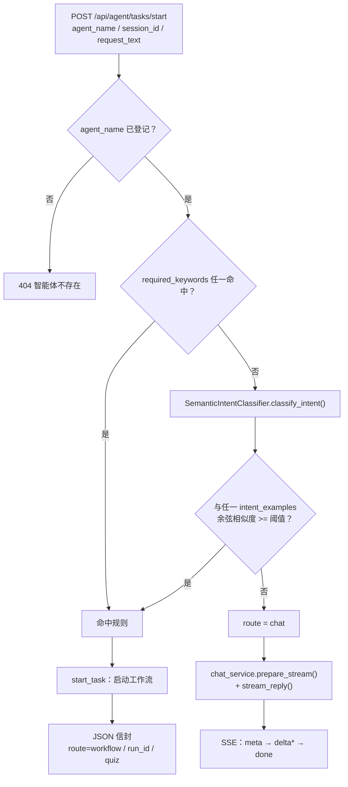
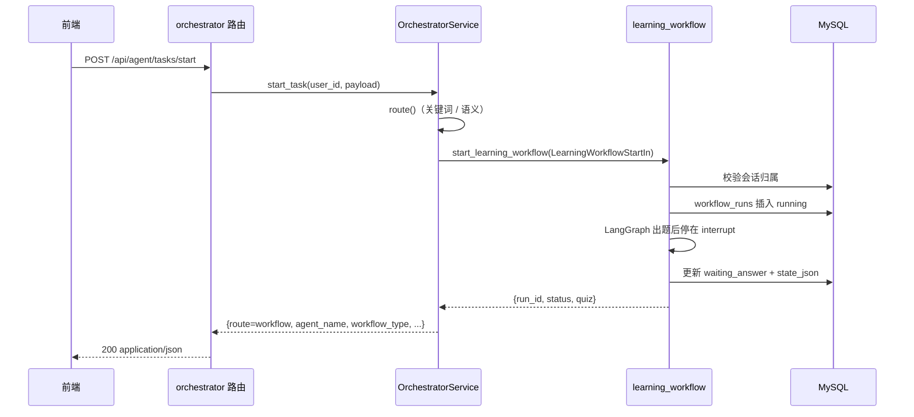
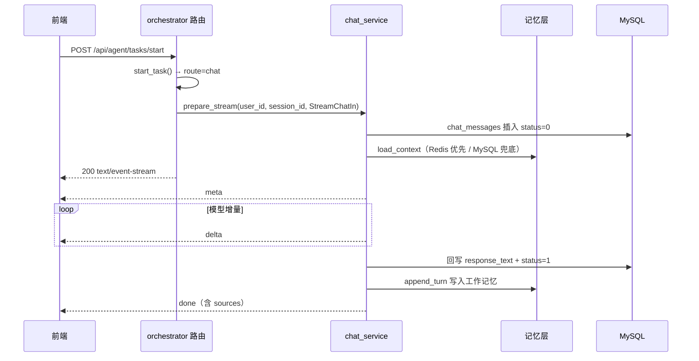
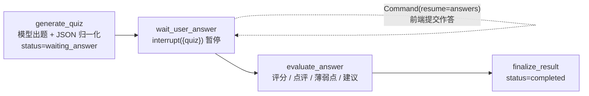
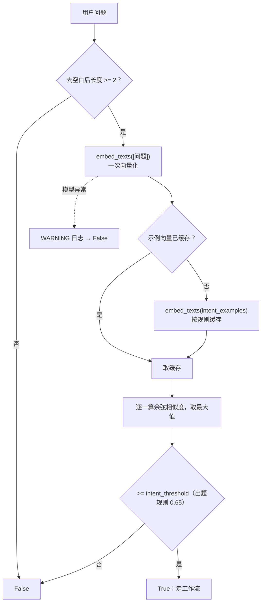

# 流程总控与学习测评工作流 · 实现思路

> 入口：`POST /api/agent/tasks/start`
> 实现位置：`app/routers/orchestrator.py`、`app/services/orchestrator_service.py`、`app/services/semantic_intent.py`、`app/services/embedding.py`、`app/agent/workflows/learning_quiz.py`、`app/services/learning_workflow.py`
> 接口联调步骤见 [`learning-workflow-api-guide.md`](learning-workflow-api-guide.md)。

---

## 1. 要解决的问题

前端原本需要自己判断「这句话该发起测评，还是普通聊天」，导致意图规则散落在客户端。
总控入口把判断收拢到后端：

- 前端只传 `agent_name` + `session_id` + `request_text`；
- 后端决定：**启动工作流**（JSON 信封）或 **通用流式聊天**（SSE）；
- 新增工作流时只加一条规则 + 一个分支，不改前端契约。

---

## 2. 分层与职责

| 层 | 文件 | 职责 |
| --- | --- | --- |
| 路由 | `app/routers/orchestrator.py` | 单入口双响应：JSON / SSE；不写业务判断 |
| 校验 | `app/schemas/orchestrator.py` | `AgentTaskStartIn` / `AgentTaskWorkflowOut` |
| 业务 | `app/services/orchestrator_service.py` | 规则表、路由决策、入参映射 |
| 业务 | `app/services/semantic_intent.py` | 语义意图判断（示例向量 + 余弦阈值） |
| 业务 | `app/services/embedding.py` | fastembed 共享实例（懒加载 + 串行化） |
| 编排 | `app/agent/workflows/learning_quiz.py` | 单图：出题 → `interrupt` 等待作答 → 评分 → 完成 |
| 编排 | `app/agent/workflows/checkpoint.py` | 全局 `MemorySaver` + `thread_id` 配置 |
| 业务 | `app/services/learning_workflow.py` | 发起 / 恢复图 + `workflow_runs` 持久化 |

---

## 3. 路由决策



要点：

- **关键词优先**：命中时不会加载 / 调用向量模型，降低延迟。
- **语义兜底**：解决「说法不同、意思一样」，如「检验一下我对数据库索引的掌握程度」。
- **未命中即聊天**：这是默认行为，不需要显式标记。

---

## 4. 两条分支的时序

### 4.1 工作流分支（JSON）



### 4.2 聊天分支（SSE）



聊天分支完全复用 `/api/sessions/{id}/stream-chat` 的服务函数与 SSE 事件格式，
前端可以用同一套解析逻辑。

---

## 5. 学习测评工作流内部（LangGraph 单图 + interrupt）



- 单图跨两次 HTTP 请求：`start` 执行到 `interrupt()` 暂停，`submit` 用
  `Command(resume=answers)` 从暂停点继续；`run_id` 同时是 `workflow_runs.run_id`
  和 LangGraph `thread_id`（`build_thread_config(run_id)`）。
- **双存储**：`workflow_runs.state_json` 只存业务快照；执行现场在
  `MemorySaver` checkpoint（`app/agent/workflows/checkpoint.py` 的进程级单例）。
- 状态集合 `created / waiting_answer / grading / completed / failed`；完成后
  尽力 `delete_thread(run_id)` 释放 checkpoint。
- **checkpoint 失效**：`MemorySaver` 在进程内，服务重启 / 多进程后旧 `run_id`
  无法恢复。提交前校验 `get_state(config).next == ("wait_user_answer",)` 且快照含
  quiz，否则不 resume（LangGraph 会从 START 重新出题），记录置 `failed` 并返回
  `409 测评流程已失效，请重新发起测评`。
- 标准答案不落库、不返回前端；评分由提交时的模型调用完成。
- **动态提示词**：出题读 `quiz_generate/quiz`、评分读 `interview_evaluator/evaluation`
  的生效模板（公共 + 私有拼接并注入用户画像，`prompt_template_service.get_rendered_prompt`），
  再追加静态 JSON 契约（题型 `radio / checkbox / textarea`、评分 `display_text / score /
  items / weaknesses / review`）；模板读取异常只记 WARNING 并降级为内置角色提示词。
- 题目 JSON 由 `parse_json_object()` 统一解析，提示词中的 JSON 示例用静态 `SystemMessage` 传入，避免被模板引擎当成占位符。
- **会话消息持久化**：出题成功后写一条 `chat_messages`（`request_id="{run_id}:quiz"`、
  `response_text` 固定文案、`response_payload` 为 quiz 数组、`select_mode=2`、`status=1`），
  前端直接渲染表单；评分完成后更新同一条消息为点评文本（`display_text`，过短时兜底拼接）
  并清空 `response_payload`，不新增消息。消息读写失败只记 WARNING，不影响测评结果。

---

## 6. 语义兜底的实现细节



- 模型 `BAAI/bge-small-zh-v1.5` 由 `app/services/embedding.py` 共享给长期记忆与总控，只加载一份。
- 初始化与推理共用一把锁：启动预热线程与首个请求不会并发初始化模型。
- 示例向量用 `lru_cache` 按规则缓存；测试可通过 `semantic_intent._cache_clear()` 清理。
- 任何异常都降级为「未命中」，不会阻断请求、也不会凭空升级成工作流。

---

## 7. 参数

| 参数 | 值 | 位置 |
| --- | --- | --- |
| 关键词 | 出题 / 刷题 / 题目 / 试题 / 练习题 / 练习 / 测验 / 测评 / 小测 / 面试题 / 考考 | `WORKFLOW_ROUTE_RULES` |
| 语义阈值 | 0.65（字段默认 0.6，出题规则显式覆盖） | `WorkflowRouteRule.intent_threshold` |
| 语义最短长度 | 2 字 | `semantic_intent.INTENT_MIN_CHARS` |
| 向量模型 | `BAAI/bge-small-zh-v1.5` | `embedding.EMBED_MODEL` |
| 题量 / 上限 | 未传时从需求提取（如「出 3 道题」），仍无则 5；上限 20 | `services/learning_workflow.py` `infer_question_count` |
| 预热线程 | 守护线程，失败只告警 | `main.py` `lifespan` |

---

## 8. 扩展一个新工作流

1. 在 `WORKFLOW_ROUTE_RULES` 增加一条 `WorkflowRouteRule`：

   ```python
   "interview_workflow": WorkflowRouteRule(
       workflow_type="mock_interview",
       required_keywords=("模拟面试", "面试练习"),
       intent_examples=("陪我模拟一次面试", "我想练习一下面试"),
       intent_threshold=0.6,
   )
   ```

2. 在 `OrchestratorService.start_task()` 增加对应 `workflow_type` 的分支，显式构造该工作流的入参。
3. 路由层无需改动：工作流分支继续返回 JSON 信封。
4. 若工作流需要独立响应字段，新增 `AgentTaskXxxOut` 或在出参中增加可选字段。

规则指向未实现的 `workflow_type` 时返回 `500`，用于尽早暴露配置错误。

---

## 9. 失败与降级

| 场景 | 行为 |
| --- | --- |
| `agent_name` 未登记 | `404 智能体不存在` |
| 语义模型不可用 / 向量化失败 | 记 WARNING，按未命中走聊天 |
| 工作流模型失败 / 输出非法 JSON | 运行记录置 `failed`，返回 `502` |
| 提交时 checkpoint 丢失（服务重启 / 多进程） | 运行记录置 `failed`，返回 `409 测评流程已失效` |
| 工作流 LLM 未配置 | `503` |
| 聊天模型未配置 | `503`（流建立前返回标准错误信封） |
| 聊天生成中断 / 客户端断开 | 保留已生成内容，`status=2` |
| 会话不存在 / 不属于当前用户 | `404`（工作流与聊天分支统一） |

---

## 10. 验证

```bash
pytest tests/test_orchestrator.py tests/test_semantic_intent.py \
       tests/test_learning_workflow.py -q
```

手工验证（三种典型请求）：

| `request_text` | 预期 |
| --- | --- |
| `帮我出 3 道 Python 基础题` | JSON，`route=workflow`，`status=waiting_answer` |
| `检验一下我对数据库索引的掌握程度` | JSON（关键词未命中，语义兜底命中） |
| `你好，介绍一下你自己` | `text/event-stream`，`meta → delta → done` |

工作流分支返回的 `run_id` 可直接用于 `POST /api/learning-workflows/{run_id}/submit`。
