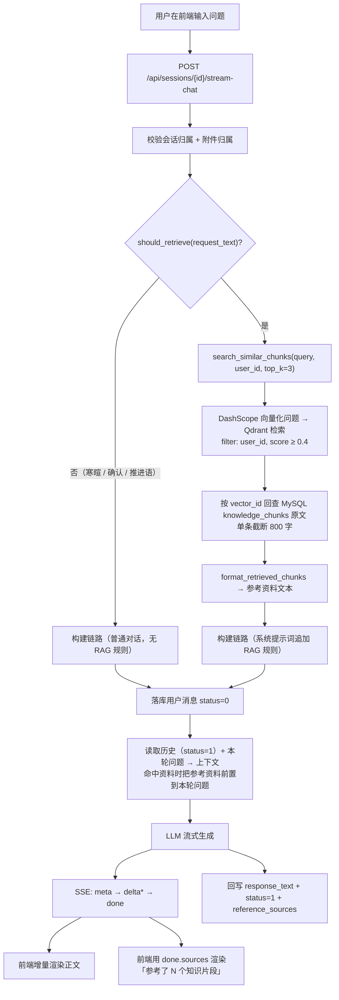
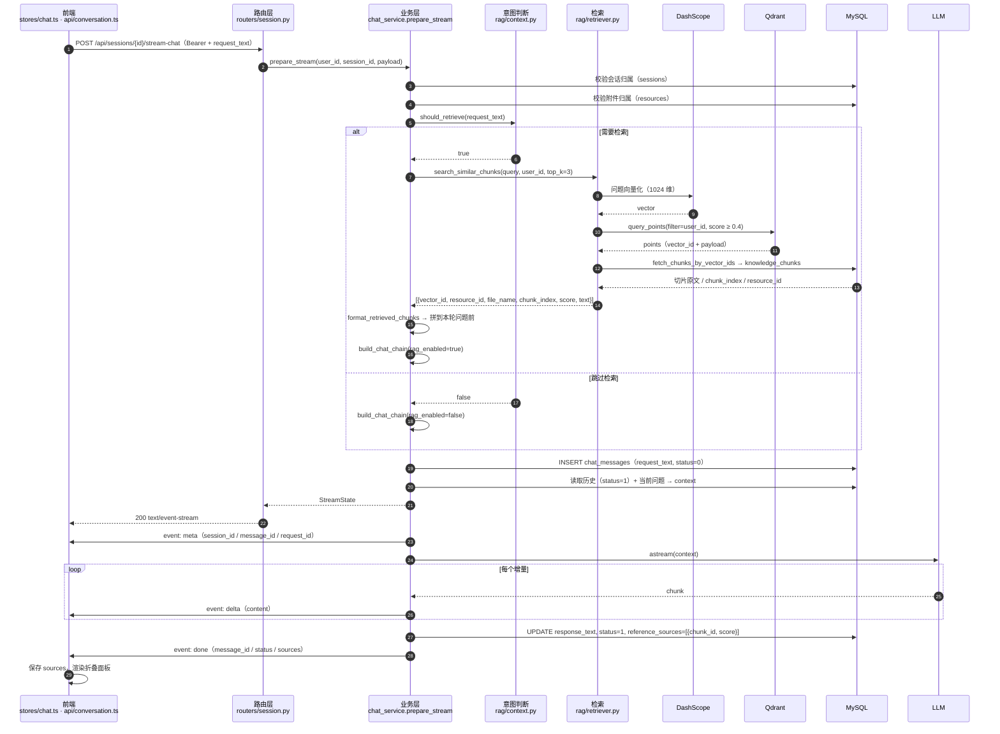
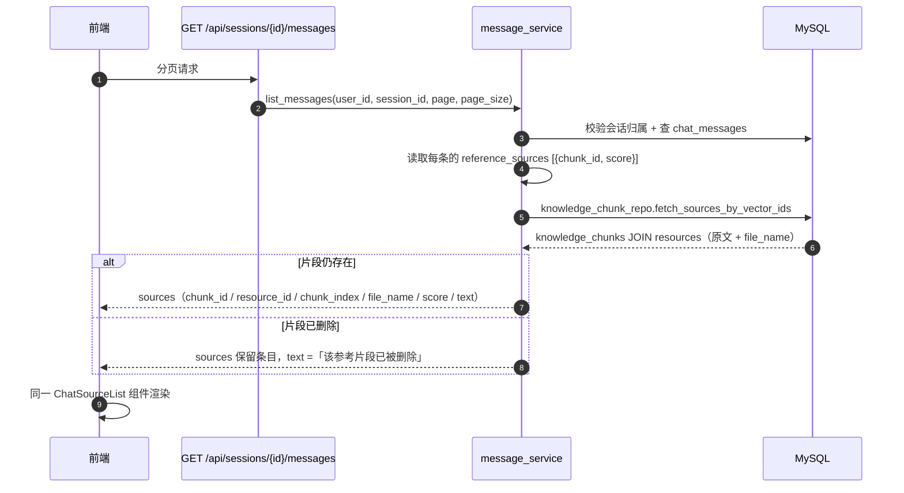
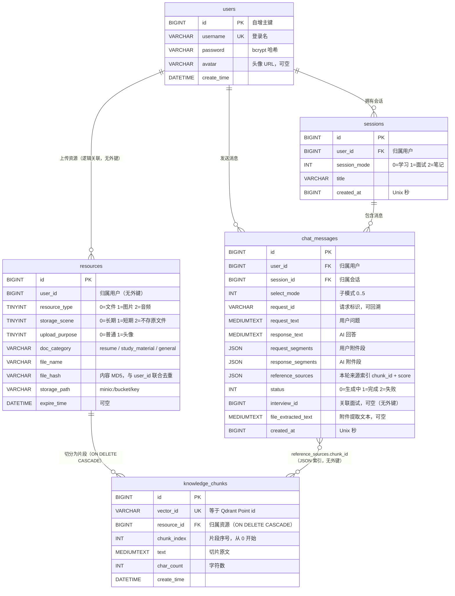
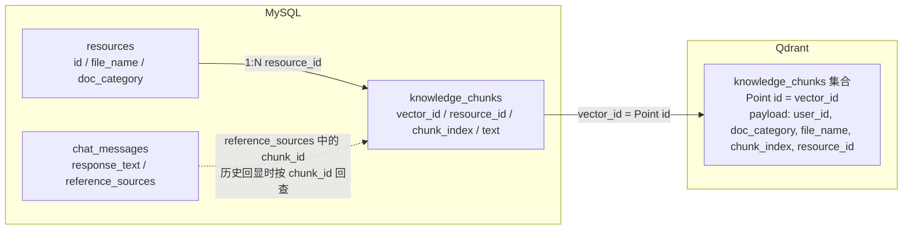

# RAG 对话数据流：从用户提问到 AI 回复

本文梳理一次「用户提问 → 按需检索知识库 → 注入上下文 → 流式生成 → 来源回显」的完整链路，对应代码为 `app/services/chat_service.py`（后端编排）与 `agent-frontend/src/stores/chat.ts` + `src/api/conversation.ts`（前端流式渲染）。

知识库的**入库**链路（上传 → 解析 → 分块 → 向量化 → 双写 Qdrant / MySQL）见 [`doc-upload-rag-guide.md`](doc-upload-rag-guide.md) 与 [`recursive-chunking.md`](recursive-chunking.md)，本文只覆盖提问之后的检索与生成。

---

## 1. 总览



分支与降级：

| 情况 | 行为 |
| --- | --- |
| 空 / 极短 / 寒暄 / 确认 / 推进语 | 不检索，普通对话，`sources` 为空数组 |
| 检索命中 | 资料拼到本轮问题前，系统提示词追加 RAG 回答规则 |
| 检索无命中（低于 0.4 或用户无文档） | 按普通对话回答，`sources` 为空数组 |
| 检索抛异常（Qdrant / 向量化不可用） | 记 WARNING，本轮降级为无资料，不阻断流式生成 |
| 生成失败 / 客户端断开 | 保留已生成正文，`status=2`，不写 `reference_sources` |

---

## 2. 时序图



---

## 3. 逐步说明

### 3.1 前端发起请求

- `stores/chat.ts` 的 `sendMessage` 先插入一条本地「生成中」消息（`status=0`，`sources: []`），再调用 `api/conversation.ts` 的 `streamChat`（`src/stores/chat.ts:120`）。
- 请求为 `POST /api/sessions/{session_id}/stream-chat`，请求体 `{request_text, select_mode?, request_id?, request_segments?}`。因 `EventSource` 不支持 POST + Authorization，前端用 `fetch` 读响应体，401 时手动续期后重试一次（`src/api/conversation.ts:245`）。

### 3.2 后端预处理（建立流之前）

`chat_service.prepare_stream`（`app/services/chat_service.py:141`）依次完成：

1. **会话归属校验**：`session_repo.get_for_user`，不存在或不属于当前用户统一 `404`。
2. **附件归属校验**：`request_segments` 中的 `resource_id` 必须属于当前用户，越权 `404`。
3. **意图判断**：`should_retrieve(request_text)`（`app/rag/context.py:77`）去掉空白 / 标点后长度 `< 5`，或整句只由确认语 / 礼貌语 / 推进语组成时返回 `False`。
4. **检索**：需要时调用 `search_similar_chunks(request_text, user_id, top_k=3)`；异常只记日志并返回空列表（降级）。
5. **构建链路**：`build_chat_chain(session_mode, select_mode, rag_enabled=bool(retrieved))`；命中资料时系统提示词追加 `RAG_SYSTEM_PROMPT`，要求优先依据资料、用 `[1] [2]` 标注来源。
6. **落库用户消息**：`status=0`，`reference_sources` 暂为空。
7. **构建上下文**：`memory.build_context` 取最近 `MEMORY_MAX_TURNS` 轮 `status=1` 的历史，命中资料时把 `format_retrieved_chunks` 生成的文本拼在本轮问题前。

> 检索用**原始问题**，注入用**增强后的问题**：前者保证意图判断不被参考资料干扰，后者让模型看到 `[1] [2]` 编号。

### 3.3 检索细节（`app/rag/retriever.py`）

| 步骤 | 说明 |
| --- | --- |
| 问题向量化 | `_embed([question])[0]`，与入库共用 `text-embedding-v4` / 1024 维，保证同一向量空间 |
| 集合检查 | `knowledge_chunks` 不存在直接返回 `[]`（用户尚未上传文档） |
| 过滤条件 | `user_id` 必带；`doc_category` 可选（供按分类收窄的调用方使用，当前聊天链路不传） |
| 打分与截断 | COSINE，`score_threshold=0.4`，`limit=top_k`；单条 `text` 截断到 800 字 |
| 回表补原文 | Qdrant 只存向量与过滤字段，按 `vector_id` 查 MySQL `knowledge_chunks`；向量存在但原文缺失时跳过该条 |
| 返回结构 | `vector_id / resource_id / file_name / doc_category / chunk_index / score / text`，按相似度降序 |

### 3.4 流式生成与落库（`app/services/chat_service.py:203`）

```text
meta  {session_id, message_id, request_id}   服务端已落库，前端替换本地临时 id
delta {content}                              增量正文，前端追加渲染
done  {message_id, status, sources}          正文与来源已持久化
error {code, message}                        生成失败（保留已生成的部分正文）
```

- 成功：`update_result(message_id, text, 1, reference_sources)`，随后下发 `done`。
- `reference_sources` 只存 `[{chunk_id, score}]`；正文全文留在 `knowledge_chunks`，消息表不重复保存。
- 失败 / 断开：`_persist_failed` 写入已生成正文并置 `status=2`，不下发 `done`，前端将消息标记为失败。

### 3.5 前端渲染

- `delta`：`stores/chat.ts` 累加 `received` 并写回 `responseText`，消息气泡按 Markdown 实时渲染。
- `done`：`handlers.onDone` 把 `sources` 挂到当前消息（`src/stores/chat.ts:161`），**不拼进 `responseText`**。
- `ChatMessageItem.vue` 在 AI 回答下方渲染 `ChatSourceList.vue`：默认收起的 `<details>`，标题「参考了 N 个知识片段」；展开后逐条展示文件名、相似度百分比、切片正文，超过 120 字可「展开全文 / 收起」。
- `sources` 为空时组件不渲染；闲聊、无命中、无关问题都不会出现该面板。

### 3.6 历史消息回显



前端 `toMessage` 把后端 snake_case 的 `sources` 归一为 `chunkId / resourceId / chunkIndex / fileName / score / text`（`src/api/conversation.ts:101`），实时与历史共用同一份类型与组件。

---

## 4. 数据表与关联关系

### 4.1 ER 图



> `interviews` 通过 `chat_messages.interview_id`（无外键）与 `interviews.message_id`（唯一外键）双向关联，与 RAG 来源链路无关，图中省略。

### 4.2 跨存储关联（MySQL ↔ Qdrant）



- Qdrant 侧**不存原文**，只存向量与过滤字段；`Point id` 与 MySQL `knowledge_chunks.vector_id` 是两边唯一的对应关系。
- `chat_messages` 与 `knowledge_chunks` 之间**没有外键**：消息只保存 `[{chunk_id, score}]`，历史回显时批量回查；片段被删除后仍保留条目并显示「该参考片段已被删除」。

### 4.3 约束与索引

| 表 | 约束 / 索引 | 作用 |
| --- | --- | --- |
| `resources` | `uk_file_hash_user_id(file_hash, user_id)` | 同一用户同内容只保留一条，上传去重 |
| `knowledge_chunks` | `vector_id` 唯一索引 | 与 Qdrant Point 一一对应，防止错配 |
| `knowledge_chunks` | `uk_chunk_resource_index(resource_id, chunk_index)` | 同一资源内片段序号唯一；重灌按 `resource_id` 整体替换 |
| `chat_messages` | `ix_chat_messages_session_id_created_at(session_id, created_at)` | 按会话分页拉取并按时间排序 |
| `chat_messages` | `request_id` 索引 | 按请求标识回溯流式落库 |
| `sessions` | `user_id` 索引 | 按用户查会话列表 |

### 4.4 关联关系与删除行为

| 关联 | 数据库实现 | 删除行为 | 用途 |
| --- | --- | --- | --- |
| `users` → `sessions` | `sessions.user_id` 外键 | 无级联 | 会话归属与数据隔离 |
| `users` → `chat_messages` | `chat_messages.user_id` 外键 | 无级联 | 消息归属 |
| `sessions` → `chat_messages` | `chat_messages.session_id` 外键 | 无级联；删除会话时由 `session_service` 按 `interviews → chat_messages → sessions` 顺序手动清理 | 会话内消息分页与记忆上下文 |
| `users` → `resources` | `resources.user_id` 普通字段（无外键） | 删除会话时按消息附件段收集后清理，失败交给过期清理重试 | 上传文件归属、用户级去重 |
| `resources` → `knowledge_chunks` | `knowledge_chunks.resource_id` 外键 | **`ON DELETE CASCADE`**，资源删除时切片同步清理 | 切片原文归属 |
| `chat_messages` → `knowledge_chunks` | `reference_sources` JSON 中的 `chunk_id`（无外键） | 无级联；回查缺失时兜底为「该参考片段已被删除」 | 来源索引，避免消息表重复保存全文 |
| `knowledge_chunks` ↔ Qdrant Point | 应用层约定：`vector_id = Point id` | 重灌按 `resource_id` 先删后写；MySQL 失败时回删新向量 | 向量检索后回表取原文 |

---

## 5. 存储与职责边界

| 存储 | 内容 | 说明 |
| --- | --- | --- |
| Qdrant `knowledge_chunks` | 向量 + `user_id` / `doc_category` / `file_name` / `chunk_index` / `resource_id` | 不存原文，只用于近邻检索与过滤 |
| MySQL `knowledge_chunks` | `vector_id` / `resource_id` / `chunk_index` / `text` / `char_count` | 切片原文，`vector_id` 即 Qdrant Point id |
| MySQL `resources` | `file_name` 等元数据 | 历史来源回显时关联取文件名 |
| MySQL `chat_messages` | `request_text` / `response_text` / `reference_sources` | 来源只存 `chunk_id + score` |

职责划分：

- `rag/context.py`：纯文本逻辑，无 IO；判断是否检索、格式化命中片段。
- `rag/retriever.py`：问题向量化 + Qdrant 检索 + 回表取原文，对外只暴露 `search_similar_chunks`。
- `rag/chunk_store.py`：`knowledge_chunks` 读写（`save_chunks` / `fetch_chunks_by_vector_ids`）。
- `services/chat_service.py`：编排检索、上下文、链路与 SSE，不直接操作存储细节。
- `services/ai/memory.py`：只查历史并拼上下文；`prompt_layer.py`：只定义提示词与链路。

---

## 6. 关键参数

| 参数 | 值 | 位置 |
| --- | --- | --- |
| 意图判断最小长度 | 5（去空白标点后） | `app/rag/context.py` `MIN_QUERY_CHARS` |
| 对话注入片段数 | 3 | `app/services/chat_service.py` `RAG_TOP_K` |
| 相似度阈值 | 0.4 | `app/rag/retriever.py` `SCORE_THRESHOLD` |
| 单条切片上限 | 800 字 | `app/rag/retriever.py` `MAX_TEXT_CHARS` |
| 向量维度 | 1024（`text-embedding-v4`） | `app/rag/core.py` |
| 记忆轮数 | `MEMORY_MAX_TURNS`（环境变量） | `app/services/ai/memory.py` |
| 前端折叠阈值 | 120 字 | `agent-frontend/src/components/chat/ChatSourceList.vue` |

---

## 7. 快速验证

1. **实时来源**：上传一份含唯一关键词的文档，提问相关问题时，`done.sources` 非空，回答中带 `[1]`，AI 气泡下方出现「参考了 N 个知识片段」。
2. **闲聊跳过**：发送「好的谢谢」或「继续」，`done.sources` 为空数组，不出现来源面板。
3. **无关问题**：提问与知识库无关的内容，检索无命中，回答正常且无来源面板。
4. **历史回显**：刷新页面后，历史消息仍显示相同来源；删除对应文档后，条目的 `text` 变为「该参考片段已被删除」。
5. **长文本折叠**：切片正文超过 120 字时默认三行截断，可展开全文 / 收起。

对应的后端契约测试见 `tests/test_rag_chat.py`。
