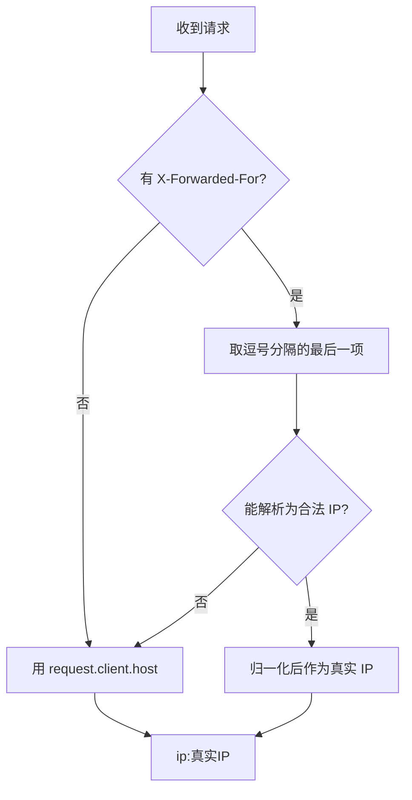
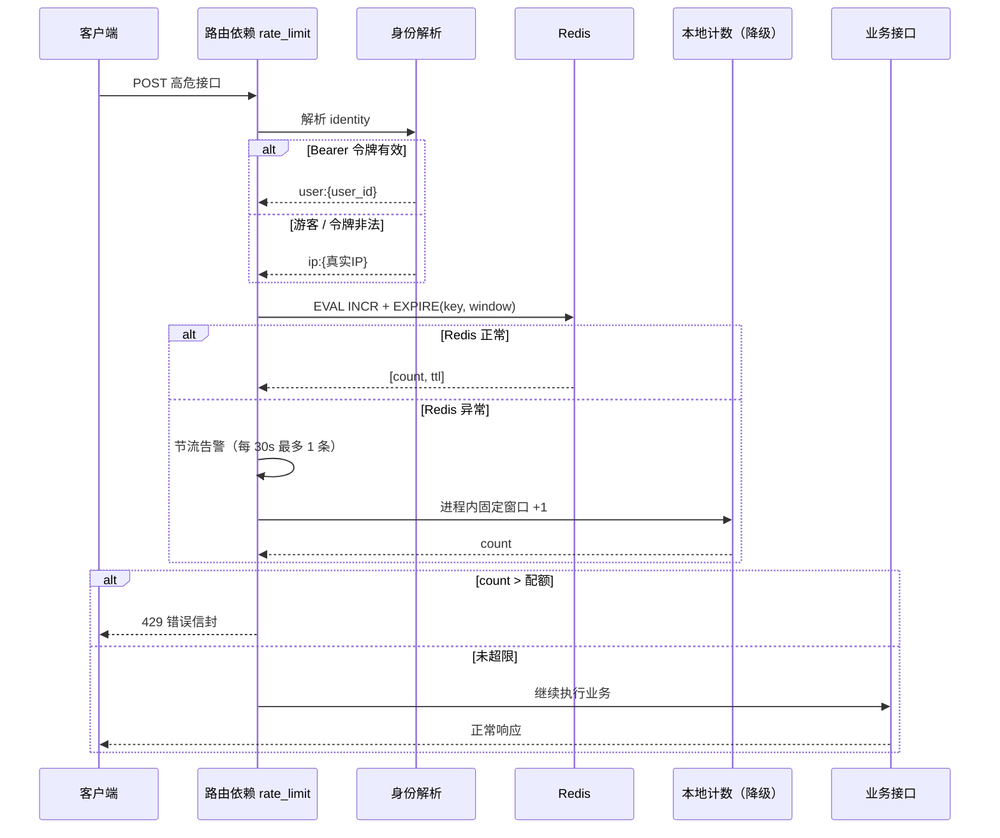
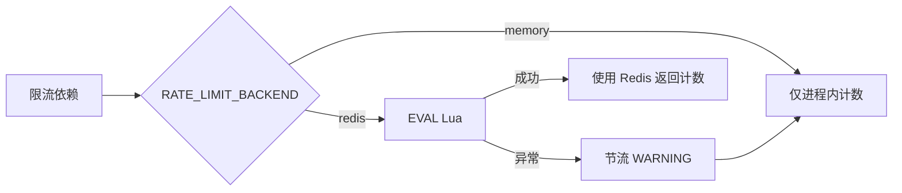

# 接口限流实现与验证指南

> 主题：把「单机进程内限流」升级为「Redis 集群统一固定窗口限流」。
>
> 覆盖：真实 IP 提取、用户 / 游客身份维度、Lua 原子计数、Redis 故障降级、
> 各高危接口配额、部署注意事项与逐条验证命令。
>
> 代码入口：[`app/core/rate_limit.py`](../app/core/rate_limit.py)、
> 配置入口：[`app/core/config.py`](../app/core/config.py)。

---

## 1. 先说结论（一张图）

```
客户端 ──▶ 边缘代理 / Nginx ──▶ 后端实例 A ┐
                │                        ├─▶ Redis：ratelimit:{scope}:{identity}
                └──▶ 后端实例 B ─────────┘         （多实例共享同一份计数）
```

- **计数集中**：所有实例对同一个 key 执行同一段 Lua 脚本，配额是「集群总配额」，
  不会因扩容变成 N × 单机配额。
- **身份优先用户**：带有效访问令牌按 `user_id` 计；否则按真实 IP 计。
- **真实 IP 只信最右**：`X-Forwarded-For` 取**最右侧**一项，客户端伪造左侧无效。
- **降级不崩溃**：Redis 连不上时自动退回进程内计数，接口继续可用；
  告警日志按间隔节流，不会刷屏。

---

## 2. 身份维度：限谁的流

`app/core/rate_limit.py` 的 `_identity(request)`：

| 请求情况 | 限流 key 中的身份 | 说明 |
| --- | --- | --- |
| `Authorization: Bearer <有效访问令牌>` | `user:{user_id}` | 同一账号换设备 / 换 IP 仍共享配额 |
| 无令牌（游客） | `ip:{真实 IP}` | 注册、登录前的公开接口 |
| 令牌过期 / 非法 / 类型不符 | `ip:{真实 IP}` | 限流不代替鉴权，401 仍由鉴权依赖给出 |

> 登录用户的配额按人算，避免「同一公司出口 IP 的多个用户互相挤占」；
> 游客按 IP 算，兜住未登录场景。

---

## 3. 真实 IP：为什么取 XFF 最右侧

`X-Forwarded-For` 的追加规则：

```
XFF: 客户端自填值 , 代理1看到的来源 , 代理2看到的来源 , … , 最近代理看到的来源
       ↑ 可伪造        ↑                ↑                    ↑ 最右：可信
```

- 最右侧一项由**离后端最近的受信代理追加**，它看到的是真实建连地址；
  客户端无法改变右侧内容，只能在左侧塞垃圾。
- 因此实现固定取 `split(",")[-1]`，并做规范化：
  - `203.0.113.9:54321` → `203.0.113.9`（剥 IPv4 端口）；
  - `[2001:db8::1]:443` → `2001:db8::1`（剥 IPv6 端口并去方括号）；
  - 使用 `ipaddress.ip_address()` 校验并归一化，非法值直接丢弃。
- 最右侧非法或没有 XFF 时，回落到 `request.client.host`（直连地址），
  **不会回退去读可伪造的左侧**。



> **部署前提**：边缘代理必须**追加或覆盖** XFF，例如 Nginx：
> `proxy_set_header X-Forwarded-For $proxy_add_x_forwarded_for;`
> 若服务直接暴露公网且没有代理追加，客户端可以伪造整个 XFF，
> 此时「最右可信」不成立 —— 必须保证至少一层受信代理。

---

## 4. 固定窗口 + Lua：为什么要原子

朴素写法是两条命令：

```
INCR key      # 计数 +1
EXPIRE key 60 # 再设过期
```

问题：两条命令之间进程崩溃 / 网络断开，就会出现「计数已加、过期未设」的
**永不过期 key**，该身份会被永久限死。并发场景下多个实例也可能都判断
「刚创建」而重复设置 / 漏设。

因此把两步放进一段 Lua，由 Redis 单线程**原子执行**：

```lua
local current = redis.call('INCR', KEYS[1])
if current == 1 then
    redis.call('EXPIRE', KEYS[1], ARGV[1])
end
return {current, redis.call('TTL', KEYS[1])}
```

- `INCR` 返回 1 表示本窗口第一次创建 key，**立刻**设 TTL；
- 后续请求只自增，不重置 TTL —— 窗口从第一次请求开始计时，真正「固定窗口」；
- 返回值 `{count, ttl}`：`count` 用于判定是否超限，`ttl` 便于排查。

对应 Python 调用：

```python
redis_client.get_client().eval(_INCREMENT_SCRIPT, 1, key, window_seconds)
```

判定规则：`count > 配额` 才拒绝。即配额 5 时，第 1..5 次放行，第 6 次 429。

---

## 5. 请求处理时序



超限响应复用统一错误信封：

```json
{
  "code": 429,
  "message": "对话请求过于频繁，请稍后再试",
  "detail": "scope=chat identity=user:42 limit=20/60s count=21"
}
```

`detail` 只含作用域、身份（用户 ID 或 IP）、配额与计数，不含令牌原文。

---

## 6. 降级策略：Redis 故障时发生了什么



- **触发条件**：连接失败、超时、脚本错误等任何 Redis 异常。
- **降级行为**：该次及后续请求改用进程内固定窗口（线程安全字典），
  接口保持可用，只是配额变成「每实例独立」。
- **日志节流**：`RATE_LIMIT_FALLBACK_LOG_INTERVAL`（默认 30 秒）内最多一条
  WARNING：`限流 Redis 不可用，已降级为进程内限流: ...`，避免故障期间刷屏。
- **恢复**：Redis 恢复后下一次请求自动回到 Redis 路径，无需重启服务。

> 降级期间多实例的配额不共享，属于「可用性优先」的取舍；
> 故障告警应接入监控，及时修复 Redis。

---

## 7. 配置项

全部只从 `app/core/config.py` 读取（`.env` 与 `.env.{APP_ENV}` 可覆盖）：

| 环境变量 | 默认值 | 含义 |
| --- | --- | --- |
| `RATE_LIMIT_BACKEND` | `redis` | `redis`（多实例共享）/ `memory`（仅进程内） |
| `RATE_LIMIT_WINDOW_SECONDS` | `60` | 固定窗口长度（秒） |
| `RATE_LIMIT_REGISTER_MAX` | `5` | 注册接口配额 / 窗口 |
| `RATE_LIMIT_CHAT_MAX` | `20` | AI 聊天配额 / 窗口 |
| `RATE_LIMIT_TASK_MAX` | `10` | 任务总控启动配额 / 窗口 |
| `RATE_LIMIT_UPLOAD_MAX` | `10` | 文件上传配额 / 窗口 |
| `RATE_LIMIT_WORKFLOW_MAX` | `5` | 学习测评工作流启动配额 / 窗口 |
| `RATE_LIMIT_KEY_PREFIX` | `ratelimit` | Redis key 前缀 |
| `RATE_LIMIT_FALLBACK_LOG_INTERVAL` | `30` | 降级告警最小间隔（秒） |

Redis 连接沿用既有配置：`REDIS_HOST` / `REDIS_PORT` / `REDIS_DB`（默认 db1）/
`REDIS_PASSWORD`。

---

## 8. 接口配额总表

| 接口 | 作用域 | 维度 | 默认配额 |
| --- | --- | --- | --- |
| `POST /api/auth/register` | `register` | IP（注册前无令牌） | 5 / 分钟 |
| `POST /api/sessions/{id}/stream-chat` | `chat` | 用户 / IP | 20 / 分钟 |
| `POST /api/agent/tasks/start` | `task` | 用户 / IP | 10 / 分钟 |
| `POST /api/files` | `upload` | 用户 / IP | 10 / 分钟 |
| `POST /api/learning-workflows/start` | `workflow` | 用户 / IP | 5 / 分钟 |

> 登录 / 刷新令牌保持原状（未加限流），避免正常前端会话刷新被误伤。

---

## 9. 逐条验证

以下命令假设服务运行在 `http://127.0.0.1:8000`，Redis 使用 db1。

### 9.1 游客按 IP 限流（注册接口，配额 5）

```bash
for i in $(seq 1 6); do
  curl -s -o /dev/null -w "%{http_code}\n" \
    -X POST http://127.0.0.1:8000/api/auth/register \
    -H 'Content-Type: application/json' \
    -H 'X-Forwarded-For: 203.0.113.50' \
    -d '{"username":"probe_user_'"$i"'","password":"abc12345","email":"p'"$i"'@example.com"}'
done
```

预期：前 5 次不是 429（可能因用户名重复等返回 4xx），第 6 次 `429`。

### 9.2 只认 XFF 最右侧（防伪造）

```bash
# 最右是 203.0.113.60，左侧随便伪造，仍与上一组 IP 的配额互不影响
curl -s -o /dev/null -w "%{http_code}\n" \
  -X POST http://127.0.0.1:8000/api/auth/register \
  -H 'Content-Type: application/json' \
  -H 'X-Forwarded-For: 1.1.1.1, 203.0.113.60' \
  -d '{"username":"probe_ff_1","password":"abc12345","email":"ff1@example.com"}'
```

把同一请求的 XFF 改成 `203.0.113.60, 6.6.6.6`，最右变成 `6.6.6.6`，
会落到另一份配额 —— 说明实现只认最右侧。

### 9.3 登录用户按 user_id 限流

```bash
TOKEN="<登录接口返回的 access_token>"

for i in $(seq 1 6); do
  curl -s -o /dev/null -w "%{http_code}\n" \
    -X POST http://127.0.0.1:8000/api/learning-workflows/start \
    -H "Authorization: Bearer $TOKEN" \
    -H 'Content-Type: application/json' \
    -d '{"session_id":1,"request_text":"出 5 道题"}'
done
```

预期：前 5 次进入业务（200 或业务错误），第 6 次 `429`；
把 `X-Forwarded-For` 换掉也仍然 429（因为维度是 `user:{id}`）。

### 9.4 查看 Redis key 与 TTL

```bash
redis-cli -n 1 --scan --pattern 'ratelimit:*'
redis-cli -n 1 get ratelimit:register:ip:203.0.113.50
redis-cli -n 1 ttl ratelimit:register:ip:203.0.113.50
redis-cli -n 1 ttl ratelimit:workflow:user:42
```

- 值应等于窗口内请求次数；
- TTL 大于 0 且不超过窗口长度，证明「首次创建即设过期」生效；
- 等待窗口结束后 key 自动消失，计数归零。

### 9.5 验证原子性（可选）

```bash
redis-cli -n 1 eval "
local current = redis.call('INCR', KEYS[1])
if current == 1 then redis.call('EXPIRE', KEYS[1], ARGV[1]) end
return {current, redis.call('TTL', KEYS[1])}
" 1 ratelimit:manual:probe 60
# 连续执行两次：第一次 [1, 60]，第二次 [2, 剩余TTL]，TTL 不会被重置
```

### 9.6 验证降级与日志节流

```bash
# 1) 停掉 Redis（按实际部署方式替换）
docker stop redis

# 2) 连续请求注册接口
for i in $(seq 1 10); do
  curl -s -o /dev/null -w "%{http_code}\n" \
    -X POST http://127.0.0.1:8000/api/auth/register \
    -H 'Content-Type: application/json' \
    -H 'X-Forwarded-For: 198.51.100.7' \
    -d '{"username":"probe_down_'"$i"'","password":"abc12345","email":"down'"$i"'@example.com"}'
done

# 3) 观察日志：30 秒内只出现一条告警
tail -n 50 logs/app.log | grep "降级为进程内限流"
```

预期：接口仍返回业务响应（不会 5xx）；第 6 次仍会 429（本地计数生效）；
告警只出现一次。恢复 Redis 后无需重启，自动回到集中计数。

### 9.7 运行自动化测试

```bash
.venv/bin/python -m pytest tests/test_rate_limit.py -v
.venv/bin/python -m pytest tests/test_auth.py -v   # 含注册限流用例
```

测试通过 `RATE_LIMIT_BACKEND=memory` 与 `rate_limit.reset()` 隔离，
不依赖外部 Redis。

---

## 10. 边界与已知取舍

| 事项 | 说明 | 建议 |
| --- | --- | --- |
| 固定窗口边界突刺 | 窗口末尾与下一窗口开头各打满配额，瞬时可达 2× 配额 | 对绝大多数接口足够；若需平滑，后续可换滑动窗口 / 令牌桶 |
| 降级期间配额不共享 | 每个实例各自计数，集群总放行量可能变大 | 接入 Redis 故障告警，尽快恢复 |
| XFF 可信前提 | 必须由受信代理追加 / 覆盖 XFF | 公网入口统一走 Nginx / 网关，禁止后端直接暴露 |
| Redis 故障判定 | 任何异常即降级，包含脚本错误 | 上线前用 9.5 的命令预演脚本 |
| 用户身份解析成本 | 令牌有效时只做 JWT 解码（无数据库查询） | 已足够轻量，无需缓存 |
| 测试与生产后端 | 测试固定 `memory`，生产默认 `redis` | 生产环境显式设置 `RATE_LIMIT_BACKEND=redis` |

---

## 11. 相关文件

| 文件 | 作用 |
| --- | --- |
| `app/core/rate_limit.py` | 真实 IP、身份解析、Lua 计数、降级、各接口依赖 |
| `app/core/config.py` | 窗口、配额、后端开关、日志间隔配置 |
| `app/core/redis_client.py` | Redis 客户端单例（限流与缓存共用） |
| `tests/test_rate_limit.py` | 单元测试：取址 / 身份 / Lua 入参 / 降级 / 429 |
| `.env.example` | 限流配置模板与注释 |
| `AGENTS.md` | 接口限流约定（唯一权威规范） |
