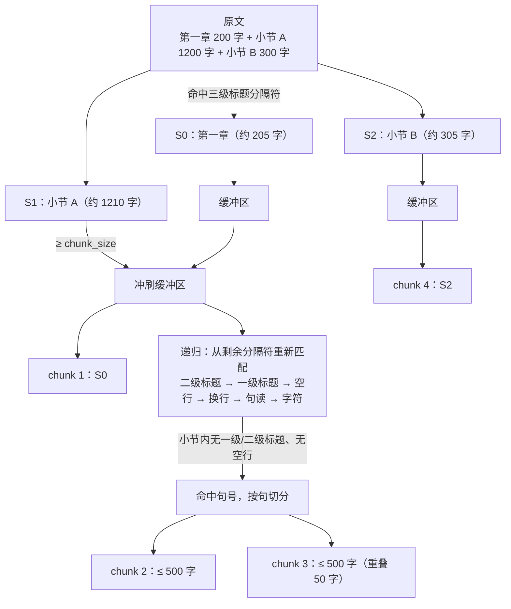
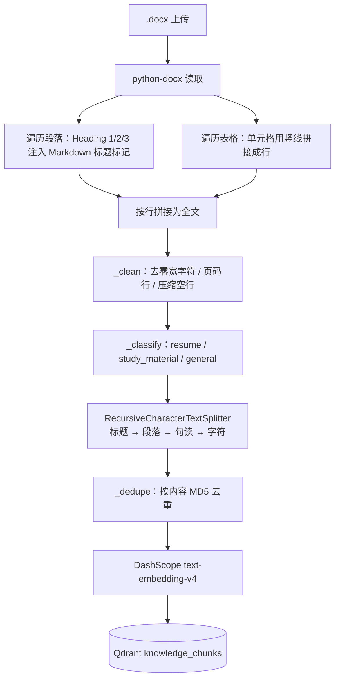
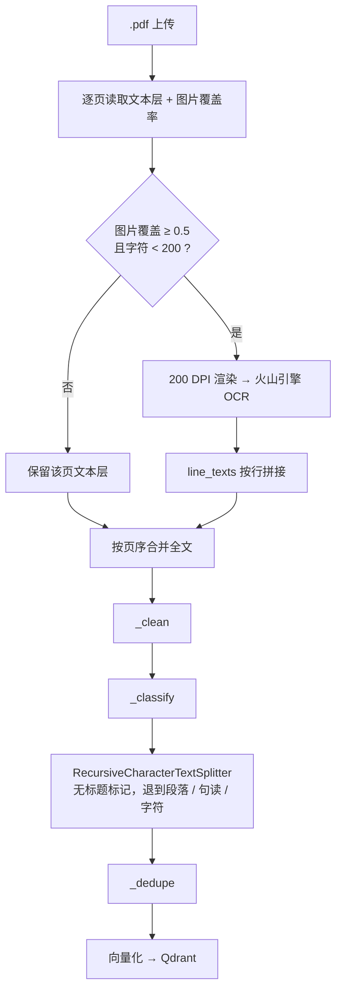

# 递归智能切片与 Word 结构识别

本文说明知识库切片从「固定窗口」升级为「递归字符切片」的实现原理、与旧方案的对比，以及 Word / PDF 各自走什么处理流程。

---

## 1. 变更概览

| 位置 | 变更 |
| --- | --- |
| `app/rag/core.py` | `_chunk_text` 改用 `RecursiveCharacterTextSplitter` |
| `app/rag/core.py` | 新增 `CHUNK_SEPARATORS`（标题 → 段落 → 句读 → 字符） |
| `app/rag/core.py` | `_parse_docx` 识别 Heading 1/2/3，注入 `#` / `##` / `###` 标记 |
| `requirements.txt` | 新增 `langchain-text-splitters==1.1.3` |

`CHUNK_SIZE=500`、`CHUNK_OVERLAP=50`、清洗、分类、去重、向量化、写 Qdrant 等逻辑保持不变。

### 1.1 分隔符优先级

```python
CHUNK_SEPARATORS = (
    "\n### ", "\n## ", "\n# ",   # 三级 / 二级 / 一级标题
    "\n\n",                      # 空行（段落）
    "\n",                        # 单换行（列表项 / PDF 行）
    "。", "！", "？", "；", "，",  # 中文句读
    " ",                         # 英文词间空格
    "",                          # 字符兜底
)
```

`keep_separator=True`：分隔符保留在切片的**开头**，因此标题标记会跟随其正文进入同一个 chunk，检索时能看出这段内容属于哪个章节。

---

## 2. RecursiveCharacterTextSplitter 实现原理

核心入口是 `split_text(text)` → `_split_text(text, separators)`，按「**先尝试高级分隔符，切不动再降级**」的策略工作。

### 2.1 执行步骤

1. **选择分隔符**：从分隔符列表头部开始，找出第一个在文本中真实出现（`re.search`）的分隔符；若直到 `""` 都没命中，则用 `""` 退化为逐字符切分。
2. **按该分隔符切分**：`_split_text_with_regex`。当 `keep_separator=True` 时，分隔符与后一段拼在一起，例如 `"\n## 变量\n..."` 会切成 `["...", "\n## 变量\n..."]`，标题留在新切片开头。
3. **分流处理**：遍历切出的片段：
   - 长度 `< chunk_size` → 放入缓冲区，等待合并；
   - 长度 `≥ chunk_size` → 先冲刷缓冲区生成 chunk，再拿**剩余的低优先级分隔符**对这段超长文本递归执行步骤 1-3。
4. **合并小块**：`_merge_splits` 贪心累积缓冲区，直到再加一段会超过 `chunk_size`；输出当前 chunk 后，从缓冲区头部弹出片段，直到剩余长度 `≤ chunk_overlap`，形成重叠。
5. **返回**：所有 chunk 保持原文顺序；只有在所有分隔符都用尽（`""` 字符级）时，单个 chunk 才可能超过 `chunk_size`，此时会打 `warning`。

### 2.2 长度与重叠的度量

- `length_function` 默认是 `len`，即**字符数**，不是 token 数。
- 重叠按「完整片段」回退，不切断片段内部；重叠量通常略小于 `chunk_overlap`，但不会把一个句子从中间复制到两个 chunk。

### 2.3 一个直观例子

文本：

```text
# 第一章
正文 A……

## 第一节
正文 B……

### 小节
正文 C……
```

- 首选 `"\n### "` 切 → `["# 第一章\n正文 A……\n\n## 第一节\n正文 B……", "### 小节\n正文 C……"]`
- 前一段若小于 500 字符，整体成为一个 chunk；若超过 500，则用**当前分隔符之后的剩余列表**继续递归（详见 2.4）
- 最终每个 chunk 都尽量以标题或段落边界开头

### 2.4 疑问：按 `###` 切开后，超长片段递归时到底用哪个分隔符？

**结论：用「当前分隔符之后」的剩余列表，并在该子列表里重新找第一个真实出现的分隔符，而不是固定按顺序硬套下一个。**

本项目列表：

```python
CHUNK_SEPARATORS = ("\n### ", "\n## ", "\n# ", "\n\n", "\n", "。", "！", "？", "；", "，", " ", "")
```

整篇文本第一次命中的是 `"\n### "` 时，切出的超长片段递归时拿到的是：

```python
("\n## ", "\n# ", "\n\n", "\n", "。", "！", "？", "；", "，", " ", "")
```

注意两个细节：

1. `"\n### "` 本身和它前面的分隔符都不会再参与该分支；
2. 递归不是「必须先用 `"\n## "`」，而是**重新从头扫描子列表**，跳过片段里不存在的分隔符。

因此：

| 超长小节内部的情况 | 实际使用的分隔符 |
| --- | --- |
| 还有 `##` 标题 | `"\n## "` |
| 没有 `##`，有 `#` | `"\n# "` |
| 都没有，有空行 | `"\n\n"` |
| 没有空行，有换行 | `"\n"` |
| 单行长文本，有句号 | `"。"`（其次 `！？；，`） |
| 连续无标点长串 | `" "`，最后 `""` 逐字符 |

因为 `###` 已经是最深一级标题，正常情况下**一个 `###` 小节内部不会再出现 `##` / `#`**，所以实际通常直接落到空行、换行或句读；只有整段既无换行又无标点的极端文本，才会用 `""` 逐字符切。若子列表全部耗尽，超长片段会原样返回并打 `warning`；本项目末尾有 `""` 兜底，不会出现这种情况。

**完整追踪示例（文字版）：**

```text
原文：
# 第一章
（正文 200 字）
### 小节 A
（连续 1200 字，无空行，有句号）
### 小节 B
（正文 300 字）

第 1 次：命中最靠前的 "\n### " → 切成 3 段
  S0 = "# 第一章\n（200 字）"       约 205 字符 → 进缓冲区
  S1 = "\n### 小节 A\n（1200 字）"  约 1210 字符 → 超长，递归
  S2 = "\n### 小节 B\n（300 字）"   约 305 字符 → 进缓冲区

S1 递归：列表变为 ["\n## ", "\n# ", "\n\n", "\n", "。", ...]
  小节 A 内没有 ## / # / 空行 → 命中 "。"，按句子切成若干 <500 的片段
  → 合并成 2~3 个 ≤500 的 chunk（相邻 chunk 重叠 50 字符）

S2 在末尾与缓冲区一起输出；S0 因后面紧跟超长片段，已在递归前被冲刷成独立 chunk。
```

**同一流程的示意图：**



### 2.5 为什么 `###` 排在 `#` 前面？

列表顺序等于**首次切分的优先级**：从头找第一个在整篇文本中出现的分隔符，命中后就按它切。

- **`###` 在前（本项目）**：先把文本拆成叶子小节，再由 `_merge_splits` 把相邻小块拼到接近 `chunk_size`。块大小更饱满，但多个短小节可能被合并进同一个 chunk，**chunk 可能跨越更高的 `##` / `#` 标题**。
- **`#` 在前**：先按章切分，超长章再在内部递归 `##` → `###`。高层章节的隔离性更好，但章节尾部容易出现偏小的 chunk。

两种顺序都遵守「先结构、后标点、最后字符」的原则，区别是**哪一级标题被当作独立分区**。如果业务要求「一个 chunk 绝不跨章」，把 `"\n# "` 提到最前，或在切片后按标题路径再做分组。

另外，小于 `chunk_size` 的片段不会继续递归——它们进入缓冲区，由合并阶段负责拼装和重叠，递归只处理「单个片段本身就超限」的情况。

---

## 3. Word 标题识别

`_parse_docx` 逐段落读取，并用 `_heading_level(paragraph)` 判断样式：

- 支持 `paragraph.style.name` 为 `Heading 1` / `Heading 2` / `Heading 3`；
- 兼容中文 Word 的本地化样式名 `标题 1` / `标题 2` / `标题 3`；
- 正则 `^(?:heading|标题)\s*([1-3])$`（忽略大小写，允许无空格写法）；
- 仅对有内容的标题注入标记，空段落原样保留以维持段落间距。

示例转换：

```text
# Python 基础
## 变量与类型
变量是内存中的命名引用……
### 内存模型
引用计数与垃圾回收……
```

表格仍按原逻辑逐行序列化为 `单元格 | 单元格`，追加在段落之后。

---

## 4. 与旧滑动窗口方案的对比

旧实现 `_chunk_text`：固定 500 字符窗口，在窗口尾部回溯最近的 `。！？\n`，且终止符位置需 ≥ 250 字符才回溯；重叠固定 50 字符。

| 维度 | 旧方案（固定窗口） | 新方案（递归切片） |
| --- | --- | --- |
| 切分依据 | 单一字符数 + 少量终止符 | 标题 → 段落 → 句读 → 空格 → 字符，逐级回退 |
| 标题语义 | 不识别，标题可能和正文被拆到两个 chunk | DOCX 标题注入标记，且随正文保留在同一 chunk 开头 |
| 超长段落 | 硬切，可能从词/句中间断开 | 先用下一级分隔符递归，实在没有边界才逐字符切 |
| 重叠位置 | 固定字符偏移，常从句子中间开始 | 以完整片段为粒度回退，切片边界更自然 |
| 段落完整性 | 可能被 500 字符窗口截断 | 优先按 `\n\n` 分段，段落短时整体保留 |
| 碎片化 | 终止符太靠前会产生短碎片 | 小块会先合并到接近 `chunk_size` 再输出 |
| 格式一致性 | 仅对纯文本友好 | Word / PDF / TXT 共用同一套切片逻辑 |
| 可解释性 | 逻辑手写，规则分散 | 分隔符列表即策略，调整优先级即可改变行为 |

局限：切片质量仍受解析结果约束。DOCX 的结构来自段落样式；PDF 没有样式信息，递归切片只能退到换行与标点级别。

---

## 5. 适合与不适合的文档

**适合**

- 有明确标题层级和段落的 Word 教材、课程笔记、手册、报告、简历；
- Markdown / 网页转出的文本（`#`、空行结构天然匹配分隔符）；
- 标点完整的中文长文（句号、问号、分号优先断开）；
- 有文本层的电子书 / PDF：虽无标题标记，仍能按段落和句子切分。

**不太适合 / 需要额外处理**

- **表格密集文档**：表格被序列化为 `a | b` 行文本，递归切片可能把一张表拆到多个 chunk，且表头不会重复；
- **扫描 PDF 且 OCR 质量差**：没有稳定标点，最终会退化为字符级切分；
- **代码 / JSON / 日志 / CSV**：标点与换行语义和自然语言不同，推荐按语言专用分隔符或按行切；
- **公式 / 图表标题**：文本碎片本身语义不足，需要版面模型或单独抽取。

---

## 6. Word 文档处理流程



关键点：

1. 标题标记在 `_parse_docx` 阶段注入，`_clean` 会保留 `# ` 前缀（只压缩多余空格和空行）；
2. 切片时 `"\n### "` / `"\n## "` / `"\n# "` 命中，标题与其正文优先留在同一 chunk；
3. 分类沿用关键字计分，显式传入的 `doc_category` 仍优先。

---

## 7. PDF 处理流程



关键点：

1. PDF 没有 Word 的段落样式，**不会产生 `#` 标记**；除非正文本身含 Markdown 标题，否则 `"\n### "` 等分隔符不会命中。
2. 实际生效的是 `"\n\n"`（PDF 文本层常保留空行）、`"\n"`（行边界）与中文句读；
3. 扫描页 OCR 结果按行拼入，与文本页按页序合并后再统一切片，因此同一份 PDF 的扫描页与普通页共享同一个 chunk 序列；
4. 页眉页脚、页码已在 `_clean` 阶段处理，仍可能残留重复页眉文本，必要时可后续增加去噪规则。

> `.doc`（OLE 二进制）走 `textutil` / `antiword` / LibreOffice 转纯文本，标题样式在转换中丢失，因此只有 `.docx` 能享受标题标记。

---

## 8. 验证方式

```bash
cd agent-backend
source .venv/bin/activate
pytest tests/test_rag_ocr.py tests/test_auth.py -q
```

已用真实 DOCX 验证：

- 一级 / 二级 / 三级标题分别输出 `#` / `##` / `###`；
- 切片首行出现 `# Python 基础`、`### 内存模型` 等标题；
- 700 字符无标点长串被切成 499 + 251 两个 chunk，重叠 50 字符；
- 表格行 `关键字 | 说明` 独立成块。

---

## 9. 已知边界与调参建议

- `chunk_size` 按字符计，中文与英文的信息密度不同；若后续改用 token 计数，可传入自定义 `length_function`。
- 短章节会被合并进相邻 chunk（这是预期行为，避免大量碎片），因此一个 chunk 可能包含多个标题；如需「一节一块」，可在切片后按标题再分组。
- 表格、代码等结构化内容建议后续单独识别并采用专用切分策略。
- 调整分隔符时保持「从结构到字符」的降序优先级，且末尾保留 `""` 作为兜底，避免超长无分隔文本无法切片。
