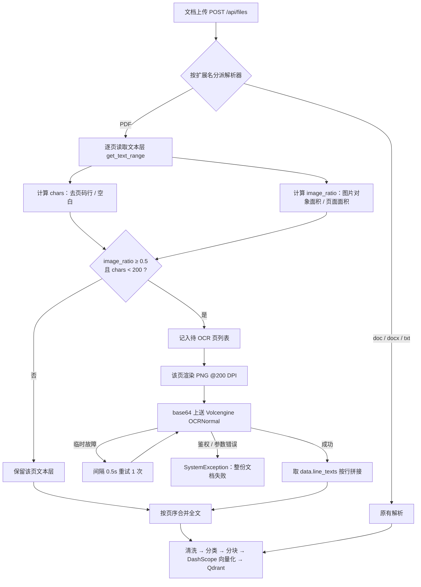

# 扫描版 PDF 识别：逐页双信号判定 + OCR 兜底

本文说明文档入库前的 PDF 解析链路如何识别扫描页、为什么这样选型，以及实现原理与运维验证方式。

---

## 1. 背景与痛点

知识库入库流程的第一步是「解析出文本」。纯数字 PDF 的文本层可直接提取，**扫描版 PDF（整页是图片）没有文本层**，按旧实现会解析为空，入库失败。

原实现（PyPDF2 + 全文平均每页字符数 < 20 判扫描件）存在以下问题：

| 痛点 | 表现 |
| --- | --- |
| 混合 PDF 漏识别 | 100 页扫描件夹 1 页数字封面，全文平均字符数被拉高，整份文档不触发 OCR，正文全部丢失 |
| 少字页面误 OCR | 数字生成的封面 / 章节页只有标题，平均字符数低却被判为扫描件，白付 OCR 费用 |
| 全文平均的粒度错误 | 判定单位是「文档」，而扫描与否是「页」的属性，无法只补扫缺失页 |
| 解析器能力不足 | PyPDF2 只能取文本，无法渲染页面；中文编码 / 复杂字体提取质量不稳定 |
| 扫描件解析为空即失败 | 没有兜底路径，用户只能自行转成文本再上传 |

---

## 2. 方案选型与原因

### 2.1 解析器：pypdfium2（替换 PyPDF2）

| 维度 | PyPDF2 / pypdf | pypdfium2（PDFium） |
| --- | --- | --- |
| 能力 | 仅解析文本层 | 文本层 + 页面渲染（同一依赖） |
| 中文 / 复杂编码提取 | 一般 | 好（PDFium 是 Chrome 内置 PDF 引擎） |
| 扫描件支持 | 不可能（不能渲染） | 渲染位图后交给 OCR |
| 许可证 | BSD | Apache-2.0 / BSD-3-Clause |
| 外部依赖 | 无 | 无（wheel 内置 PDFium 二进制） |

选它是因为**提取与渲染共用一套依赖**：若继续用 pypdf + pdf2image，需要额外安装 poppler；PyMuPDF 渲染质量好但 AGPL 许可对商业分发不友好。

### 2.2 OCR 服务：火山引擎 `OCRNormal`

| 方案 | 中文扫描件准确率 | 部署 / 运维 | 结论 |
| --- | --- | --- | --- |
| **火山引擎 OCRNormal** | 高 | 云服务，按页计费 | **采用**（已有账号与 cn-north-1 凭证） |
| Tesseract | 一般，须装中文语言包并做预处理 | 自部署，轻量 | 准确率不足以支撑简历 / 教材 |
| PaddleOCR | 高 | 自部署，依赖重、调优成本高 | 团队当前无 OCR 运维投入 |
| 阿里 / 腾讯 OCR | 高 | 云服务 | 与现有火山账号体系不一致 |
| Textract / Azure / Google Document AI | 高 | 跨境网络、合规与成本 | 国内业务不适用 |

云 OCR 的代价是按页计费且存在网络抖动，因此**只对判定为扫描页的页面调用**，并对临时故障重试一次。

### 2.3 判定策略：逐页双信号

判定单位从「整份文档」改为「每一页」，同时看两个信号：

- **有效字符数 `chars`**：去掉零宽字符、独立页码行与全部空白后的字符数。
- **图片覆盖率 `image_ratio`**：页面内图片对象覆盖面积 / 页面面积，钳制到 `0..1`。

```
image_ratio ≥ 0.5 且 chars < 200  → 扫描页，走 OCR
其余                              → 信任文本层
```

原因：

1. **逐页判定**解决混合 PDF 漏页——每页独立决策，扫描页补扫、数字页不重复 OCR。
2. **图片覆盖率**是「这页是不是扫描件」的结构性证据，能避免数字生成的少字封面 / 章节页被误判为扫描件。
3. **200 字符阈值**区分「整页图片 + 零星伪文本」与「整页图片但带完整可搜索文本层」（常见于经过 OCR 的 PDF 或带水印的电子书），后者不必重复付费 OCR。
4. **过滤页码行**避免 `- 12 -` 之类的页眉页脚被算作正文，拉高 `chars`。

---

## 3. 实现原理图



对应代码：

- 判定与合并：`app/rag/core.py` 的 `_analyze_pdf` / `_needs_ocr` / `_parse_pdf`
- 渲染与 OCR：`app/rag/ocr.py` 唯一的对外函数 `ocr_pdf(path, page_indices=None)`

`ocr_pdf` 返回 `{页下标: 文本}`，由 `_parse_pdf` 与文本层按页序合并；未指定 `page_indices` 时识别全部页（保留独立使用的能力）。

---

## 4. 关键参数

| 常量 | 位置 | 值 | 作用 |
| --- | --- | --- | --- |
| `SCAN_IMAGE_COVERAGE` | `app/rag/core.py` | `0.5` | 图片覆盖率达到该值才可能是扫描页 |
| `SCAN_TEXT_MAX_CHARS` | `app/rag/core.py` | `200` | 文本层少于该字符数才判定 OCR |
| `RENDER_DPI` | `app/rag/ocr.py` | `200` | 渲染精度；150 对小字偏糊，300 体积翻倍收益有限 |
| `_OCR_MAX_ATTEMPTS` | `app/rag/ocr.py` | `2` | 单页最多尝试次数（含首次） |
| `_OCR_RETRY_DELAY_SECONDS` | `app/rag/ocr.py` | `0.5` | 重试间隔 |
| `_OCR_LOCK` | `app/rag/ocr.py` | — | 串行化 SDK 调用，规避进程内共享 `requests.Session` 竞争 |

---

## 5. 失败处理

| 情况 | 行为 |
| --- | --- |
| 未配置 `VOLC_ACCESS_KEY` / `VOLC_SECRET_KEY` | 抛 `SystemException("OCR 服务未配置")`，后台入库失败并记日志 |
| `ResponseMetadata.Error` 为鉴权 / 权限错误（如 `AccessDenied`） | **不重试**，立即失败（重试无意义） |
| `InternalError` / `ServerError` / `ServiceUnavailable` / `Throttling` / `RequestTimeout` / `FlowLimitExceeded` | 重试一次；仍失败则整份文档失败 |
| 网络异常 / 响应非字典 | 视为临时故障，重试一次 |
| 任一扫描页最终失败 | 整份文档失败，不做「部分入库」——避免残缺文本静默污染检索结果 |

---

## 6. 验证

### 6.1 单元测试（不访问火山引擎）

```bash
cd agent-backend
source .venv/bin/activate
pytest tests/test_rag_ocr.py -v
```

覆盖：逐页返回、仅识别指定页、页码越界、鉴权错误不重试、临时错误重试成功 / 重试耗尽、双信号判定、图片覆盖率、混合 PDF 按页合并。

### 6.2 判定自检（本地生成无文本层 PDF）

```bash
python - <<'PY'
import tempfile
from pathlib import Path
from PIL import Image
from app.rag.core import _analyze_pdf

with tempfile.TemporaryDirectory() as tmp:
    path = Path(tmp) / "scan.pdf"
    images = [Image.new("RGB", (600, 800), "white") for _ in range(2)]
    images[0].save(path, format="PDF", resolution=150,
                   save_all=True, append_images=images[1:])
    pages, ocr_pages = _analyze_pdf(path)
    print(len(pages), ocr_pages)   # 预期 2 [0, 1]
PY
```

### 6.3 端到端

上传扫描版 PDF 后观察后台日志：

- 出现 `PDF 含扫描页，转 OCR：path=... pages=N ocr_pages=M`；
- 随后出现 `知识库入库完成：file=... chunks=N` 且 `chunks > 0`；
- Qdrant `knowledge_chunks` 中该 `resource_id` 点数大于 0。

---

## 7. 已知边界

- **手写体 / 印章 / 公式**：通用 OCR 的识别率有限，可能产生错字。
- **多栏排版**：`line_texts` 按识别顺序拼接，栏间阅读顺序可能错乱。
- **矢量绘制的「伪扫描页」**：正文以路径而非图片对象绘制时，`image_ratio` 偏低，会走文本层；若同时无文本层则无法识别。
- **加密 / 损坏的 PDF**：打不开时由 `ingest_file` 转成「文件解析失败」。
- **超大页面**：按 200 DPI 渲染单页内存约 `宽×高×4` 字节，异常大页可能占用较多内存。
- **成本**：OCR 按页计费；判定阈值偏松会增加调用量，调整前建议先用真实样本统计 `chars` / `image_ratio` 分布。
