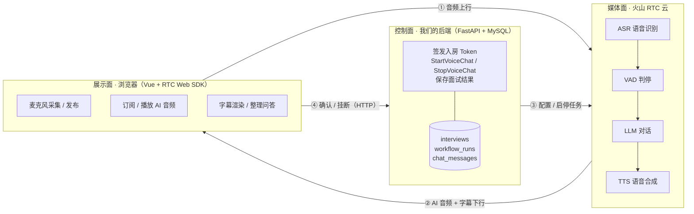
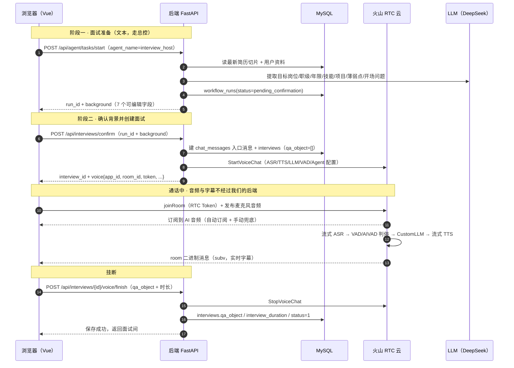
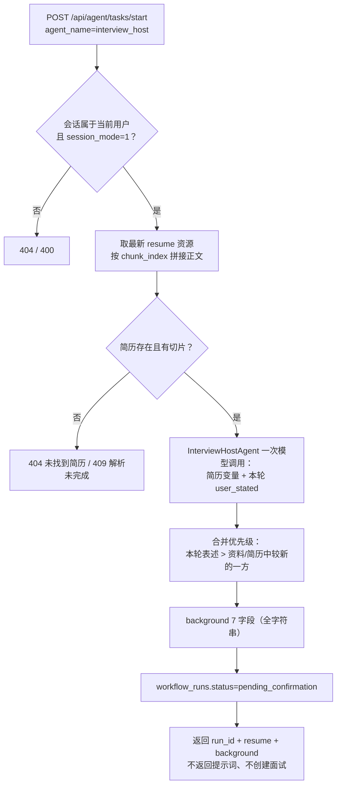
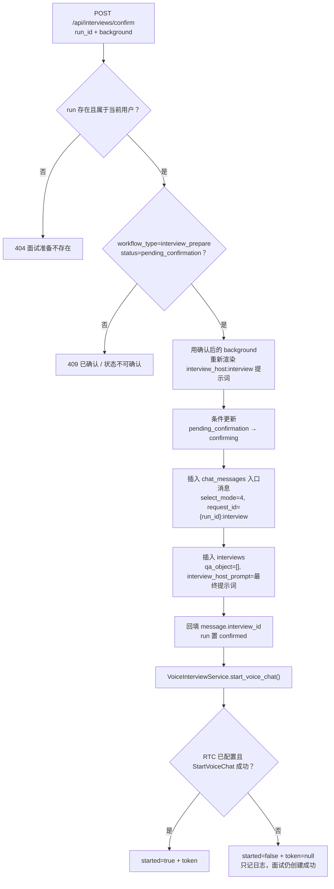
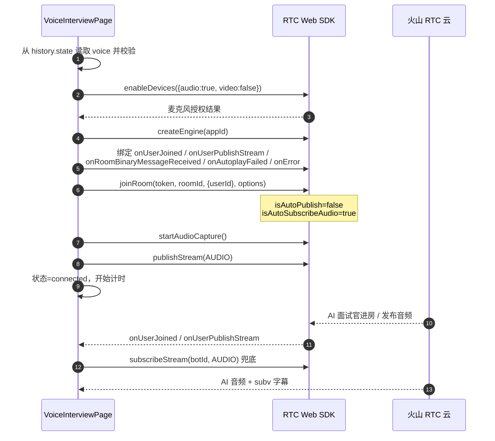
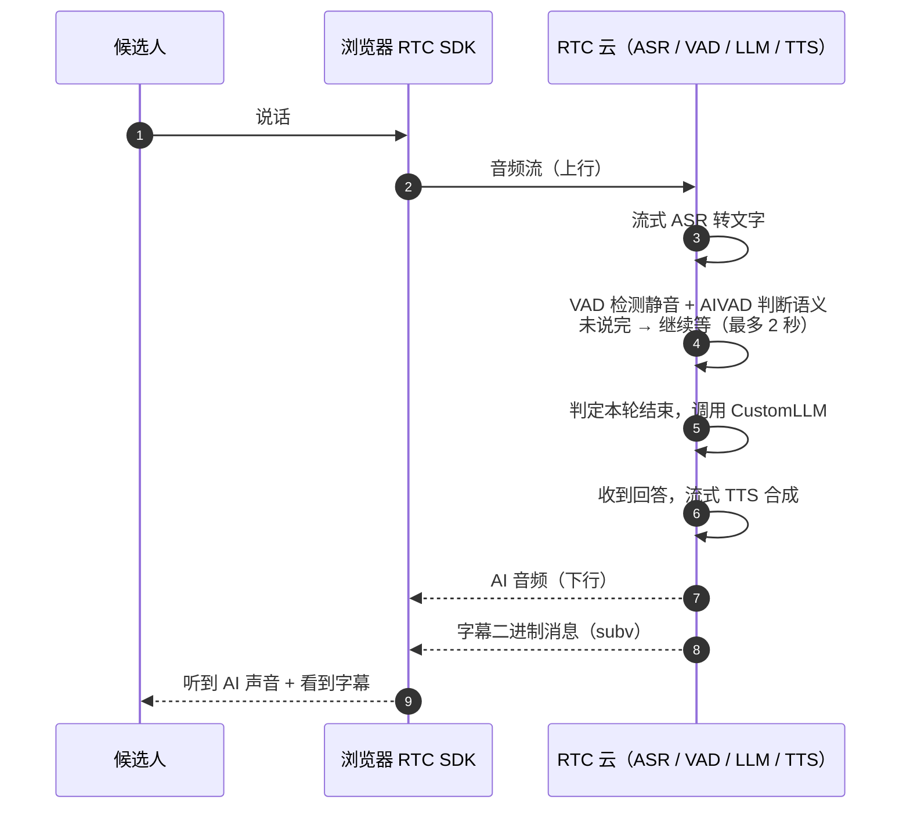
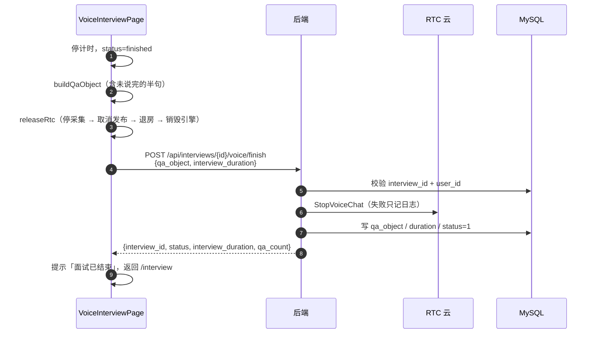
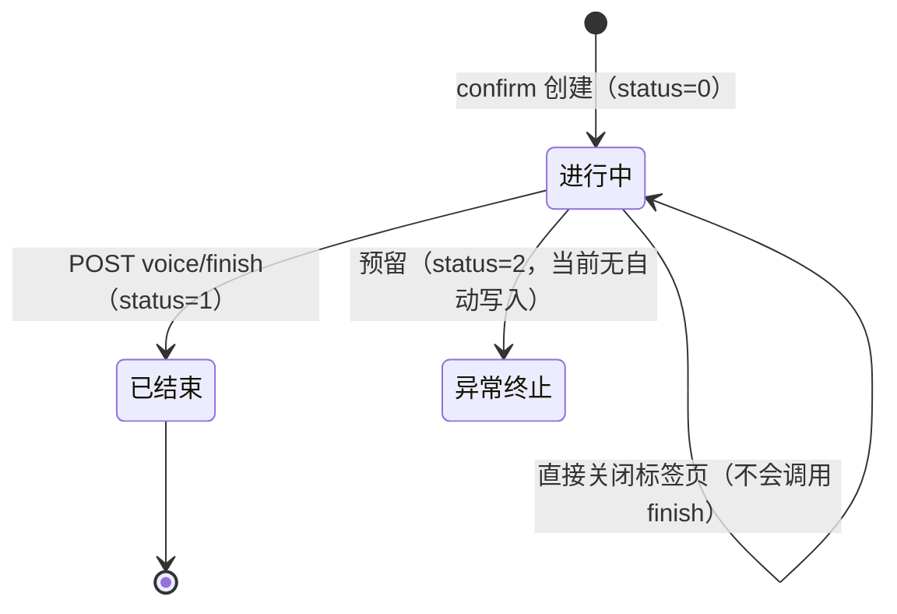

# AI 语音面试（火山 RTC）· 技术方案与数据流

> **状态**：已实现（分支 `interview-rtc`）
> **入口**：`POST /api/interviews/confirm` → 前端 `/interview/voice?interview_id=...`
> **实现位置**：`app/routers/interview.py`、`app/services/interview_service.py`、`app/services/voice_interview_service.py`、`app/core/config.py`；前端 `VoiceInterviewPage.vue`、`utils/voiceInterview.ts`
> **相关文档**：[前后端接入与配置上手指南](voice-interview-rtc-guide.md)、[面试准备两阶段流程](interview-host-verification-guide.md)、[前端页面验证指南](../../agent-frontend/docs/voice-interview-verification.md)

---

## 1. 一句话理解

> **我们的后端只负责「开门」和「关门」，真正的语音对话在火山 RTC 云端完成，浏览器负责采集声音、播放声音和收集字幕。**

之所以容易看不懂，是因为这套功能横跨了三个「面」，而代码只覆盖其中一部分：



三个面的边界决定了理解重点：

| 面 | 谁在做 | 关键事实 |
| --- | --- | --- |
| 控制面 | 我们的后端 | **不接触音频、不接收实时转写**；只生成 token、调用启停接口、挂断时落库 |
| 媒体面 | 火山 RTC 云 | 语音识别、判停、大模型回答、语音合成都在这条链路里；模型地址和密钥由我们的后端在启动时下发 |
| 展示面 | 浏览器 | 采集麦克风、播放 AI 声音、解析字幕、把字幕整理成 `qa_object`，挂断时提交给后端 |

---

## 2. 先认识这些缩写

| 术语 | 全称 / 含义 | 在这套功能里具体指什么 |
| --- | --- | --- |
| **RTC** | Real-Time Communication，实时音视频通信 | 火山引擎的 RTC 服务：负责把浏览器和 AI 面试官放进同一个「房间」，双向传音频（低延迟）。类似腾讯 TRTC、声网 Agora。 |
| **ASR** | Automatic Speech Recognition，语音识别 | 把候选人说的话转成文字。这里用火山的流式大模型 ASR（`Mode=bigmodel`）。 |
| **TTS** | Text To Speech，语音合成 | 把大模型的文字回答念出来。这里用火山双向流式 TTS（`volcano_bidirection`），边生成边播放，首字延迟低。 |
| **LLM** | Large Language Model，大语言模型 | 生成面试官的回答。复用项目里已配置的 OpenAI 兼容模型（当前 `.env.dev` 是 DeepSeek）。 |
| **VAD** | Voice Activity Detection，语音活动检测 | 判断「用户还在说」还是「说完了」。静音超过 `SilenceTime` 就认为这一轮说完了，触发 AI 接话。 |
| **AIVAD** | AI VAD，语义判停 | 在声学静音之上再看语义是否完整；句子没说完时最多等到静音 2 秒，减少思考停顿被误判。 |
| **Bot / Agent** | 房间里的「机器人用户」 | AI 面试官在 RTC 房间里也是一个用户，有自己的 `bot_user_id`（`aiinterviewer{interview_id}`）。 |
| **Room / Task** | 房间 / AI 任务 | 房间是音频通道；Task 是云端跑着的这条 AI 流水线。当前两者同名：`voiceinterview{interview_id}`。 |
| **AccessToken** | RTC 入房令牌 | 由后端用 AppID/AppKey 签发给前端，浏览器凭它入房。**AppKey 永远不下发前端**。 |
| **JWT** | JSON Web Token | 业务登录令牌（`Authorization: Bearer`），与 RTC Token 是两套东西，不要混淆。 |
| **subv** | subtitle 的缩写 | 房间二进制消息的类型标识，火山用它把实时字幕推给前端。 |
| **TLV** | Type-Length-Value | 一种简单的二进制打包格式：4 字节类型 + 4 字节长度 + 负载。字幕消息就是 TLV。 |
| **SSE** | Server-Sent Events | 文本聊天用的流式协议，**语音面试不走 SSE**。 |
| **CustomLLM** | 自定义大模型模式 | RTC 云不内置模型，而是按我们下发的 URL / 模型名 / 密钥去调用外部模型。 |
| **Barge-in** | 打断 | AI 正在说话时用户开口，是否立刻停下来听用户。当前使用 RTC 默认行为。 |

---

## 3. 端到端全景



**关键结论**：通话过程中，我们的后端是「旁观者」。音频、识别结果、模型回答、字幕都不经过 FastAPI；后端只在开始前和结束后各出现一次。

---

## 4. 阶段一：面试准备（只产出可编辑背景）

入口不是健康检查那类 REST 接口，而是流程总控 `POST /api/agent/tasks/start`，规则表里 `interview_host` 是 `direct=True`，命中即启动工作流。



要点：

- 这一步**只准备、不创建**，用户还能在弹窗里改 7 个字段。
- `background` 字段：`target_job / target_level / years_experience / target_skills / project_experience / weak_topics / opening_question`。
- 技能、薄弱点用「、」连接；年限格式为「N 年 / 应届/无经验」。
- 覆盖顺序：本轮明确表述 > `user_profiles.updated_at` 与简历 `create_time` 中较新的一方；未提及的字段由另一方兜底。
- 详细规则见 [面试准备两阶段流程](interview-host-verification-guide.md)。

---

## 5. 阶段二：确认背景、创建面试、拉起 AI

### 5.1 后端做了什么



几点设计取舍：

- **先落库、后拉 AI**：即使 RTC 挂了，面试记录和入口消息也已存在；前端提示「面试已创建，但 AI 语音面试未能启动」。
- **原子抢占**：`claim_status` 是条件更新，并发重复确认只有一个请求能成功，另一个得到 `409`。
- **提示词先渲染**：模板缺失这类配置问题会在消费 run 之前暴露，修好后还能重试确认。
- **失败补偿**：面试记录建失败时，会删掉刚插入的入口消息，避免孤立消息。

### 5.2 `start_voice_chat` 生成的入房参数

后端返回给前端的 `voice`：

| 字段 | 示例 | 用途 |
| --- | --- | --- |
| `app_id` | `6ae5e051150a1701666a0cc4` | RTC 应用 ID，前端建引擎用 |
| `room_id` | `voiceinterview186` | 房间 ID |
| `user_id` | `7231` | 候选人在房间里的用户 ID |
| `bot_user_id` | `aiinterviewer186` | AI 面试官的用户 ID，前端据此识别「AI 字幕」 |
| `task_id` | `voiceinterview186` | 云端 AI 任务 ID，停止时用 |
| `token` | `0016ae5...` | 前端入房 AccessToken |
| `expire_at` | `1762...` | Token 过期时间（Unix 秒），默认 6 小时 |
| `started` | `true` | AI 是否真正拉起；`false` 时前端不入房 |

**绑定关系固定**：同一场面试复用同一房间 / 任务 / Bot，所以命名都用 `interview_id` 拼出来，天然幂等。

### 5.3 RTC AccessToken 是怎么来的

不是调用 RTC 接口换的，而是**后端本地算出来的**（火山官方算法移植）：

```text
token = "001" + AppID + base64( pack(msg) + pack(sign) )
msg   = nonce + issued_at + expire_at + room_id + user_id + 权限表
sign  = HMAC-SHA256(AppKey, msg)
权限表 = {0:过期时间, 1:过期时间, 2:过期时间, 3:过期时间, 4:过期时间}
         └ 0 发布流  1 发布音频  2 发布视频  3 发布数据  4 订阅流
```

所以：

- 前端拿到的是**用户身份**的 token，有发布音频和订阅音频的权限；
- **AppKey 只在后端参与签名**，绝不返回前端；
- token 放在路由 `history.state`，不放进 URL（避免被日志 / 分享链接泄露）。

### 5.4 `history.state` 传递 token 的实现

整条链路只做三件事：**写入 → 读回 → 校验**。

#### ① 写入：确认成功后 `router.push` 的 `state` 参数

`InterviewRoom.vue` 的 `handleConfirm()`：

```ts
const voice = result.voice
if (!result.interviewId || !voice || !voice.started) {
  ElMessage.warning('面试已创建，但 AI 语音面试未能启动，请稍后重试')
  return
}

// interview_id 放 query；voice（含 rtc_token）只放 history state，避免出现在 URL。
// 逐字段展开为普通值（HistoryState 只接受可结构化克隆的基础类型）。
await router.push({
  name: 'interview-voice',
  query: { interview_id: String(result.interviewId) },
  state: {
    voice: {
      appId: voice.appId,
      roomId: voice.roomId,
      userId: voice.userId,
      botId: voice.botId,
      rtcToken: voice.rtcToken,
      taskId: voice.taskId,
      expireAt: voice.expireAt,
      started: voice.started,
    },
  },
})
```

这里的 `state` 是 vue-router 的 `RouteLocationOptions.state`，最终由浏览器写入当前历史条目的 `window.history.state`，不参与 URL。

#### ② 读回：语音页初始化时从 `window.history.state` 取

`VoiceInterviewPage.vue`：

```ts
/** voice 通过 history state 传入，刷新页面后仍可读取；不落在 URL 上 */
const voice = ref<VoiceRoom | null>(readVoiceFromHistory())

function readVoiceFromHistory(): VoiceRoom | null {
  const state = window.history.state as { voice?: unknown } | null
  return normalizeVoiceRoom(state?.voice)
}
```

`onMounted` 里 `joinRoom()` 直接使用这个 `voice`；浏览器刷新后 `history.state` 仍在，所以可以自动重新入房。

#### ③ 校验：字段缺失就不发起 RTC 连接

`utils/voiceInterview.ts` 的 `normalizeVoiceRoom()` 同时兼容后端 snake_case 和前端 camelCase 两套命名，并对必填字段做运行时校验：

```ts
export function normalizeVoiceRoom(raw: unknown): VoiceRoom | null {
  if (!isRecord(raw)) return null

  const appId = toText(raw.app_id) || toText(raw.appId)
  const roomId = toText(raw.room_id) || toText(raw.roomId)
  const userId = toText(raw.user_id) || toText(raw.userId)
  const botId =
    toText(raw.bot_id) || toText(raw.botId) || toText(raw.bot_user_id)
  const rtcToken =
    toText(raw.rtc_token) || toText(raw.rtcToken) || toText(raw.token)
  if (!appId || !roomId || !userId || !botId || !rtcToken) return null

  const taskId = toText(raw.task_id) || toText(raw.taskId) || roomId
  const expireAt =
    typeof raw.expire_at === 'number'
      ? raw.expire_at
      : typeof raw.expireAt === 'number'
        ? raw.expireAt
        : null

  return {
    appId,
    roomId,
    userId,
    botId,
    rtcToken,
    taskId,
    expireAt,
    started: raw.started === true,
  }
}
```

任何必填项缺失（包括直接打开书签、手动改地址、状态被清空）都会返回 `null`，页面提示「缺少面试参数，请返回面试间重新发起」，**不会用残缺参数去连接 RTC**。

#### 为什么不用 URL query / localStorage

| 方案 | 刷新后保留 | 地址栏 / 日志可见 | 新标签 / 书签可复用 | 生命周期 |
| --- | --- | --- | --- | --- |
| URL query | 是 | **是**（截图、日志、Referer 都可能泄露） | 是 | 跟随链接长期存在 |
| localStorage | 是 | 否 | 是 | 持久化，需手动清理 |
| **`history.state`** | **是** | **否** | **否** | 仅当前历史条目，离开页面即失效 |

这与 token 的定位一致：**一次面试、一个历史条目、6 小时有效**。`interview_id` 放 query 是为了可读与调试；真正的凭证只走 `state`。

### 5.5 StartVoiceChat 下发了什么配置

`_build_config()` 组装的云端流水线：

| 配置块 | 内容 | 作用 |
| --- | --- | --- |
| `ASRConfig.ProviderParams` | `Mode=bigmodel, StreamMode=0`，可选独立 AppId / AccessToken | 流式语音识别 |
| `ASRConfig.VADConfig` | `SilenceTime`（默认 1500ms，钳制在 `[500, 2999]`）、`AIVAD`（默认 true） | 判停：等用户真正说完再让 AI 接话 |
| `TTSConfig` | `Provider=volcano_bidirection`，`voice_type=VOLC_RTC_TTS_SPEAKER` | 双向流式语音合成，边生成边播 |
| `LLMConfig` | `Mode=CustomLLM`、`Url={LLM_BASE_URL}/chat/completions`、`ModelName`、`APIKey`、`SystemMessages=[面试官提示词]`、`HistoryLength` | RTC 云按 OpenAI 兼容协议回调外部大模型 |
| `SubtitleConfig` | `SubtitleMode=VOLC_RTC_SUBTITLE_MODE`（默认 0） | 控制字幕下发，前端依赖它拿字幕 |
| `AgentConfig` | `TargetUserId=[候选人]`、`UserId=bot_user_id`、`WelcomeMessage`、`IdleTimeout` | 指定服务对象、Bot 身份、开场白、空闲超时 |

**重要**：`SystemMessages` 就是确认背景后渲染出来的 `interview_host_prompt`，所以用户在弹窗里改的岗位 / 技能 / 薄弱点会真正影响 AI 的提问。模型密钥是**随请求下发给 RTC 云**的，云端代替我们调用 LLM。

---

## 6. 通话中：入房、音频、字幕

### 6.1 前端入房顺序



为什么**手动发布**而不是自动发布：要确保麦克风采集成功后再发流，避免前端显示「已入房」但实际没有声音。自动订阅音频再配一个手动订阅兜底，防止某些时序下没订阅到 Bot。

### 6.2 一轮对话发生了什么



判停参数直接影响体验：

- `SilenceTime` 太小 → 用户思考稍一停顿，AI 就抢话；
- `SilenceTime` 太大 → 用户说完要等很久 AI 才接；
- `AIVAD=true` → 句子没说完时不会因为短暂静音被截断（语义不完整最多等到静音 2 秒）。

当前默认 `1500ms + AIVAD=true`，仍觉得抢话可调到 `2000`，改 `.env.dev` 后重启后端。

### 6.3 字幕协议：TLV + `subv`

火山把字幕作为**房间二进制消息**广播，前端 `onRoomBinaryMessageReceived` 收到后解析：

```text
 0        4        8                                8+N
 +--------+--------+----------------------------------+
 | "subv" | length | UTF-8 JSON                       |
 | 4 字节 | 4 字节 | N 字节（大端长度）                |
 +--------+--------+----------------------------------+
```

JSON 负载形如：

```json
{
  "data": [
    {
      "userId": "aiinterviewer186",
      "text": "你好，我是本场面试的 AI 面试官",
      "definite": true,
      "paragraph": false
    }
  ]
}
```

| 字段 | 含义 |
| --- | --- |
| `userId` | 谁说的。和 `voice.bot_id` 相同 → AI；和 `voice.user_id` 相同 → 我；其他一律忽略 |
| `text` | 目前已识别出的整句文本（增量更新通常是整句替换，不是追加片段） |
| `definite` | AI 字幕的「句子完成」标记 |
| `paragraph` | 用户字幕的「段落完成」标记 |

前端合并规则（`utils/voiceInterview.ts`）：

- 未完成：覆盖 `partial`（同一说话人只保留一句半成品）；
- 已完成：追加为正式行，并清空 `partial`；
- 同一句的增量保留更长的版本，避免文本回退；
- 最后一行和当前完成句完全相同时不重复追加；
- 显示时把 `partial` 拼在正式行后面，所以用户能看到「正在说的话」。

### 6.4 `qa_object` 是怎么整理出来的

挂断时 `buildQaObject()` 把字幕按说话人归并：

```text
AI 句 1 + AI 句 2 + ...        → question（连续 AI 字幕合并）
我 句 1 + 我 句 2 + ...        → answer（连续用户字幕合并）
再出现 AI 句且 answer 非空     → 上一轮结束，flush 一条 {id, question, answer, created_at}
未说完的 partial 也纳入        → 保证挂断时已说的内容不丢
```

所以**问答配对完全由前端按「谁先说」推断**，后端不做语义配对。

---

## 7. 挂断与落库



顺序上的取舍：

- **先释放本地 RTC 再调接口**：避免保存请求等待期间还占着麦克风；
- **后端先停 AI 再落库**：即使 `StopVoiceChat` 失败也继续保存，避免丢失用户已完成的内容；
- **保存失败也返回面试间**：本地资源已释放，只提示「通话已结束，但面试结果保存失败」。

面试记录状态：



---

## 8. 数据归属：谁掌握什么

| 数据 | 产生方 | 存放 / 传递 | 说明 |
| --- | --- | --- | --- |
| 面试背景 `background` | 后端 LLM 提取 + 用户编辑 | `workflow_runs.state_json` | 确认后固化到 `confirmed_background` |
| 主考官提示词 | 后端渲染 | `interviews.interview_host_prompt` | 同时下发给 RTC 云作为 `SystemMessages` |
| RTC 入房 token | 后端签发 | `history.state`（前端） | 6 小时有效，刷新页面仍在，不进 URL |
| 实时音频 | 浏览器 ↔ RTC 云 | 不落后端 | 后端无法监听通话内容 |
| 实时字幕 | RTC 云 → 浏览器 | 不落后端 | 仅前端内存中合并 |
| `qa_object` | **前端**整理 | 挂断时 POST 给后端 | 后端直接保存，未逐条校验内容 |
| 时长 | 前端计时 | 随挂断提交 | 后端只校验 `>=0` |
| 面试状态 | 后端 | `interviews.status` | 只由 confirm / finish 写入 |

> 这是一个**信任前端**的设计：字幕只在浏览器里，后端拿不到原始音频或转写，因此 `qa_object` 只能由前端提交。优点是链路简单、后端无实时负载；代价是内容可被客户端篡改、关闭页面会丢结果。

---

## 9. 异常与降级

| 场景 | 行为 |
| --- | --- |
| 未配置 `VOLC_RTC_APP_ID / APP_KEY` | confirm 仍成功，`started=false`、`token=null`；前端提示「AI 语音面试未能启动」 |
| `StartVoiceChat` 调用失败 | 同上，只记 ERROR 日志；面试记录保留 |
| 用户拒绝麦克风 | 页面错误态「未获得麦克风权限」，不入房 |
| 浏览器拦截自动播放 | 显示「开启声音」按钮，点击后 `engine.play(botId, AUDIO)` |
| RTC 回调错误 | 释放 RTC，显示「语音连接异常，请返回后重新发起面试」 |
| 挂断保存失败 | 本地 RTC 已释放，提示「通话已结束，但面试结果保存失败」，仍返回面试间 |
| 刷新语音页 | `history.state` 保留，可自动重新入房 |
| 书签直开语音页 | 缺少 `voice`，提示缺少参数，不发起 RTC 连接 |
| 直接关闭标签页 | **不调用 finish**，记录停留 `status=0`；RTC Bot 在 `IdleTimeout`（默认 180s）后自动停止 |

---

## 10. 配置项速查（RTC 相关）

完整模板见 `.env.example`，开发环境见 `.env.dev`。

| 变量 | 必需 | 默认 | 作用 |
| --- | --- | --- | --- |
| `VOLC_ACCESS_KEY` / `VOLC_SECRET_KEY` / `VOLC_REGION` | 是 | — | 调用 RTC OpenAPI（SigV4 签名） |
| `VOLC_RTC_APP_ID` / `VOLC_RTC_APP_KEY` | 是 | — | RTC 应用凭证；缺失时降级为「只建面试」 |
| `VOLC_RTC_TOKEN_TTL_SECONDS` | 否 | 21600 | 前端入房 token 有效期（秒） |
| `VOLC_RTC_TTS_SPEAKER` | 否 | `zh_female_linjianvhai_moon_bigtts` | AI 音色 |
| `VOLC_RTC_TTS_APP_ID` / `VOLC_RTC_TTS_ACCESS_TOKEN` | 否 | — | TTS 独立账号时才填 |
| `VOLC_RTC_ASR_APP_ID` / `VOLC_RTC_ASR_ACCESS_TOKEN` | 否 | — | 流式 ASR 独立账号时才填；不填走 `bigmodel` 默认 |
| `VOLC_RTC_VAD_SILENCE_TIME_MS` | 否 | 1500 | 判停静音时长（`[500,3000)`），越大 AI 越晚接话 |
| `VOLC_RTC_AIVAD` | 否 | true | 语义判停，减少思考停顿被误判 |
| `VOLC_RTC_WELCOME_MESSAGE` | 否 | 固定开场白 | AI 进房后的第一句话 |
| `VOLC_RTC_HISTORY_LENGTH` | 否 | 10 | 云端 LLM 带入的历史轮数 |
| `VOLC_RTC_IDLE_TIMEOUT` | 否 | 180 | 空闲多久后自动停止 Bot（秒） |
| `VOLC_RTC_SUBTITLE_MODE` | 否 | 0 | 字幕下发模式 |

---

## 11. 关键代码索引

| 关注点 | 文件 | 位置 |
| --- | --- | --- |
| RTC 配置项 | `app/core/config.py` | `VOLC_RTC_*`、`RTCConfig`、`has_rtc_config()` |
| Token 签名 / 启停 RTC | `app/services/voice_interview_service.py` | `generate_rtc_token()`、`_build_config()`、`start_voice_chat()`、`stop_voice_chat()` |
| 挂断落库 | `app/services/voice_interview_service.py` | `finish_interview()` |
| 确认面试 | `app/services/interview_service.py` | `InterviewService.confirm_interview()` |
| 接口契约 | `app/routers/interview.py`、`app/schemas/interview.py` | confirm / finish / detail |
| 面试表 | `app/db/models.py`、`app/db/interview_repo.py` | `Interview`、`finish()` |
| 入房 / 音频 / 字幕页面 | `agent-frontend/src/views/VoiceInterviewPage.vue` | `joinRoom()`、`handleBinaryMessage()`、`handleHangUp()` |
| 字幕解析与问答整理 | `agent-frontend/src/utils/voiceInterview.ts` | `parseSubtitleMessage()`、`applySubtitleItems()`、`buildQaObject()` |
| 确认弹窗与跳转 | `agent-frontend/src/views/InterviewRoom.vue` | `handleConfirm()` |

---

## 12. 当前设计的已知边界（读代码时容易困惑的点）

1. **后端没有实时转写**：想在后端做实时质检 / 打断，需要额外接入字幕回流或录音存储，当前没有。
2. **`qa_object` 由客户端构建**：后端把它当作可信数据直接保存；如需防篡改，应在服务端重算或增加校验。
3. **`opening_question` 不参与语音开场**：它只作为会话入口消息的 `response_text` 展示；AI 开口说的是 `VOLC_RTC_WELCOME_MESSAGE`。提示词变量目前注入 `target_job / target_level / years_experience / target_skills / weak_topics`。
4. **关闭页面不自动收尾**：没有 `beforeunload` 自动调用 finish（可靠性差），记录会停在 `status=0`，靠 RTC 空闲超时停 Bot。
5. **模型密钥下发给云端**：`LLM_API_KEY` 随 `StartVoiceChat` 传给 RTC 云，云端用它调用模型；密钥托管边界需要按安全要求评估。
6. **打断行为未显式配置**：当前未设置 `InterruptConfig` / `InterruptMode`，使用 RTC 默认（用户开口可打断 AI）。若希望 AI 说完再听，需要后续显式配置。
7. **AccessToken 与 JWT 是两套令牌**：前者只用于 RTC 入房，后者用于业务接口；排查问题时不要混用。

---

## 13. 一句话复习

> 文本阶段由后端准备「面试官的人设和背景」→ 确认时后端创建面试记录并把配置推给 RTC 云 → 浏览器和 RTC 云直接传音频，云端完成「听 → 想 → 说」→ 字幕只到浏览器，挂断时由浏览器整理成问答提交，后端停任务并落库。

---

## 附录 A · 与示意图对应的核心代码

> 为便于阅读，代码删除了日志、类型注解、错误提示等非关键行，完整实现以仓库文件为准。
> 「后端」= `agent-backend`，「前端」= `agent-frontend`。

| 示意图 | 对应代码 |
| --- | --- |
| §4 面试准备流程 | A.1 变量合并 |
| §5.1 确认流程 | A.2 确认 → 落库 → 拉起 AI |
| §5.3 Token 结构 | A.3 AccessToken 签名 |
| §5.5 RTC 配置 | A.4 StartVoiceChat 参数 |
| §6.1 入房时序 | A.5 前端入房 |
| §6.2 一轮对话时序 | A.6 云端流水线（伪代码，非本仓库代码） |
| §6.3 字幕 TLV | A.7 TLV 解析 + A.8 字幕合并 |
| §6.4 `qa_object` | A.9 问答整理 |
| §7 挂断时序 | A.10 前端挂断 + A.11 后端停止与落库 |
| RTC OpenAPI 调用 | A.12 统一出口 `_call` |

### A.1 面试准备：变量合并（对应 §4）

```python
# app/services/interview_host_workflow.py · start_interview_prepare（节选）
profile = user_profile_repo.get_by_user_id(user_id)
profile_is_latest = _profile_is_latest(profile, resume)
# 资料比简历新时才参与覆盖，否则完全交给简历
profile_overrides = _user_overrides(profile) if profile_is_latest else {}

# 本轮明确表述优先级最高；opening_question / project_experience 仍取简历
stated_overrides = {
    field: stated[field]
    for field in (*OVERRIDE_FIELDS, YEARS_FIELD)   # target_job / target_level / target_skills / weak_topics / years_experience
    if field in stated
}

# dict 展开顺序即优先级：越靠右覆盖越靠左
variables = {**extracted, **profile_overrides, **stated_overrides}
background = _build_background(variables)

workflow_run_repo.insert({
    "run_id": run_id,
    "user_id": user_id,
    "session_id": session_id,
    "workflow_type": "interview_prepare",
    "status": "pending_confirmation",   # 只落待确认状态，不建面试
    "state_json": {"background": background, "source_variables": variables, ...},
})
```

### A.2 确认面试：校验 → 抢占 → 落库 → 拉起 AI（对应 §5.1）

```python
# app/services/interview_service.py · InterviewService.confirm_interview（节选）
row = workflow_run_repo.get_for_user(payload.run_id, user_id)   # 404 若不存在 / 越权
# 409 校验省略：workflow_type、status=confirmed / 非 pending_confirmation

background = payload.background.model_dump()
prompt = interview_host_workflow.build_interview_prompt(background, user_id)

# 条件更新 pending_confirmation → confirming：并发下只有一个请求成功
if not workflow_run_repo.claim_status(
    payload.run_id, user_id, "pending_confirmation", "confirming"
):
    raise BusinessException("该面试已确认，请勿重复确认", http_status=409)

state = dict(row["state_json"] or {})
message = message_repo.insert({
    "user_id": user_id,
    "session_id": row["session_id"],
    "select_mode": 4,                                  # 4 = 模拟面试
    "request_id": f"{payload.run_id}:interview",       # 幂等标识
    "request_text": state.get("request_text") or "开始面试",
    "response_text": background.get("opening_question") or "面试已准备好，请开始回答。",
    "status": 1,
})
interview = interview_repo.insert({
    "user_id": user_id,
    "session_id": row["session_id"],
    "message_id": message["id"],                       # 唯一：一条入口消息开一场面试
    "qa_object": [],
    "interview_host_prompt": prompt,                   # 确认后的最终提示词
})
message_repo.set_interview_id(message["id"], interview["id"])
workflow_run_repo.update(payload.run_id, {"status": "confirmed", ...})

# 落库完成后再拉起 AI：RTC 失败只体现在 started=false
voice = voice_interview_service.VoiceInterviewService().start_voice_chat(interview)
```

### A.3 AccessToken 签名（对应 §5.3）

```python
# app/services/voice_interview_service.py（节选）
def _pack_uint16(value: int) -> bytes:
    return struct.pack("<H", value & 0xFFFF)

def _pack_uint32(value: int) -> bytes:
    return struct.pack("<I", value & 0xFFFFFFFF)

def _pack_bytes(value: bytes) -> bytes:
    return _pack_uint16(len(value)) + value

def _pack_string(value: str) -> bytes:
    return _pack_bytes(value.encode("utf-8"))

def _pack_privileges(privileges: dict[int, int]) -> bytes:
    parts = [_pack_uint16(len(privileges))]
    for key in sorted(privileges):                     # 按 key 升序，保证签名稳定
        parts.append(_pack_uint16(key))
        parts.append(_pack_uint32(privileges[key]))
    return b"".join(parts)

def generate_rtc_token(app_id, app_key, room_id, user_id, expire_at):
    issued_at = int(time.time())
    nonce = random.randint(1, 99999999)

    privileges = {}
    for key in (0, 1, 2, 3):        # 0 发布流 / 1 音频 / 2 视频 / 3 数据
        privileges[key] = expire_at
    privileges[4] = expire_at       # 4 订阅流

    msg = b"".join((
        _pack_uint32(nonce),
        _pack_uint32(issued_at),
        _pack_uint32(expire_at),
        _pack_string(room_id),
        _pack_string(user_id),
        _pack_privileges(privileges),
    ))
    sign = hmac.new(app_key.encode("utf-8"), msg, hashlib.sha256).digest()
    content = _pack_bytes(msg) + _pack_bytes(sign)
    return "001" + app_id + base64.b64encode(content).decode("ascii")
```

### A.4 StartVoiceChat 参数（对应 §5.5）

```python
# app/services/voice_interview_service.py · _build_config（节选）
asr_params = {"Mode": "bigmodel", "StreamMode": 0}
if rtc.asr_app_id and rtc.asr_access_token:
    asr_params["AppId"] = rtc.asr_app_id
    asr_params["AccessToken"] = rtc.asr_access_token

tts_params = {"audio": {"voice_type": rtc.tts_speaker}}
if rtc.tts_app_id and rtc.tts_access_token:
    tts_params["app"] = {"appid": rtc.tts_app_id, "token": rtc.tts_access_token}

llm = config.get_llm_config()
llm_config = {
    "Mode": "CustomLLM",                               # 云端回调外部模型
    "Url": f"{llm.base_url}/chat/completions",
    "ModelName": llm.model,
    "APIKey": llm.api_key,
    "SystemMessages": [system_prompt],                 # interview_host_prompt
    "HistoryLength": rtc.history_length,
}

# 官方范围 [500, 3000)，越界会被 StartVoiceChat 拒绝
silence_time_ms = min(max(rtc.vad_silence_time_ms, 500), 2999)

return {
    "ASRConfig": {
        "Provider": "volcano",
        "ProviderParams": asr_params,
        "VADConfig": {"SilenceTime": silence_time_ms, "AIVAD": rtc.aivad},
    },
    "TTSConfig": {"Provider": "volcano_bidirection", "ProviderParams": tts_params},
    "LLMConfig": llm_config,
    "SubtitleConfig": {"SubtitleMode": rtc.subtitle_mode},
}
```

```python
# start_voice_chat 中实际下发的请求体（节选）
body = {
    "AppId": rtc.app_id,
    "RoomId": room_id,                 # voiceinterview{interview_id}
    "TaskId": task_id,                 # 与 RoomId 相同
    "Config": _build_config(rtc, system_prompt),
    "AgentConfig": {
        "TargetUserId": [user_id],     # 服务哪个候选人
        "UserId": bot_user_id,         # aiinterviewer{interview_id}
        "WelcomeMessage": rtc.welcome_message,
        "IdleTimeout": rtc.idle_timeout,
    },
}
_call("StartVoiceChat", body)          # volcengine SDK + SigV4 签名
```

### A.5 前端入房（对应 §6.1）

```ts
// agent-frontend/src/views/VoiceInterviewPage.vue · joinRoom（节选）
const devices = await VERTC.enableDevices({ video: false, audio: true })
if (!devices.audio) {
  setError('未获得麦克风权限，请允许录音后重试')
  return
}

const rtcEngine = VERTC.createEngine(currentVoice.appId)
engine = rtcEngine
bindEvents(rtcEngine)   // onUserJoined / onUserPublishStream / onRoomBinaryMessageReceived ...

await rtcEngine.joinRoom(
  currentVoice.rtcToken,
  currentVoice.roomId,
  { userId: currentVoice.userId },
  {
    isAutoPublish: false,          // 手动发布：采集成功后再发流
    isAutoSubscribeAudio: true,    // 自动订阅 AI 音频
    isAutoSubscribeVideo: false,
    roomProfileType: RoomProfileType.chat,
  },
)
await rtcEngine.startAudioCapture()
await rtcEngine.publishStream(MediaType.AUDIO)

status.value = 'connected'
startTimer()
```

```ts
// Bot 进房 / 发布音频时再订阅一次，兜底自动订阅失效的时序
function handleUserJoined(event: { userInfo: { userId: string } }): void {
  if (event.userInfo.userId !== voice.value?.botId) return
  void subscribeBotAudio()      // subscribeStream(botId, MediaType.AUDIO)
}
```

### A.6 云端一轮对话（伪代码，对应 §6.2）

> 这段不在本仓库里，是火山 RTC 云端的行为，用伪代码帮助理解「听 → 想 → 说」。

```text
loop:
    audio = receive_audio(room, target_user_id)

    text = ASR.stream(audio)                        # 流式识别，随说随出字
    if not VAD.endpoint(text, silence_ms=1500, aivad=True):
        continue                                    # 用户没说完：继续等，不打断

    answer = LLM.chat(
        system   = interview_host_prompt,           # 我们下发的 SystemMessages
        history  = last_N_turns,                    # HistoryLength
        user     = text,
    )

    for chunk in answer:                            # 流式 TTS，边生成边播
        audio_out = TTS.stream(chunk)
        publish_to_room(audio_out, from_user=bot_user_id)

    send_binary(room, type="subv", payload={
        "userId": bot_user_id, "text": current_sentence, "definite": True,
    })
```

### A.7 字幕 TLV 解析（对应 §6.3）

```ts
// agent-frontend/src/utils/voiceInterview.ts · decodeSubtitleTlv
export function decodeSubtitleTlv(
  buffer: ArrayBuffer,
): { type: string; value: string } | null {
  if (buffer.byteLength < 8) return null

  const typeBytes = new Uint8Array(buffer, 0, 4)
  let type = ''
  for (let i = 0; i < typeBytes.length; i += 1) type += String.fromCharCode(typeBytes[i])
  type = type.replace(/\0/g, '')

  const length = new DataView(buffer, 4, 4).getUint32(0)   // 大端
  if (length <= 0 || 8 + length > buffer.byteLength) return null

  const value = new TextDecoder().decode(new Uint8Array(buffer, 8, length))
  return { type, value }        // type === 'subv' 才是字幕
}
```

### A.8 字幕合并（对应 §6.3）

```ts
// agent-frontend/src/utils/voiceInterview.ts · applySubtitleItems（节选）
for (const item of items) {
  const speaker = resolveSpeaker(item.userId, selfUserId, botId)  // bot → 'ai'，自己 → 'me'，其他 → null
  if (!speaker) continue

  const text = item.text.trim()
  if (!text) continue

  // 增量通常是整句替换：保留更长的一版，避免文本回退
  const current = next.partial[speaker]
  const merged = text.startsWith(current)
    ? text
    : current.startsWith(text)
      ? current
      : text

  const completed = speaker === 'ai' ? item.definite : item.paragraph
  if (!completed) {
    next.partial[speaker] = merged        // 半句：只覆盖当前 partial
    continue
  }

  const last = next.lines[next.lines.length - 1]
  if (!(last && last.speaker === speaker && last.text === merged)) {
    next.lines.push({ id: next.nextId, speaker, text: merged })   // 完成句：追加
    next.nextId += 1
  }
  next.partial[speaker] = ''
}
```

### A.9 `qa_object` 整理（对应 §6.4）

```ts
// agent-frontend/src/utils/voiceInterview.ts · buildQaObject（节选）
const lines = state.lines.slice()
if (state.partial.ai.trim()) lines.push({ id: -1, speaker: 'ai', text: state.partial.ai })
if (state.partial.me.trim()) lines.push({ id: -2, speaker: 'me', text: state.partial.me })

const result: VoiceQaItem[] = []
let question = ''
let answer = ''

const flush = (): void => {
  if (!question.trim() && !answer.trim()) return
  result.push({
    id: result.length + 1,
    question: question.trim(),
    answer: answer.trim(),
    created_at: Math.floor(Date.now() / 1000),
  })
  question = ''
  answer = ''
}

for (const line of lines) {
  if (line.speaker === 'ai') {
    if (answer) flush()          // 用户已作答后又出现 AI 提问 → 上一轮结束
    question += line.text.trim()
  } else {
    answer += line.text.trim()
  }
}
flush()                          // 收尾最后一轮
```

### A.10 前端挂断（对应 §7）

```ts
// agent-frontend/src/views/VoiceInterviewPage.vue · handleHangUp（节选）
hangingUp.value = true
status.value = 'finished'
stopTimer()

const duration = startedAt
  ? Math.max(1, Math.round((Date.now() - startedAt) / 1000))
  : 1
const qaObject = buildQaObject(subtitleState.value)

await releaseRtc()               // 停采集 → 取消发布 → 退房 → 销毁引擎

try {
  await finishVoiceInterview(currentInterviewId, {
    qaObject,
    interviewDuration: duration,
  })
  ElMessage.success('面试已结束')
} catch {
  // 本地 RTC 已释放，仅提示保存失败
  ElMessage.warning('通话已结束，但面试结果保存失败')
} finally {
  await router.replace({ name: ModuleKey.Interview })
}
```

### A.11 后端停止 RTC 与落库（对应 §7）

```python
# app/services/voice_interview_service.py
def stop_voice_chat(self, interview_id: int) -> bool:
    if not config.has_rtc_config():
        return False

    rtc = config.get_rtc_config()
    task_id, _ = _room_names(interview_id)          # voiceinterview{id}
    body = {"AppId": rtc.app_id, "RoomId": task_id, "TaskId": task_id}
    try:
        _call("StopVoiceChat", body)
    except Exception:
        logger.error("停止 AI 面试官失败 | interview_id=%s", interview_id, exc_info=True)
        return False                                # 停止失败不阻断结果保存
    return True


def finish_interview(self, user_id, interview_id, qa_object, interview_duration):
    interview = interview_repo.get_for_user(interview_id, user_id)
    if interview is None:
        raise BusinessException("面试记录不存在", http_status=404)

    self.stop_voice_chat(interview_id)              # 先停 AI

    updated = interview_repo.finish(               # 再落库
        interview_id, user_id, qa_object, interview_duration
    )
    return {
        "interview_id": updated["id"],
        "status": updated["status"],                # 1 = 已结束
        "interview_duration": updated["interview_duration"],
        "qa_count": len(qa_object),
    }
```

```python
# app/db/interview_repo.py · finish（节选）
obj = session.scalar(
    select(Interview).where(
        Interview.id == interview_id,
        Interview.user_id == user_id,               # 防越权
    )
)
if obj is None:
    return None

obj.qa_object = qa_object
obj.interview_duration = interview_duration
obj.status = 1
session.commit()
```

### A.12 业务接口调用 OpenAPI 的统一出口（基建）

StartVoiceChat / StopVoiceChat 都走同一个方法，底层是火山 `volcengine` SDK 的 SigV4 签名：

```python
# app/services/voice_interview_service.py
_API_INFO = {
    "StartVoiceChat": ApiInfo("POST", "/", {"Action": "StartVoiceChat", "Version": "2025-06-01"}, {}, {}),
    "StopVoiceChat":  ApiInfo("POST", "/", {"Action": "StopVoiceChat",  "Version": "2025-06-01"}, {}, {}),
}

def _call(action: str, body: dict) -> dict:
    raw = _build_service().json(action, {}, json.dumps(body, ensure_ascii=False))
    data = json.loads(raw)
    error = (data.get("ResponseMetadata") or {}).get("Error") or {}
    if error:
        raise RuntimeError(f"action={action} code={error.get('Code')} message={error.get('Message')}")
    return data
```
