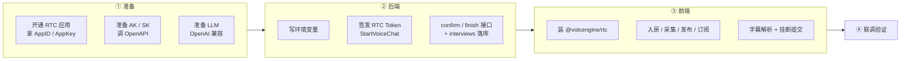
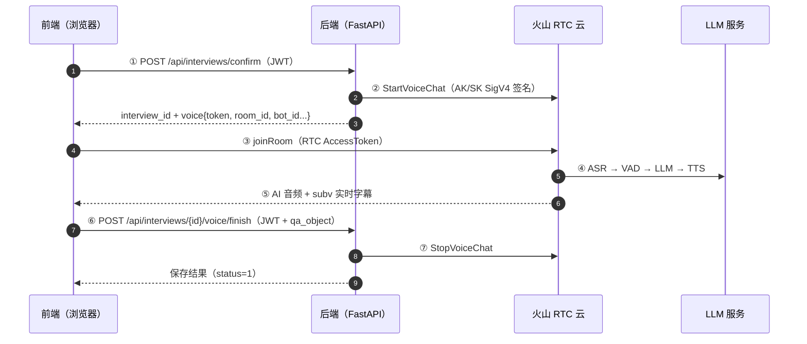
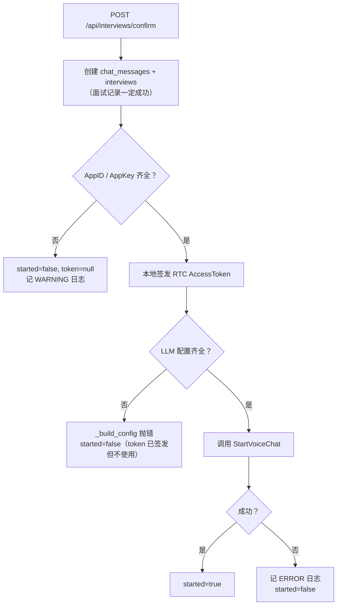
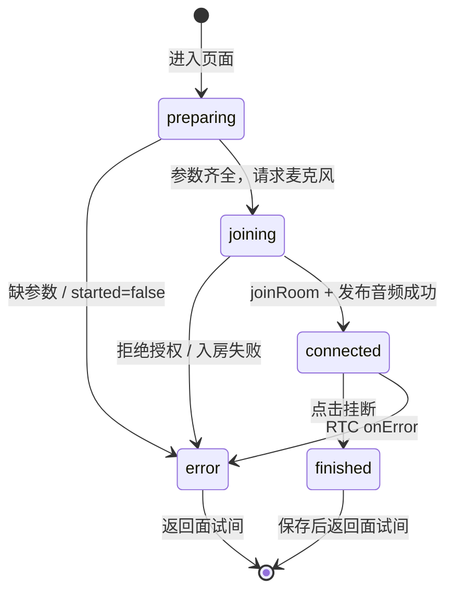
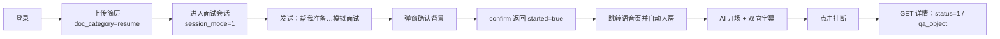

# 语音面试 RTC · 前后端接入与配置上手指南

> **适用版本**：`agent-backend` 分支 `interview-rtc`、`agent-frontend` 同步版本
> **目标读者**：第一次接触 RTC 语音面试，需要从零把链路跑通或接入新语音场景的同学
> **前置阅读**：[技术方案与数据流](voice-interview-design.md)（原理、三个面、字幕协议、代码索引）
> **联调验证**：[前端页面验证指南](../../agent-frontend/docs/voice-interview-verification.md)、[面试准备两阶段流程](interview-host-verification-guide.md)

本文回答三个问题：

1. **要配什么**（火山控制台 + 环境变量）；
2. **前后端各写什么**（按接入顺序给出关键代码）；
3. **怎么确认接对了**（联调步骤 + 排错表）。

---

## 0. 接入清单（先看全貌）



| # | 事项 | 负责方 | 产出 |
| --- | --- | --- | --- |
| 1 | 创建 RTC 应用，获取 AppID / AppKey | 账号管理员 | `VOLC_RTC_APP_ID / APP_KEY` |
| 2 | 准备火山访问密钥 | 账号管理员 | `VOLC_ACCESS_KEY / SECRET_KEY / REGION` |
| 3 | 准备大模型（OpenAI 兼容） | 后端 | `LLM_API_KEY / MODEL / BASE_URL` |
| 4 | 配置环境变量并重启后端 | 后端 | `/api/interviews/confirm` 返回 `started=true` |
| 5 | 安装 `volcengine` SDK | 后端 | `requirements.txt` |
| 6 | 安装 `@volcengine/rtc` | 前端 | `package.json` |
| 7 | 确认接口返回 `voice` 入房参数 | 后端 | token / room / bot id |
| 8 | 语音页入房 + 字幕 + 挂断 | 前端 | 完整页面闭环 |
| 9 | 挂断接口落库 | 后端 | `status=1`、`qa_object` |
| 10 | 真机联调 | 双方 | 双向字幕、AI 音频、结果可查 |

---

## 1. 系统角色与接入点

后端只在**开始**和**结束**各出现一次，通话中的音频不经过后端：



| 接入点 | 请求 | 关键返回 |
| --- | --- | --- |
| 确认并创建面试 | `POST /api/interviews/confirm` | `interview_id`、`voice{app_id, room_id, user_id, bot_user_id, task_id, token, expire_at, started}` |
| 结束并落库 | `POST /api/interviews/{id}/voice/finish` | `status=1`、`session_id`、`interview_duration`、`qa_count`；`INTERVIEW_EVAL_AUTO=true` 时后台自动生成复盘 |
| 查看结果 | `GET /api/interviews/{id}` | `qa_object`、`interview_duration`、`status` |

> **两套令牌别混用**：业务接口用 JWT（`Authorization: Bearer`）；RTC 入房用 AccessToken（`voice.token`）。二者互不通用。

---

## 2. 配置指南

### 2.1 控制台 / 账号侧准备

| 需要的东西 | 在哪里拿 | 对应环境变量 | 是否必需 |
| --- | --- | --- | --- |
| RTC 应用 ID | 火山引擎控制台 → 实时音视频 RTC → 应用管理 | `VOLC_RTC_APP_ID` | 是 |
| RTC 应用密钥 | 同上（**只给后端**） | `VOLC_RTC_APP_KEY` | 是 |
| 火山访问密钥 | 账号 → 访问控制 / API 访问密钥 | `VOLC_ACCESS_KEY` / `VOLC_SECRET_KEY` | 是 |
| 区域 | 与 RTC 应用一致 | `VOLC_REGION`（默认 `cn-north-1`） | 否 |
| 大模型服务 | DeepSeek / 通义 / 其他 OpenAI 兼容服务 | `LLM_API_KEY` / `LLM_MODEL` / `LLM_BASE_URL` | 是 |
| 豆包语音合成音色 | RTC 控制台 / 豆包语音 | `VOLC_RTC_TTS_SPEAKER` | 否（有默认） |
| ASR / TTS 独立账号 | 仅当 RTC 应用未绑定默认账号时才需要 | `VOLC_RTC_ASR_*` / `VOLC_RTC_TTS_*` | 否 |

几个容易踩坑的点：

- **AppKey 不是 AK/SK**：AppKey 用于本地签发入房 Token；AK/SK 用于调用 `StartVoiceChat` / `StopVoiceChat` OpenAPI。
- **AppID 必须前后端一致**：前端 `createEngine(appId)` 与后端签名用的 AppID 不一致时，入房会失败。
- **LLM 密钥会下发给 RTC 云**：云端代替我们调用模型，密钥托管边界需按安全要求评估。
- **区域要匹配**：OpenAPI 的 `VOLC_REGION` 与 RTC 应用所在区域不一致，可能返回签名 / 资源错误。

### 2.2 后端环境变量

分层规则（见 `AGENTS.md` §5）：**真实环境变量 > `.env.{APP_ENV}` > `.env`**。开发环境改 `.env.dev`，改完**重启后端**（`--reload` 也会生效）。

最小可用配置（示例值均为占位符）：

```env
# ---- 火山 OpenAPI（RTC 启停任务）----
VOLC_ACCESS_KEY=your_access_key
VOLC_SECRET_KEY=your_secret_key
VOLC_REGION=cn-north-1

# ---- 火山 RTC 应用 ----
VOLC_RTC_APP_ID=your_rtc_app_id
VOLC_RTC_APP_KEY=your_rtc_app_key

# ---- 大模型（OpenAI 兼容，RTC 云端回调）----
LLM_PROVIDER=deepseek
LLM_MODEL=deepseek-chat
LLM_API_KEY=sk-xxxx
LLM_BASE_URL=https://api.deepseek.com/v1
```

可选项与默认值：

| 变量 | 默认值 | 说明 |
| --- | --- | --- |
| `VOLC_RTC_TOKEN_TTL_SECONDS` | `21600`（6h） | 前端入房 Token 有效期 |
| `VOLC_RTC_TTS_SPEAKER` | `zh_female_linjianvhai_moon_bigtts` | AI 音色 |
| `VOLC_RTC_TTS_APP_ID` / `VOLC_RTC_TTS_ACCESS_TOKEN` | 空 | TTS 使用独立账号时才填 |
| `VOLC_RTC_ASR_APP_ID` / `VOLC_RTC_ASR_ACCESS_TOKEN` | 空 | ASR 使用独立账号时才填；不填走 `bigmodel` 默认 |
| `VOLC_RTC_VAD_SILENCE_TIME_MS` | `1500` | 判停静音时长（毫秒，官方范围 `[500, 3000)`）；越大 AI 越晚接话 |
| `VOLC_RTC_AIVAD` | `true` | 语义判停；语义不完整时最多等到静音 2 秒 |
| `VOLC_RTC_WELCOME_MESSAGE` | 「你好，我是本场面试的 AI 面试官，我们现在开始。」 | AI 开场白 |
| `VOLC_RTC_HISTORY_LENGTH` | `10` | 云端 LLM 带入的历史轮数 |
| `VOLC_RTC_IDLE_TIMEOUT` | `180` | 空闲多少秒后自动停止 Bot（控制成本的关键） |
| `VOLC_RTC_SUBTITLE_MODE` | `0` | 字幕下发模式 |

快速自检（不打印密钥）：

```bash
source .venv/bin/activate
python -c "from app.core import config; print({'rtc': config.has_rtc_config(), 'llm': bool(config.LLM_API_KEY), 'silence_ms': config.VOLC_RTC_VAD_SILENCE_TIME_MS, 'aivad': config.VOLC_RTC_AIVAD})"
```

预期：`{'rtc': True, 'llm': True, 'silence_ms': 1500, 'aivad': True}`。

### 2.3 未配置时会发生什么



前端只有在 `voice.started === true` 时才跳转语音页；否则提示「面试已创建，但 AI 语音面试未能启动」，面试记录仍保留。

---

## 3. 后端接入

### 3.1 依赖

```text
# requirements.txt
volcengine==1.0.229
```

- `volcengine` SDK 只用于调用 OpenAPI（SigV4 签名、请求封装）；
- **RTC AccessToken 是本地手算的**，不依赖 SDK（算法见 §3.4）。

### 3.2 配置模块

配置统一在 `app/core/config.py`，业务层禁止直接 `os.getenv`：

```python
# app/core/config.py（节选）
VOLC_ACCESS_KEY: str | None = os.getenv("VOLC_ACCESS_KEY")
VOLC_SECRET_KEY: str | None = os.getenv("VOLC_SECRET_KEY")
VOLC_REGION: str = os.getenv("VOLC_REGION", "cn-north-1")

VOLC_RTC_APP_ID: str | None = os.getenv("VOLC_RTC_APP_ID")
VOLC_RTC_APP_KEY: str | None = os.getenv("VOLC_RTC_APP_KEY")
VOLC_RTC_TOKEN_TTL_SECONDS: int = int(os.getenv("VOLC_RTC_TOKEN_TTL_SECONDS", "21600"))
VOLC_RTC_VAD_SILENCE_TIME_MS: int = int(os.getenv("VOLC_RTC_VAD_SILENCE_TIME_MS", "1500"))
VOLC_RTC_AIVAD: bool = (
    os.getenv("VOLC_RTC_AIVAD", "true").strip().lower() in {"1", "true", "yes", "on"}
)

class RTCConfig(NamedTuple):
    app_id: str
    app_key: str
    token_ttl_seconds: int
    tts_speaker: str
    # ... ASR / TTS / VAD / welcome / history / idle timeout / subtitle

def has_rtc_config() -> bool:
    """缺凭证时降级为「只建面试、不启动 AI」。"""
    return bool(VOLC_RTC_APP_ID and VOLC_RTC_APP_KEY)

def get_rtc_config() -> RTCConfig:
    if not VOLC_RTC_APP_ID or not VOLC_RTC_APP_KEY:
        raise RuntimeError("环境变量 VOLC_RTC_APP_ID / VOLC_RTC_APP_KEY 未配置")
    return RTCConfig(app_id=VOLC_RTC_APP_ID, app_key=VOLC_RTC_APP_KEY, ...)
```

**延迟校验**：缺配置不会导致服务启动失败，只影响语音面试本身。

### 3.3 服务层职责

`app/services/voice_interview_service.py` 只有四件事：

| 方法 | 作用 | 失败策略 |
| --- | --- | --- |
| `generate_rtc_token()` | 本地签发入房 AccessToken | 配置缺失由调用方判断 |
| `start_voice_chat()` | 生成入房参数 + 调用 `StartVoiceChat` | 异常只记日志，返回 `started=false` |
| `stop_voice_chat()` | 调用 `StopVoiceChat` | 失败只记日志，返回 `False` |
| `finish_interview()` | 停 AI + 保存 `qa_object` / 时长 + `status=1` | RTC 停止失败不阻断落库 |

### 3.4 签发入房 Token

AccessToken 结构（火山官方 `"001"` 版本）：

```text
token = "001" + AppID + base64( pack(msg) + pack(sign) )
msg   = nonce + issued_at + expire_at + room_id + user_id + 权限表
sign  = HMAC-SHA256(AppKey, msg)
权限表 = {0,1,2,3 → 发布流/音频/视频/数据, 4 → 订阅流}，值均为 expire_at
```

关键实现：

```python
def generate_rtc_token(app_id, app_key, room_id, user_id, expire_at):
    issued_at = int(time.time())
    nonce = random.randint(1, 99999999)

    privileges = {key: expire_at for key in (0, 1, 2, 3)}   # 发布流 / 音频 / 视频 / 数据
    privileges[4] = expire_at                                # 订阅流

    msg = b"".join((
        _pack_uint32(nonce), _pack_uint32(issued_at), _pack_uint32(expire_at),
        _pack_string(room_id), _pack_string(user_id), _pack_privileges(privileges),
    ))
    sign = hmac.new(app_key.encode("utf-8"), msg, hashlib.sha256).digest()
    return "001" + app_id + base64.b64encode(_pack_bytes(msg) + _pack_bytes(sign)).decode()
```

排查 Token 问题时看三点：**AppID 是否与前端一致、AppKey 是否正确、`expire_at` 是否已过期**。

### 3.5 启动 AI：StartVoiceChat

```python
room_id = task_id = f"voiceinterview{interview_id}"
bot_user_id = f"aiinterviewer{interview_id}"
expire_at = int(time.time()) + rtc.token_ttl_seconds

voice = {
    "app_id": rtc.app_id,
    "room_id": room_id,
    "user_id": str(interview["user_id"]),
    "bot_user_id": bot_user_id,
    "task_id": task_id,
    "token": generate_rtc_token(rtc.app_id, rtc.app_key, room_id, str(interview["user_id"]), expire_at),
    "expire_at": expire_at,
    "started": False,
}

body = {
    "AppId": rtc.app_id,
    "RoomId": room_id,
    "TaskId": task_id,
    "Config": _build_config(rtc, interview["interview_host_prompt"] or _DEFAULT_SYSTEM_PROMPT),
    "AgentConfig": {
        "TargetUserId": [str(interview["user_id"])],
        "UserId": bot_user_id,
        "WelcomeMessage": rtc.welcome_message,
        "IdleTimeout": rtc.idle_timeout,
    },
}
_call("StartVoiceChat", body)
voice["started"] = True
```

`Config` 的关键内容：

```python
{
    "ASRConfig": {
        "Provider": "volcano",
        "ProviderParams": {"Mode": "bigmodel", "StreamMode": 0},
        "VADConfig": {"SilenceTime": 1500, "AIVAD": True},
    },
    "TTSConfig": {
        "Provider": "volcano_bidirection",
        "ProviderParams": {"audio": {"voice_type": rtc.tts_speaker}},
    },
    "LLMConfig": {
        "Mode": "CustomLLM",
        "Url": f"{llm.base_url}/chat/completions",
        "ModelName": llm.model,
        "APIKey": llm.api_key,
        "SystemMessages": [system_prompt],     # 面试官提示词
        "HistoryLength": rtc.history_length,
    },
    "SubtitleConfig": {"SubtitleMode": rtc.subtitle_mode},
}
```

> **命名约定很重要**：`room_id == task_id`，`bot_user_id` 必须与前端 `voice.bot_id` 一致，否则订阅不到 AI 音频、字幕也分不清说话人。

### 3.6 接口与数据落库

**确认接口**（第二阶段）除了创建记录，还必须把 `voice` 原样返回：

```json
{
  "code": 200,
  "message": "ok",
  "data": {
    "run_id": "3f2c...",
    "interview_id": 123,
    "session_id": 45,
    "message_id": 678,
    "status": "confirmed",
    "voice": {
      "app_id": "your_rtc_app_id",
      "room_id": "voiceinterview123",
      "user_id": "7231",
      "bot_user_id": "aiinterviewer123",
      "task_id": "voiceinterview123",
      "token": "001...",
      "expire_at": 1762000000,
      "started": true
    }
  }
}
```

**挂断接口**请求体：

```json
{
  "qa_object": [
    { "id": 1, "question": "请做一下自我介绍", "answer": "我有 5 年 Java 经验……", "created_at": 1762000000 }
  ],
  "interview_duration": 426
}
```

`interviews` 表关键字段：

| 字段 | 写入时机 | 说明 |
| --- | --- | --- |
| `message_id` | confirm | 入口消息，唯一 |
| `interview_host_prompt` | confirm | 确认背景后渲染的提示词，同时下发给 RTC |
| `qa_object` | finish | 前端整理的问答数组 |
| `interview_duration` | finish | 秒 |
| `status` | confirm=0 / finish=1 | 0 进行中，1 已结束，2 预留异常终止 |

### 3.7 后端本地验证（curl）

```bash
source .venv/bin/activate
uvicorn app.main:app --reload --reload-exclude 'logs/*' --port 8000
```

```bash
TOKEN="<登录接口返回的 access_token>"
RUN_ID="<第一阶段返回的 run_id>"

# 确认背景并创建面试
curl -s -X POST http://127.0.0.1:8000/api/interviews/confirm \
  -H "Authorization: Bearer $TOKEN" \
  -H "Content-Type: application/json" \
  -d "{
    \"run_id\": \"$RUN_ID\",
    \"background\": {
      \"target_job\": \"高级后端开发工程师\",
      \"target_level\": \"高级\",
      \"years_experience\": \"5 年\",
      \"target_skills\": \"Java、MySQL、Redis\",
      \"project_experience\": \"高并发订单系统\",
      \"weak_topics\": \"分布式事务\"
    }
  }" | jq '.data | {interview_id, voice}'

# 挂断并落库
curl -s -X POST http://127.0.0.1:8000/api/interviews/123/voice/finish \
  -H "Authorization: Bearer $TOKEN" \
  -H "Content-Type: application/json" \
  -d '{"qa_object":[{"id":1,"question":"请做一下自我介绍","answer":"我有 5 年 Java 经验","created_at":1762000000}],"interview_duration":120}' | jq
```

预期：`voice.started=true`；finish 返回 `status=1`、`session_id`、`qa_count=1`。默认 `INTERVIEW_EVAL_AUTO=true` 时，后台会为本次面试生成复盘消息（失败只记日志）。
具体接口测试直接在 `http://127.0.0.1:8000/docs` 里点也可以，但要注意先登录拿 JWT。

> `run_id` 由第一阶段 `POST /api/agent/chat` 命中面试意图后、从 `task(kind=interview_prepare)` 的 `payload.run_id` 取得，要求会话 `session_mode=1` 且已上传简历。详见[面试准备两阶段流程](interview-host-verification-guide.md)。

---

## 4. 前端接入

### 4.1 依赖与构建

```json
{
  "dependencies": {
    "@volcengine/rtc": "^4.69.4"
  }
}
```

```bash
pnpm install
pnpm dev       # http://localhost:5173，/api 代理到 127.0.0.1:8000
```

要点：

- RTC SDK 由**浏览器直连火山云端**（WebRTC 媒体 + WebSocket 信令），不经过 Vite 代理；Vite 代理只用于业务 HTTP 接口。
- 语音页必须**懒加载**，避免把约 2MB（gzip ~627KB）的 SDK 塞进首屏。
- 麦克风采集要求**安全上下文**：`localhost` / `127.0.0.1` / HTTPS；局域网 IP + HTTP 浏览器会拒绝 `getUserMedia`。
- 建议用最新版 Chrome / Edge 验证；Safari 需 HTTPS，且自动播放限制更严格。

### 4.2 路由与参数传递

`src/router/index.ts`：语音页是**独立全屏路由**，不套 `AppShell`：

```ts
{
  path: '/interview/voice',
  name: 'interview-voice',
  component: () => import('@/views/VoiceInterviewPage.vue'),
}
```

跳转时：`interview_id` 放 query，**token 只放 `history.state`**：

```ts
await router.push({
  name: 'interview-voice',
  query: { interview_id: String(interviewId) },
  state: { voice: { appId, roomId, userId, botId, rtcToken, taskId, expireAt, started } },
})
```

语音页读取并校验：

```ts
const voice = ref<VoiceRoom | null>(readVoiceFromHistory())

function readVoiceFromHistory(): VoiceRoom | null {
  const state = window.history.state as { voice?: unknown } | null
  return normalizeVoiceRoom(state?.voice)
}
```

为什么放 `history.state`、三种方案的对比见[技术方案 §5.4](voice-interview-design.md#54-historystate-传递-token-的实现)。

### 4.3 页面状态机



### 4.4 入房关键代码

```ts
const devices = await VERTC.enableDevices({ video: false, audio: true })
if (!devices.audio) {
  setError('未获得麦克风权限，请允许录音后重试')
  return
}

const rtcEngine = VERTC.createEngine(voice.appId)
engine = rtcEngine
bindEvents(rtcEngine)

await rtcEngine.joinRoom(
  voice.rtcToken,
  voice.roomId,
  { userId: voice.userId },
  {
    isAutoPublish: false,          // 手动发布：采集成功后再发流
    isAutoSubscribeAudio: true,    // 自动订阅 AI 音频
    isAutoSubscribeVideo: false,
    roomProfileType: RoomProfileType.chat,
  },
)
await rtcEngine.startAudioCapture()
await rtcEngine.publishStream(MediaType.AUDIO)
```

顺序不能颠倒：**先 `startAudioCapture` 再 `publishStream`**，否则可能入房成功但没有声音。

### 4.5 事件绑定

| 事件 | 用途 | 关键处理 |
| --- | --- | --- |
| `onUserJoined` | 感知 AI 进房 | `userId === voice.botId` 时订阅音频 |
| `onUserPublishStream` | AI 开始发流 | 同样按 `botId` 过滤后订阅（兜底） |
| `onRoomBinaryMessageReceived` | 实时字幕 | 解析 `subv` TLV |
| `onAutoplayFailed` | 自动播放被拦截 | 显示「开启声音」按钮 |
| `onError` | 连接异常 | 释放 RTC + 错误态 |

```ts
function bindEvents(rtcEngine: IRTCEngine): void {
  rtcEngine.on(VERTC.events.onRoomBinaryMessageReceived, handleBinaryMessage)
  rtcEngine.on(VERTC.events.onUserJoined, handleUserJoined)
  rtcEngine.on(VERTC.events.onUserPublishStream, handleUserPublishStream)
  rtcEngine.on(VERTC.events.onAutoplayFailed, handleAutoplayFailed)
  rtcEngine.on(VERTC.events.onError, handleEngineError)
}
```

Bot 订阅兜底：

```ts
function handleUserJoined(event: { userInfo: { userId: string } }): void {
  if (event.userInfo.userId !== voice.value?.botId) return
  void engine?.subscribeStream(voice.value.botId, MediaType.AUDIO)
}
```

### 4.6 字幕接收与展示

火山下发的是**房间二进制消息**，格式为 TLV：

```text
+--------+--------+---------------------------+
| "subv" | length | UTF-8 JSON                |
| 4 B    | 4 B BE | length 字节               |
+--------+--------+---------------------------+
```

```ts
function handleBinaryMessage(event: { userId: string; message: ArrayBuffer }): void {
  const items = parseSubtitleMessage(event.message)   // 非 subv / 非法长度返回 []
  if (!items.length) return
  subtitleState.value = applySubtitleItems(
    subtitleState.value,
    items,
    voice.value.userId,
    voice.value.botId,
  )
}
```

合并规则：

- `userId === botId` → AI；`userId === userId` → 我；其他忽略；
- AI 用 `definite`、用户用 `paragraph` 判断句子是否完成；
- 未完成覆盖半句，完成追加为新行；
- 同一句增量保留更长版本，避免文字回退；
- 挂断时未说完的半句也纳入 `qa_object`。

### 4.7 挂断

```ts
const qaObject = buildQaObject(subtitleState.value)
const duration = Math.max(1, Math.round((Date.now() - startedAt) / 1000))

await releaseRtc()    // 停采集 → 取消发布 → 退房 → 销毁引擎

try {
  await finishVoiceInterview(interviewId, { qaObject, interviewDuration: duration })
  ElMessage.success('面试已结束')
} catch {
  ElMessage.warning('通话已结束，但面试结果保存失败')
} finally {
  await router.replace({ name: ModuleKey.Interview })
}
```

**先释放本地 RTC，再调保存接口**：避免请求等待期间继续占用麦克风。

### 4.8 离开与刷新

| 操作 | 行为 |
| --- | --- |
| 页面刷新 | `history.state` 保留，自动重新入房 |
| 路由离开 / 卸载 | `onBeforeUnmount` 停止计时并释放 RTC，**不会调用 finish** |
| 直接关闭标签页 | 本地资源随页面销毁；后端记录保持 `status=0`；Bot 在 `IdleTimeout` 后停止 |
| 书签直开语音页 | 没有 `history.state.voice`，提示缺少参数，不发起连接 |

---

## 5. 联调步骤（从零跑通）



| # | 操作 | 预期 |
| --- | --- | --- |
| 1 | 登录，准备一个面试会话 | 会话列表可见 |
| 2 | 上传简历（`doc_category=resume`），等待解析完成 | 资源入库，切片可查 |
| 3 | 在会话里发送「帮我准备高级后端开发工程师的模拟面试」 | 弹出「确认面试背景」 |
| 4 | 检查弹窗 7 个字段 | 已按简历 / 画像预填 |
| 5 | 点击「确认并开始面试」 | `POST /api/interviews/confirm` 200 |
| 6 | 检查 confirm 响应 | `voice.started=true`，token 有值 |
| 7 | 检查地址栏 | `?interview_id=...`，**无 token** |
| 8 | 观察控制台 | `AI 面试官已进房`、`已订阅 AI 音频 {botId}` |
| 9 | 对麦克风说话 | 听到 AI 声音，左右分列字幕 |
| 10 | 挂断 | `finish` 200，返回面试间 |
| 11 | `GET /api/interviews/{id}` | `status=1`、`interview_duration>0`、`qa_object` 非空 |

前端页面级验证清单见[前端验证指南](../../agent-frontend/docs/voice-interview-verification.md)。

---

## 6. 排错速查

| 现象 | 优先检查 |
| --- | --- |
| confirm 200 但 `started=false` | `.env.dev` 的 AppID/AppKey；后端日志 `启动 AI 面试官失败`；`LLM_*` 是否齐全 |
| `StartVoiceChat` 报参数错误 | AppID 是否有效、`VOLC_REGION` 是否匹配、AK/SK 是否有 RTC 权限；VAD 取值后端已钳制到 `[500,2999]`，一般不是它的问题 |
| 入房失败 / token 无效 | AppID 前后端是否一致；AppKey 是否填错；token 是否过期（默认 6h）；服务器时间是否准确 |
| 能入房但听不到 AI | 浏览器自动播放策略（点「开启声音」）；`bot_user_id` 是否与 `voice.botId` 一致；控制台是否有订阅日志 |
| 没有「我」的字幕 | 麦克风授权 / 安全上下文；RTC 控制台是否需要独立 ASR 凭证（填 `VOLC_RTC_ASR_*`） |
| AI 抢话 | 调大 `VOLC_RTC_VAD_SILENCE_TIME_MS`（如 2000），保持 `VOLC_RTC_AIVAD=true`，重启后端 |
| 字幕文本乱码 | 必须用 `ArrayBuffer` 解析，`TextDecoder` 按 UTF-8 解码；检查 TLV 长度是否越界 |
| 通话几分钟后 AI 自动退出 | `VOLC_RTC_IDLE_TIMEOUT`（默认 180s）触发，重新发起面试 |
| 关闭页面后记录一直 `status=0` | 当前设计缺口：关闭页面不会调用 finish；需后续补自动收尾策略 |
| 业务接口 401 | 用了 RTC token 而不是 JWT；JWT 过期需刷新 |
| 局域网手机访问无法录音 | 必须 HTTPS 或 `localhost` 安全上下文 |

---

## 7. 接入新语音场景的最小改造

当前实现把「面试」写死在命名和提示词里。如果要复用到语音播客、口语陪练等场景，按下面顺序改：

1. **参数化命名**：`_room_names()` 里的 `voiceinterview{id}`、`aiinterviewer{id}` 改成场景前缀 + 业务 id；
2. **参数化系统提示词**：`start_voice_chat()` 接收 `system_prompt`，不要只读 `interview_host_prompt`；
3. **新增业务表 / 字段**：保存该场景的会话结果、时长、状态；
4. **复用启停逻辑**：`generate_rtc_token` / `StartVoiceChat` / `StopVoiceChat` 可直接复用；
5. **前端复用人房逻辑**：把 `joinRoom` / 事件绑定 / `releaseRtc` 抽成 composable（如 `useVoiceRoom.ts`）；
6. **字幕与问答**：按场景决定 `qa_object` 的归并规则（播客可能只需要完整转写文本）；
7. **配置复用**：同一个 RTC 应用可以承载多个场景，仍建议每个场景独立的 `TaskId` 前缀；
8. **成本控制**：为每个场景设置合理的 `IdleTimeout`，并确保挂断路径一定调用 `StopVoiceChat`。

---

## 8. 安全与成本清单

- **AppKey 只存在后端**：前端只有用户身份的 AccessToken，且权限仅发布 / 订阅音频。
- **Token 不进 URL**：放 `history.state`，默认 6 小时过期；不要把 token 打到日志里。
- **业务接口必须鉴权**：`confirm` / `finish` / 详情都按 `user_id` 隔离，越权统一 404。
- **`qa_object` 来自客户端**：后端当前直接保存，未做逐条校验；对可信度要求高的场景需服务端重算或校验。
- **LLM 密钥下发给云端**：评估是否使用独立、可轮换的密钥，避免与后端其他用途共用。
- **及时停 Bot**：挂断一定走 `finish`（内部 `StopVoiceChat`）；异常关闭时依赖 `IdleTimeout` 兜底，这个值直接关系到计费时长。
- **录音合规**：如后续开启录音存储，需在界面上明确告知并获得用户同意。

---

## 9. 关键文件索引

| 模块 | 文件 |
| --- | --- |
| 配置 | `app/core/config.py`（`VOLC_RTC_*`、`has_rtc_config()`） |
| RTC 服务 | `app/services/voice_interview_service.py` |
| 确认 / 挂断业务 | `app/services/interview_service.py` |
| 路由 / 契约 | `app/routers/interview.py`、`app/schemas/interview.py` |
| 数据层 | `app/db/interview_repo.py`、`app/db/models.py` |
| 前端页面 | `agent-frontend/src/views/VoiceInterviewPage.vue` |
| 前端工具 | `agent-frontend/src/utils/voiceInterview.ts` |
| 前端接口 | `agent-frontend/src/api/interview.ts` |
| 路由 | `agent-frontend/src/router/index.ts` |
